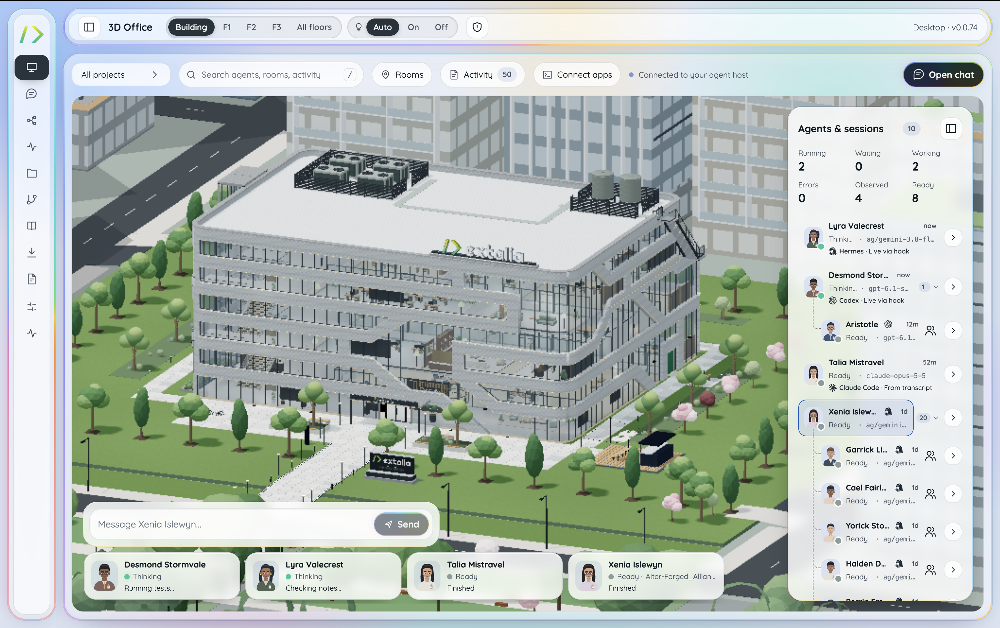
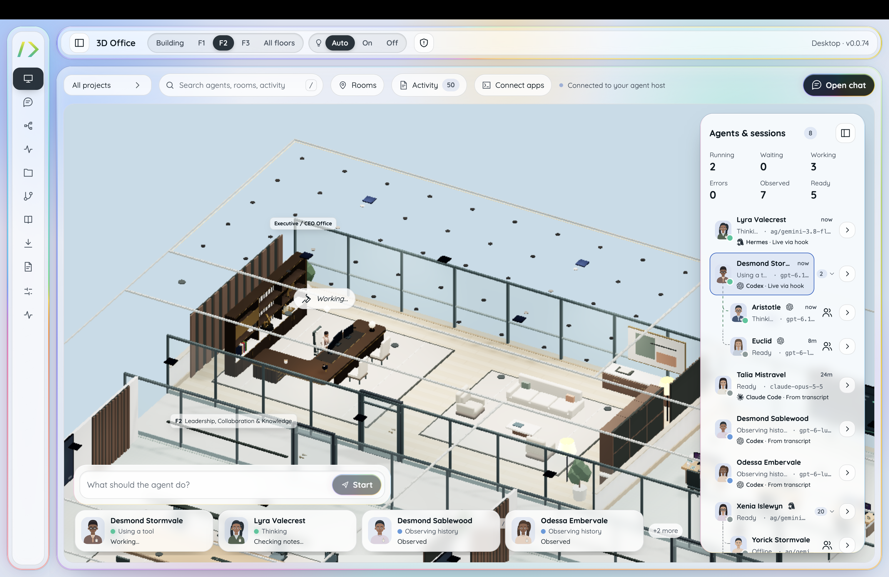
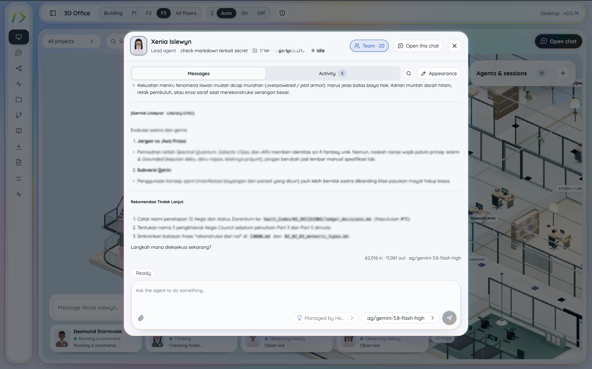
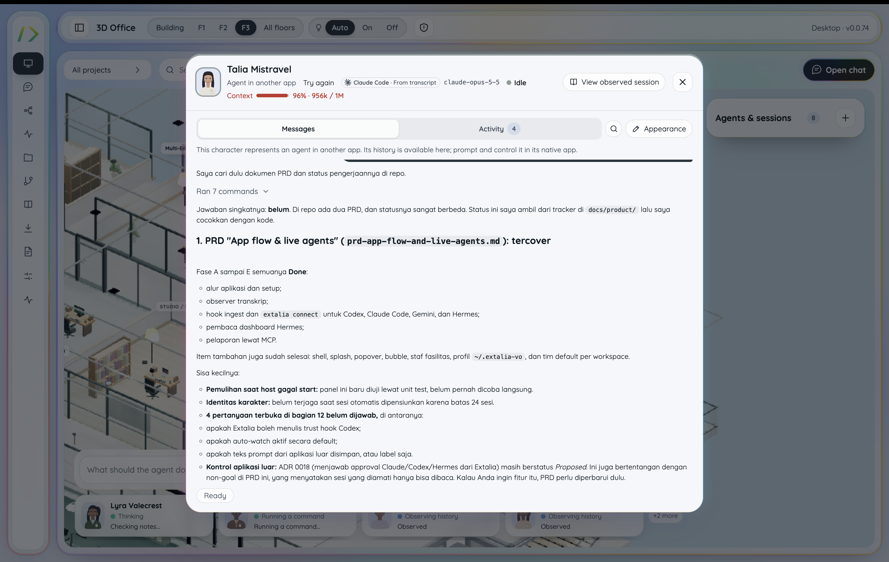
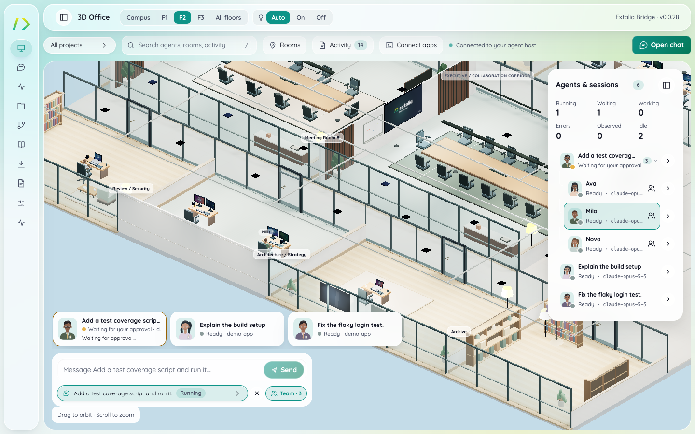
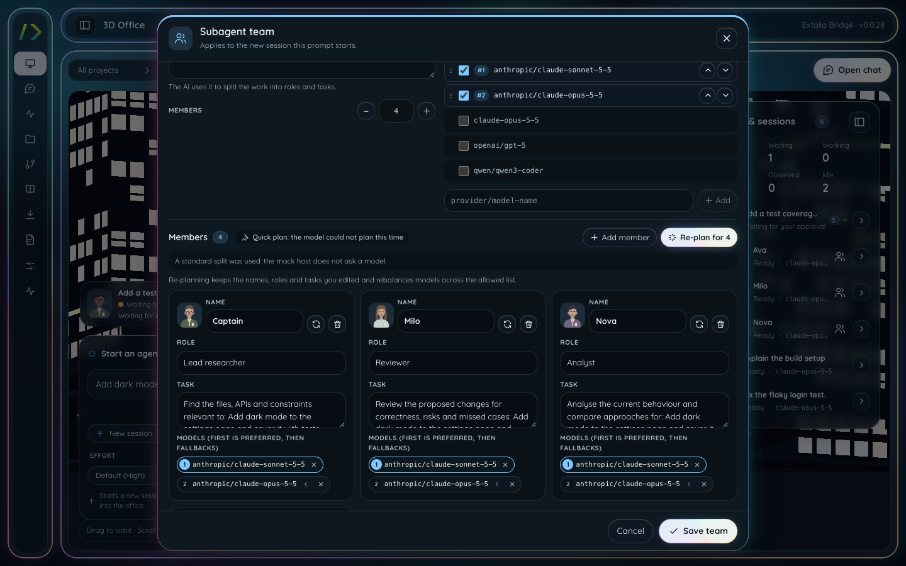
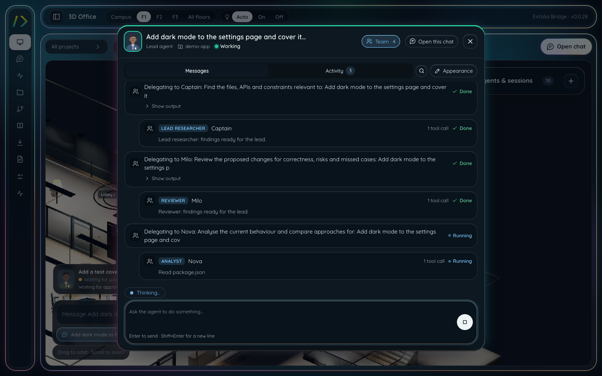

<p align="center">
  <picture>
    <source media="(prefers-color-scheme: dark)" srcset="docs/brand/extalia-logo-dark.png">
    
  </picture>
</p>

# Extalia

<p align="center">
  <a href="https://github.com/Extalia-VO/extalia-virtual-agent/releases/tag/v0.4.109"></a>
  <a href="https://github.com/Extalia-VO/extalia-virtual-agent/actions"></a>
  <a href="LICENSE"></a>
  
</p>

> **Open-Source Spatial AI-Agent Workspace and Orchestration Platform**

Extalia provides a unified workspace where developers can prompt, steer, orchestrate, and observe autonomous AI agents through both conventional engineering views (Chat, Console, Tasks, Files, Git, Terminal, and Logs) and an interactive 3D virtual office.

> **Status: beta (v0.4.109).** Working today: Extalia Native autonomous orchestration with model routing and subagent teams; live observation and hook integration for Codex, Claude Code, Gemini CLI, Hermes, and Antigravity; native history import and secret redaction; interactive 3D virtual office (furnished F1–F3 campus, glass elevator controller, floor stairwells, kinematic walking avatars, smart screens, and facility staff); task-based spatial dispatch (Library / Skills Floor 1); dual-mode in-scene prompt dock (Managed & Observed); and unified Desktop and Web applications.

---

## 📸 Preview

### Living 3D Virtual Office & Campus Architecture


### Interactive Floor Workspaces & Autonomous Workforce


### In-Scene Prompt Dock & Agent Steering

Extalia provides dual interaction modes directly inside the 3D office viewport:

#### 1. Managed Mode (Interactive Steering & Team Orchestration)
Direct conversational steering with in-scene composer, runtime switching, model routing, file attachments, and multi-agent team oversight:


#### 2. Observed Mode (External Agent Observability & Context Tracking)
Non-intrusive monitoring of outside agents (Claude Code, Codex, Hermes) with real-time transcript streaming, command logs, and live context window tracking:


### Multi-Floor Team Pods & Navigation


### Subagent Team Planning & Delegation
| Subagent Role Orchestration | Delegated Multi-Agent Execution |
| :---: | :---: |
|  |  |

---

## 🌟 Highlights

- **Spatial Agent Observability:** Visualizes agent and subagent execution states in real time within a living 3D virtual office (Three.js / React Three Fiber).
- **Task-Based Spatial Movement:** Characters navigate the 3D campus dynamically; agents executing `skill_manage` or skill curation tools automatically walk to the Floor 1 Library / Skills desk and return to their workstation when done.
- **Autonomous Multi-Agent Orchestration:** Native DAG task scheduling with bounded concurrency, model routing across heterogeneous providers, and team role delegation.
- **Runtime & Provider Agnostic:** Fully decoupled from specific AI runtimes. Supports Hermes Agent, Codex, Claude Code, Gemini / Antigravity, and custom models via runtime adapters.
- **Zero-Config Hooks & Observability:** Automatic connection on startup for Hermes (`post_llm_call`), Codex, Claude Code, Gemini, and Antigravity with live context window usage and status streaming.
- **Normalized Event Protocol:** All UI views and spatial scenes communicate strictly through versioned, serializable events via the **Extalia Protocol**.
- **Rust Control Plane Sidecar:** Bundled `extalia-core` SQLite WAL store and `extalia-daemon` stdio sidecar for authoritative mission recovery and task leases.
- **Multi-View Workspace:** Seamlessly switch between 3D Office, Chat, Agent Console, Task DAG, File Inspector, Git Diff, Terminal, and Activity Logs.
- **Historical Session Importer:** Discovers and ingests historical sessions from major agent frameworks into an open, portable session format.
- **Local-First & Zero Credential Leakage:** Credentials, sensitive environment tokens, and private repositories remain strictly local. Credential detection masks secrets during ingestion and export.

---

## 📥 Downloads (Beta Tester Preview)

Pre-built releases for testers are available on the [Extalia v0.4.109 Release](https://github.com/Extalia-VO/extalia-virtual-agent/releases/tag/v0.4.109):

| Platform | Package | Architecture | Direct Download |
| :--- | :--- | :--- | :--- |
| **Windows** | NSIS Installer | x64 | [Extalia-0.4.109-win-x64-setup.exe](https://github.com/Extalia-VO/extalia-virtual-agent/releases/download/v0.4.109/Extalia-0.4.109-win-x64-setup.exe) |
| **macOS** | Disk Image (DMG) | Apple Silicon (arm64) | [Extalia-0.4.109-mac-arm64.dmg](https://github.com/Extalia-VO/extalia-virtual-agent/releases/download/v0.4.109/Extalia-0.4.109-mac-arm64.dmg) · [ZIP](https://github.com/Extalia-VO/extalia-virtual-agent/releases/download/v0.4.109/Extalia-0.4.109-mac-arm64.zip) |
| **macOS** | Disk Image (DMG) | Intel (x64) | [Extalia-0.4.109-mac-x64.dmg](https://github.com/Extalia-VO/extalia-virtual-agent/releases/download/v0.4.109/Extalia-0.4.109-mac-x64.dmg) · [ZIP](https://github.com/Extalia-VO/extalia-virtual-agent/releases/download/v0.4.109/Extalia-0.4.109-mac-x64.zip) |
| **Linux** | Universal AppImage | x64 | [Extalia-0.4.109-linux-x86_64.AppImage](https://github.com/Extalia-VO/extalia-virtual-agent/releases/download/v0.4.109/Extalia-0.4.109-linux-x86_64.AppImage) |
| **Linux** | Debian / Ubuntu Package | x64 | [Extalia-0.4.109-linux-amd64.deb](https://github.com/Extalia-VO/extalia-virtual-agent/releases/download/v0.4.109/Extalia-0.4.109-linux-amd64.deb) |
| **Web** | Static Web Client | Universal | [extalia-web-0.4.109.zip](https://github.com/Extalia-VO/extalia-virtual-agent/releases/download/v0.4.109/extalia-web-0.4.109.zip) |
| **CLI** | Local Web Bridge | Universal | [extalia-vo-0.4.109.tgz](https://github.com/Extalia-VO/extalia-virtual-agent/releases/download/v0.4.109/extalia-vo-0.4.109.tgz) |

---

## 🔌 Two Ways to Work with Agents

| Managed sessions | Observed sessions |
| --- | --- |
| Extalia drives an agent **runtime** such as Hermes Agent. The runtime uses the **provider or router** you choose (OpenAI-compatible endpoints, 9Router, OmniRouter, Ollama, …). You prompt and steer from Extalia. | Agents keep running in **their own apps** (Codex, Claude Code, Gemini CLI, Antigravity). Extalia reads their session logs read-only, receives events from hooks installed once with your approval (`extalia connect`), and visualizes the work. Prompting stays in the agent's app. |

Both modes emit the same Extalia Protocol events, so every view and the office treat them alike. See [Runtimes, providers and observed agents](docs/architecture/runtime-adapters.md).

---

## 🏗 System Architecture

Extalia enforces complete separation between agent runtimes and visualization layers:

```text
AI Runtime / Provider (Hermes, Codex, Claude, Gemini)
                      ↓
               Runtime Adapter
                      ↓
        Extalia Protocol (Normalized Events)
                      ↓
         Session / Task / Agent State Store
                      ↓
  UI Suite (3D Office | Chat | Console | Tasks | Terminal)
```

The 3D office never imports runtime-specific code or vendor dependencies directly.

---

## 🚀 Quick Start

Requires Node.js 22.13+ (Node 23 needs 23.4+) and pnpm 12 (`corepack enable`). No account, API key, or private file is needed.

```bash
pnpm install
pnpm dev            # Web client at http://127.0.0.1:5180
pnpm dev:desktop    # Desktop shell (Electron)
pnpm check          # lint, boundaries, public-safety scan, typecheck, tests, build
```

What works today:

- **An agent with only an API key or router**: Extalia Native reads, searches and edits your project and runs commands with your approval, through OpenAI, Anthropic, OpenRouter, 9Router, OmniRoute, Ollama or any OpenAI-compatible endpoint.
- **Orchestration** (on by default): the agent hands read-only research to worker agents on Complex / Standard / Quick models you choose.
- **Memory and skills** per connection: Extalia's own, the provider's (OmniRoute), or off; nine built-in skills plus your own.
- **Native history import** from Codex, Claude Code, Hermes Agent and Gemini CLI, read-only, with preview.
- **Continue in Extalia**: when Codex or Claude Code runs out of quota, continue an imported or observed conversation in a new Extalia session; the original request and recent messages are carried over and the source is never changed.
- **History per connection**: turn session history off for a connection and its new sessions stay in memory only.
- **Live agent-app hooks and MCP server**: one-step connection via `extalia connect` (Codex, Claude Code, Gemini CLI, Hermes, and Antigravity) with zero-config auto-connect on startup; loopback stdio JSON-RPC MCP server (`extalia mcp`) for intent and handoff reporting.
- **Desktop** (auto-update from GitHub Releases) and **Web** through `npm i -g extalia-vo` → `extalia` (updates through npm).
- **One profile for Web and Desktop** in `~/.extalia-vo` (`%USERPROFILE%\.extalia-vo` on Windows; `EXTALIA_HOME` overrides it): connections, workspaces, sessions and interface preferences. Data from the folder used up to 0.0.20 is copied there once; the old folder is kept.
- **Extalia Protocol v0** with strict validation, English and Indonesian UI, light, dark (Royal Charcoal) and liquid-glass themes.

More in [Getting started](docs/getting-started/README.md) and the [documentation index](docs/README.md).

---

## 📂 Monorepo Structure

Target layout from the PRD. Today the repository contains 11 workspace packages and a Rust Cargo workspace (`crates/extalia-core`, `crates/extalia-daemon`):

```text
extalia/
├── apps/
│   ├── desktop/            # Desktop application shell (macOS, Windows, Linux)
│   ├── web/                # Standalone Web client and Three.js / R3F office UI
│   └── cli/                # Terminal CLI, local bridge launcher, and MCP server
│
├── packages/
│   ├── core/               # Domain models, state machines, and business logic
│   ├── protocol/           # Normalized event schemas, JSON schemas, types, and validators
│   ├── platform/           # Platform capability contracts (filesystem, terminal, git)
│   ├── host/               # Local agent host, session storage, and hook ingest
│   ├── runtime/            # Runtime adapter interfaces, provider loops, and delegation
│   ├── importers/          # Session discovery, parsers, and secret redaction
│   └── office/             # Spatial room semantics, resource registry, and lighting
│
├── crates/
│   ├── extalia-core/       # Rust control plane, SQLite store, and mission journal
│   └── extalia-daemon/     # Stdio sidecar daemon wire contract v1
│
├── docs/                   # Architectural specs, Master PRD v1.1, and ADRs
└── tooling/                # Verification, code safety, and build scripts
```

---

## 🗺 Roadmap & Milestones

Development is tracked across iterative public milestones aligned with Master PRD v1.1:

- **✓ v0.1.0-alpha: Public Foundation & Vertical Slice** *(Completed)*
  Monorepo boundaries, cross-platform CI matrix, Extalia Protocol v0, and a managed runtime adapter.
- **✓ v0.2.0-alpha: Workspaces & Session Hub** *(Completed)*
  Profile manager, workspace repository linking, persistent multi-session store, and unified sidebar.
- **✓ v0.3.0-beta: Import Center & Agent Console** *(Completed)*
  Historical session importers (Codex, Claude, Hermes), secret redaction scanner, non-3D Agent Console, and terminal/git observability.
- **🚀 v0.4.0-beta: Subagents & Project Orchestration** *(Active Milestone)*
  Subagent lifecycle manager, dynamic 3D office seating, task-based spatial dispatch, dual-mode prompt dock, and multi-agent coordination.
- **v0.5.0-beta: Durable Control & Knowledge Vault** *(Upcoming)*
  Task leases, heartbeat/reaper crash recovery, digest-bound approvals, SkillSpector quarantine gate, and bidirectional Obsidian knowledge graph.
- **v0.6.0-beta: Evolve & Autonomous Learning** *(Upcoming)*
  Experience capture, disposable sandbox evaluation in git worktrees, hybrid learning activation, and Evolve Learning Center.
- **v1.0.0-ga: Extension SDK & Production Release**
  Public Extension SDK, signed cross-platform desktop installers (macOS, Windows, Linux), and community plugin registry.

---

## 🔒 Security & Privacy

1. **Workspace Boundary:** Filesystem read/write operations outside designated project roots are denied by default.
2. **Secret Redaction:** Credential scanning masks API keys and auth tokens before they are stored in session histories or exports.
3. **Declared Capabilities:** Plugins and skills must declare explicit capability manifests before gaining system access.
4. **Consent for Connections:** Connecting an agent app shows a dry run, requires approval, backs up its configuration, and can be undone.

See [Security model](docs/architecture/security.md). Report vulnerabilities privately as described in [SECURITY.md](SECURITY.md).

---

## 🤝 Contributing

We welcome community contributions! Please review [CONTRIBUTING.md](CONTRIBUTING.md), [GOVERNANCE.md](GOVERNANCE.md), and the [Code of Conduct](CODE_OF_CONDUCT.md) before submitting pull requests.

All commits follow [Conventional Commits](https://www.conventionalcommits.org/):
- `feat(scope): ...`
- `fix(scope): ...`
- `docs(scope): ...`
- `refactor(scope): ...`
- `test(scope): ...`

---

## 📄 License

Extalia is open-source software licensed under the [MIT License](LICENSE). The Righteous typeface outlines used in the logo are licensed under the [SIL Open Font License 1.1](apps/web/public/fonts/Righteous-OFL.txt).
