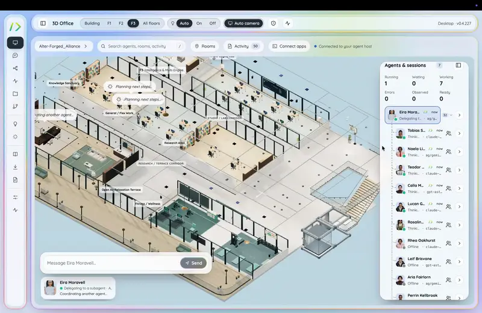
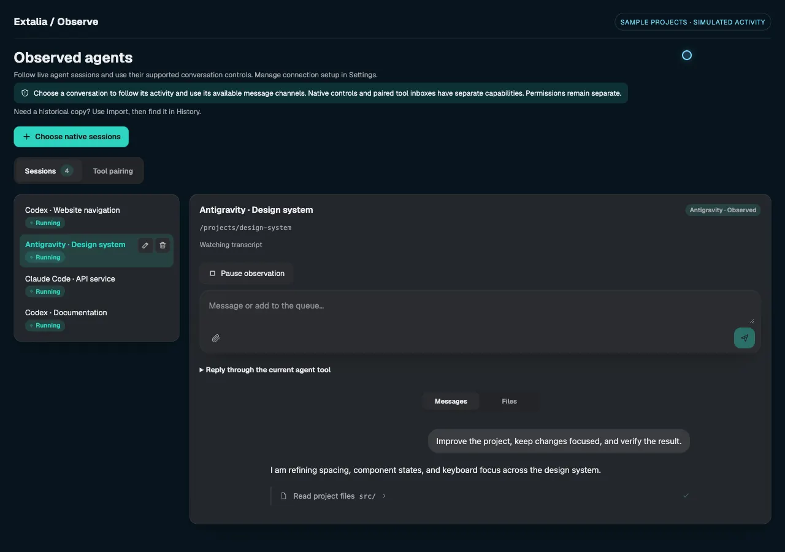
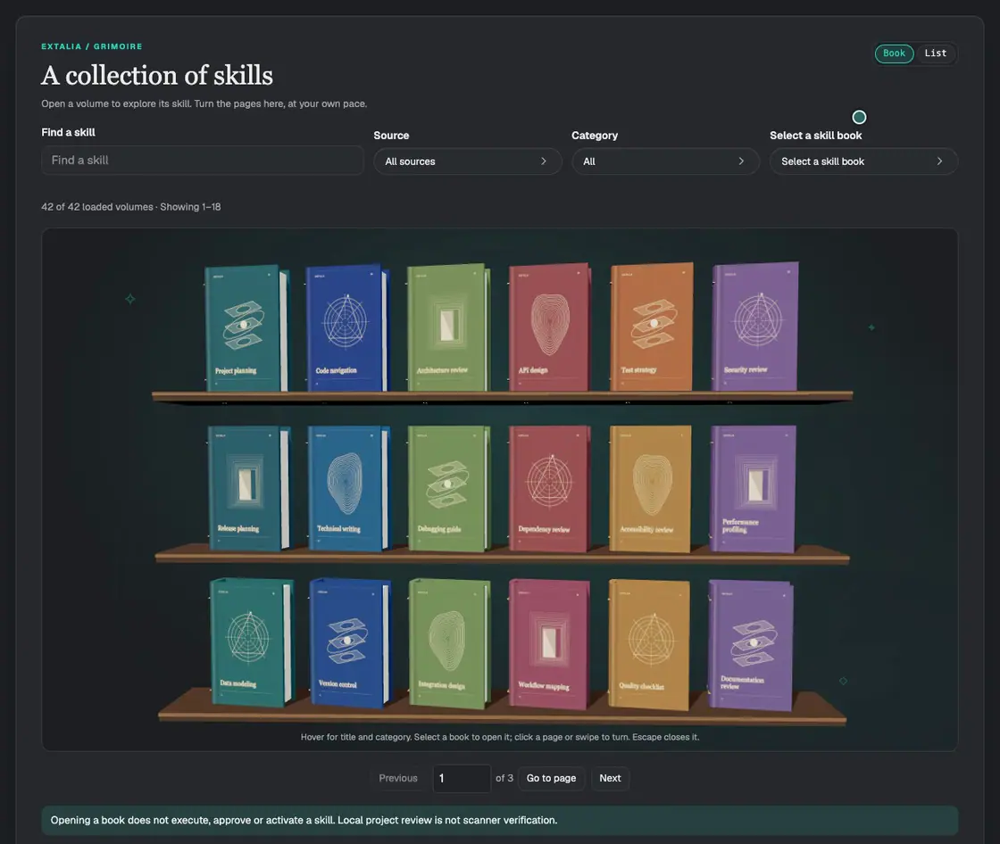
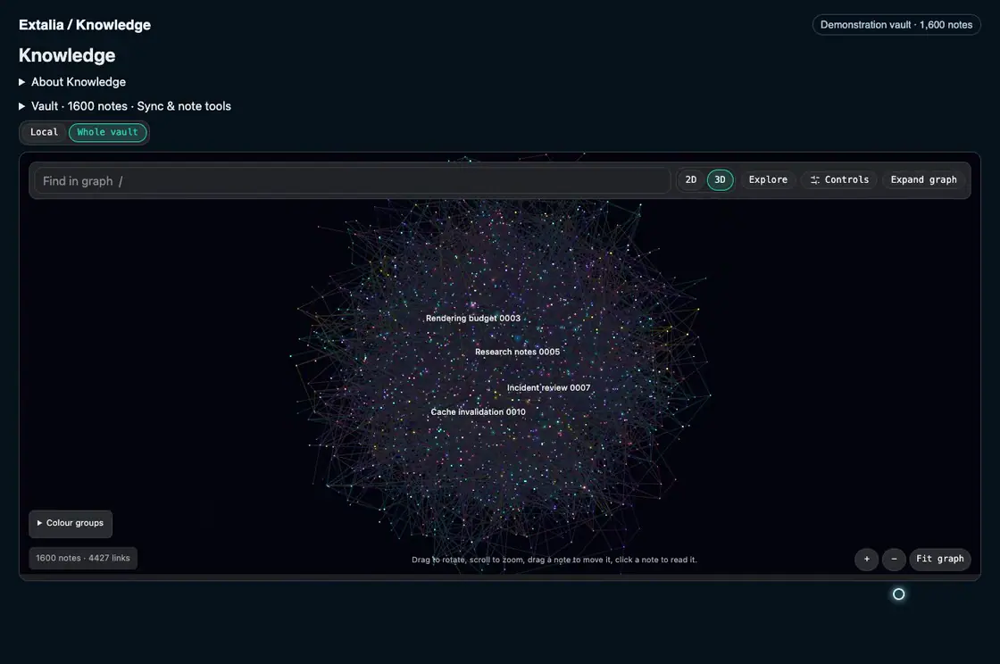

# Download Extalia

| macOS | Windows | Linux |
| --- | --- | --- |
| [**Download for Mac**](https://github.com/Extalia-VO/extalia-virtual-agent/releases) | [**Download for Windows**](https://github.com/Extalia-VO/extalia-virtual-agent/releases) | [**Download for Linux**](https://github.com/Extalia-VO/extalia-virtual-agent/releases) |
| Apple Silicon / Intel · DMG or ZIP | x64 · Setup EXE | x64 · AppImage, DEB or per-user setup |

[](https://github.com/Extalia-VO/extalia-virtual-agent/actions) [](https://www.npmjs.com/package/extalia-vo) [](LICENSE)

**Prefer npm?** Run `npm install -g extalia-vo@latest`, then `extalia`.
See [npm installation and first launch](#install-through-npm) for requirements
and setup.

Choose the release and architecture from the linked assets. **Beta previews**
are marked as prereleases and are separate from npm's `latest` tag. Source on
`main` may be newer than the published downloads; check the matching release
notes and checksum file. On Mac, move **Extalia.app** into **Applications**.

**Free macOS previews are ad-hoc signed and are not Apple-notarized.** macOS may
show an unidentified-developer or verification warning. For an official download
you trust, try opening it once, then use **System Settings → Privacy & Security →
Open Anyway** and confirm the launch. These previews use manual replacement
updates; see [macOS release modes](docs/release/packaging.md#macos-release-modes).

<details>
<summary>Optional Terminal step for a trusted official macOS preview</summary>

If the quarantine warning persists after the normal opening steps, you can
remove quarantine from the installed application:

```bash
xattr -dr com.apple.quarantine /Applications/Extalia.app
```

This applies only to that copy of Extalia. It does not notarize the app or verify
its origin; use it only after confirming you trust the official download.

</details>

See [Platform and releases](docs/modules/platform-release.md) for packaging,
updates and platform-specific limits.

## Your agents in a shared 3D office

An open-source workspace for running AI agents and following their work in Chat
or a shared 3D office. Use Extalia Native with your own model connection, manage
Hermes Agent sessions, or observe agents running in their existing apps.

Teams can delegate scoped work to workers and bring their findings back to the
lead agent. The Office makes that activity visible as the work happens:

<p align="center">
  
  <br>
  <sub><b>One lead. Multiple workers. Progress you can follow.</b></sub>
</p>

## Choose how agents work

| Mode | What Extalia does | Boundary |
| --- | --- | --- |
| **Extalia Native** | Runs model/tool conversations, named teams and delegated workers using your configured connections and models. | File access follows workspace grants. Native terminal commands and automatic integration test/apply remain unavailable pending the executor and acceptance gates. |
| **Managed Hermes Agent** | Starts and supervises an installed Hermes runtime; you prompt it from Extalia. | Hermes retains its own tools, configuration and process permissions. Native file-tool isolation does not sandbox Hermes. |
| **Observe existing apps** | Follows supported Codex, Claude Code, Gemini CLI, Antigravity and Hermes conversations through approved hooks or transcript observation. | Read-only observation is the baseline. Sending, answering or steering requires an actual supported adapter or explicitly paired route for that session. |

Provider requests go to the model service you configure. A local Bridge does
not mean inference is local; use a local model service if that is your intent.
Finding an installed CLI or receiving a hook does not prove control capabilities.
See [runtime adapters](docs/architecture/runtime-adapters.md) and
[observed replies](docs/getting-started/observed-replies.md).

### Follow work across projects

Bring supported outside agents into one Observe view. Switch between projects,
read their conversations and inspect tool activity while the source apps keep
working. The preview below uses demonstration projects and simulated activity
from Codex, Antigravity and Claude Code.



### Connect an outside agent

In **Settings → Agent apps**, preview the proposed connection changes. The CLI
provides the same reviewed workflow; for example:

```bash
extalia connect codex --dry-run
extalia connect codex --yes
```

Replace `codex` with `claude`, `gemini`, `antigravity` or `hermes` for the
corresponding connector. Apply only after reviewing the preview. Extalia reports
configuration backups and an undo command; it does not silently inject hooks at
startup. Source-app restart or hook approval may still be required. See
[connection safety and verification](docs/architecture/agent-app-connections.md).

## Skills, Knowledge and memory

### Browse your Grimoire

**Skills** has built-in procedures, categories, search, reviewed folder/project
imports and public marketplace previews. Built-ins include memory and team
workflow guidance plus opt-in Caveman-style concise replies. Explicit **Learn as
skill** requests and eligible post-task learning can propose candidates into the
user library; ordinary document reading does not automatically install a skill.

Turn to the next shelf, hover over a book for a preview, then open it and slide
through its pages. These books contain demonstration skill content.



External and generated candidates stay separate from active skills. Their exact
revision needs inspection, user review, applicable approval and activation.
The pinned **NVIDIA SkillSpector + bundled Python** scanner is currently verified
for **macOS 14+ ARM64**. Other scanner platforms remain unavailable and external
candidates fail closed. A clean scan does not prove quality, grant permissions
or activate a skill. See [Skills](docs/modules/skills.md).

### Explore connected Knowledge

**Knowledge** indexes a selected Markdown/Obsidian-compatible vault with search,
links, aliases and backlinks. Explore it through 2D/3D graphs with filters, focus
and elastic node dragging, or use the list view. Graph layout changes do not
rewrite notes or links. Obsidian itself is not required or installed by Extalia.

This demonstration vault has **1,600 notes and 4,427 links**. Rotate the graph,
click a node to read its note, or drag a node and let it return to the layout.



### Keep useful workspace memory

**Workspace memory** supplies bounded relevant summaries and paged reads for
Native conversations. It is distinct from the vault index and conversation
history. On supported macOS/Linux paths, eligible saved Native Chat can curate
notes and propose skills after work. An isolated workspace with its own
non-default profile can continue maintenance while other profiles run; same-profile
work still takes priority. Only one curator runs at a time, and shared registry
or unresolved ownership operations can still require waiting. Generated skills
are never activated automatically. Windows learning artifact staging and broader
learning-quality acceptance remain unfinished. See
[Knowledge and memory](docs/modules/knowledge-memory.md).

## Install through npm

Requires Node.js **22.13+ on the 22.x line**, or **23.4+ on newer lines**.

```bash
npm install -g extalia-vo@latest
extalia
```

The command starts the local Bridge and opens the Web app at
`http://127.0.0.1:4310/`. The app, public scene assets and matching platform
daemon are installed together. Install `extalia-vo`, rather than an individual
`@extalia/daemon-*` package. Contributors use pnpm inside this repository;
keep the global npm application install outside its dependency tree.

On first launch:

1. Choose **Extalia Native**, configure your model service or local router,
   and **test the connection before selecting a model**. Hermes Agent is an
   optional installed runtime.
2. Choose a project folder, or skip and add a workspace from Chat or Settings
   later. Desktop uses the operating system's folder dialog; Web browses folders
   on the Bridge computer.
3. Start a conversation or configure a team. Worker findings return to the lead;
   the Office presents the same session activity as the conventional views.

```bash
extalia version        # show the installed version
extalia doctor         # inspect host and data-directory diagnostics
extalia update         # update the npm installation
```

Press **Ctrl+C** in the terminal to stop the Bridge. Desktop and the Bridge
share one data root; stop one before starting the other. See
[Getting started](docs/getting-started/README.md) for setup and troubleshooting.

## Workspaces and your data

Extalia-owned settings, workspace registrations, saved sessions, imports, memory,
skill records and caches use a shared root:

- **macOS / Linux:** `~/.extalia-vo`
- **Windows:** `%USERPROFILE%\.extalia-vo`
- **Override:** `EXTALIA_HOME` selects another root.

Project files can live anywhere you choose. A user-selected external vault and
outside agent apps' original files remain in their own locations. Credentials use
the configured secret store, including the OS credential store where available.
See the [storage inventory and reset guide](docs/architecture/storage.md) for
these boundaries. Close every host before deleting the active profile to reset
Extalia; project files and external vaults are not deleted by that reset.

Replacing, adding or removing working folders requires an explicit **Review
folder access** before an existing Native session continues. Chat, character
conversations and the Office prompt dock retain the draft and attachments;
reviewing does not resend a rejected message. Moving a session to another
workspace previews the destination access and retains its history. Knowledge
uses the destination workspace's vault profile; changing only a project folder
does not erase its vault. See [session workspaces](docs/getting-started/native-session-workspaces.md)
and [workspace access](docs/getting-started/workspace-boundaries.md).

## Documentation and roadmap

| Start here | Covers |
| --- | --- |
| [Getting started](docs/getting-started/README.md) | Install, setup, model connections and troubleshooting |
| [Native agent](docs/modules/native-agent.md) | Chat, teams, missions, permissions and recovery |
| [Skills](docs/modules/skills.md) | Built-ins, imports, scanner and activation |
| [Knowledge and memory](docs/modules/knowledge-memory.md) | Vaults, 2D/3D graphs, recall and learning |
| [Agent integrations](docs/modules/integrations.md) | Hooks, observed capabilities, messages and handover |
| [3D Office](docs/modules/office.md) | Campus, characters, movement and performance scope |
| [Platform and releases](docs/modules/platform-release.md) | Desktop, Web/CLI, setup and packaging |
| [PRDs and acceptance](docs/product/README.md) | Implemented, partial and unfinished requirements |

The [public milestones](https://github.com/Extalia-VO/extalia-virtual-agent/milestones)
and [PRD v2 tracking](docs/release/prd-v2-tracking.md) record delivery scope:

- **v0.4:** ongoing subagent/project orchestration and integration work.
- **v0.5:** durable control, retained Knowledge and scanner/Python acceptance.
  [Gate #60](https://github.com/Extalia-VO/extalia-virtual-agent/issues/60) remains
  open, including ownership, reconciliation, exact action approval and evidence.
- **v0.6:** reviewed learning, evaluation and Evolve acceptance;
  [gate #61](https://github.com/Extalia-VO/extalia-virtual-agent/issues/61).
- **v1.0:** scoped production support, portability and SDK isolation;
  [gate #62](https://github.com/Extalia-VO/extalia-virtual-agent/issues/62).

Observe capability verification and PRD v2 integration have their own tracks.
Feature code, a passing test suite and a published preview do not by themselves
close a release gate. Changes are recorded in [CHANGELOG.md](CHANGELOG.md).

## Develop from source

Use the Node.js range and pnpm version declared in [package.json](package.json),
plus Rust through `rustup` for the repository-pinned toolchain. Building the UI
and running tests does not require a provider account; actual agent inference
uses a connection you configure.

```bash
git clone https://github.com/Extalia-VO/extalia-virtual-agent.git
cd extalia-virtual-agent
pnpm install
pnpm dev:desktop                  # Electron with the local agent host
pnpm dev                          # Web UI only; no agent host
pnpm build
node apps/cli/dist/extalia.mjs start  # built Web app through the local Bridge
pnpm check                        # lint, types, Rust/TS tests, builds and inventories
```

Use a separate `EXTALIA_HOME` when testing without your normal setup and
sessions. Only one host may own the same root. Contributions start with an
issue and follow [CONTRIBUTING.md](CONTRIBUTING.md),
[GOVERNANCE.md](GOVERNANCE.md) and the [Code of Conduct](CODE_OF_CONDUCT.md).
Architecture and dependency boundaries are documented in
[the architecture overview](docs/architecture/overview.md).
Report vulnerabilities through [SECURITY.md](SECURITY.md).

## License

Application code is [MIT](LICENSE). Bundled scene assets retain their own terms,
including non-commercial assets; the code license does not relicense them.
The commercial-assets switch changes runtime selection, not the packaged files.
Review the [asset inventory](apps/web/public-assets/README.md) and
[third-party notices](apps/web/public-assets/THIRD_PARTY_NOTICES.md) before reuse.
The logo's Righteous typeface outlines use the
[SIL Open Font License 1.1](apps/web/public/fonts/Righteous-OFL.txt).
