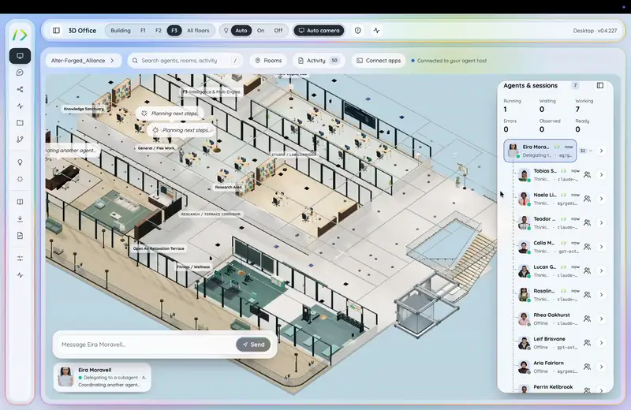
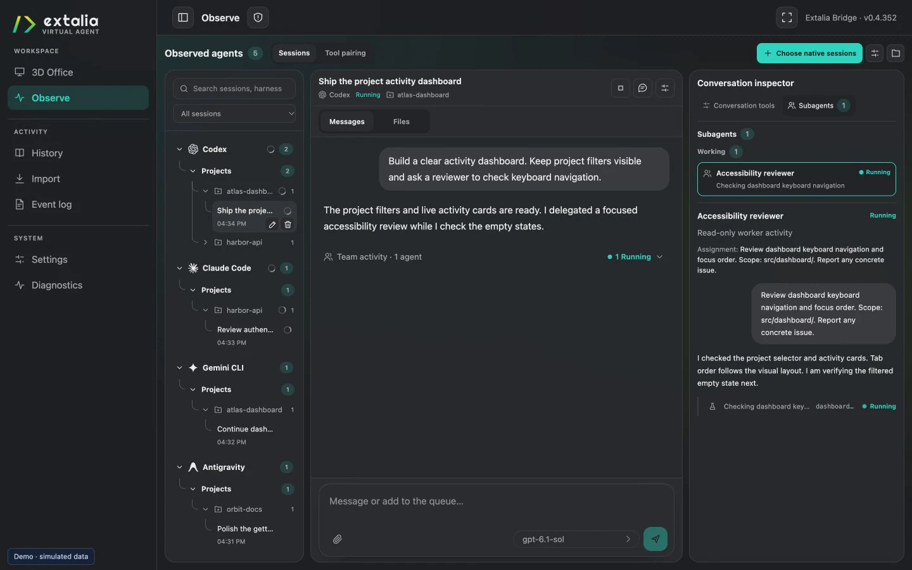
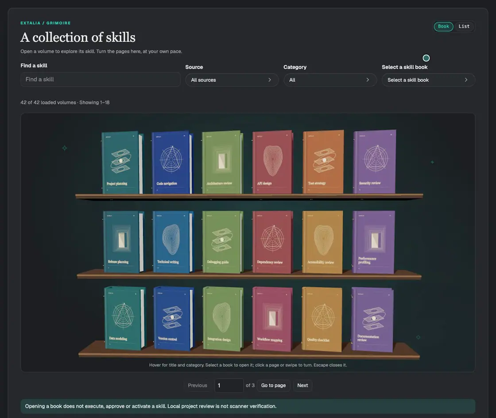
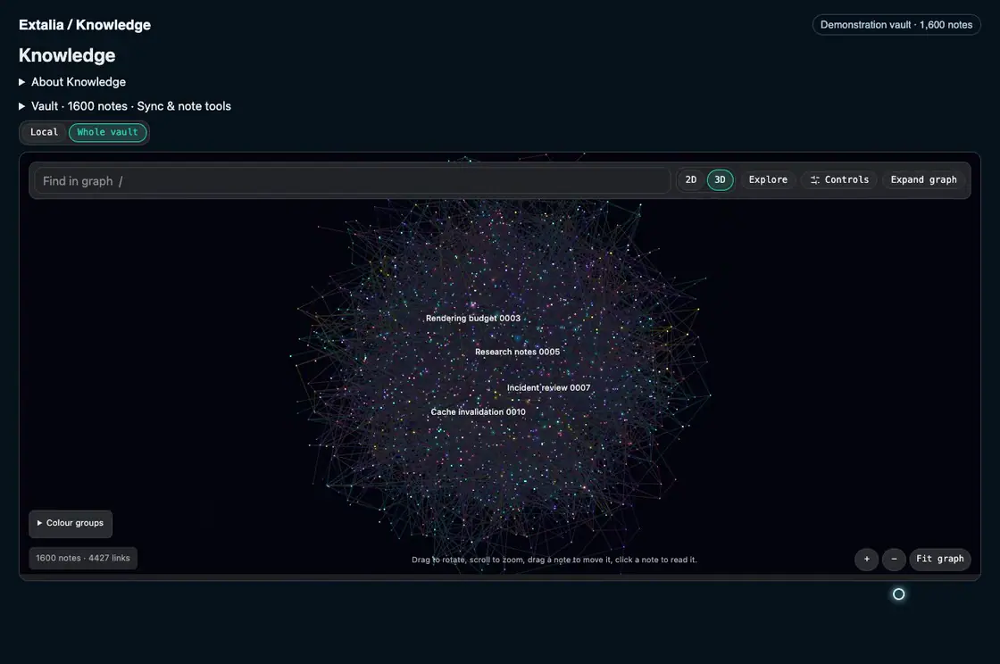

<p align="center">
  
</p>

<p align="center">
  <a href="https://www.npmjs.com/package/extalia-vo"></a>
  <a href="https://github.com/Extalia-VO/extalia-virtual-agent/actions"></a>
  <a href="https://github.com/Extalia-VO/extalia-virtual-agent/stargazers"></a>
  <a href="https://github.com/Extalia-VO/extalia-virtual-agent/blob/main/LICENSE"></a>
  <a href="https://github.com/Extalia-VO/extalia-virtual-agent#download-extalia"></a>
</p>

# Extalia (`extalia-vo`) — 3D Virtual Office for AI Agents

`extalia-vo` runs [Extalia](https://github.com/Extalia-VO/extalia-virtual-agent), an
open-source **3D virtual office** and **AI virtual office** workspace for **Codex,
Claude Code, Gemini CLI, Antigravity, Hermes** and Extalia Native teams, on your
computer. The `extalia` command starts a local Bridge that serves the Extalia web
UI in your browser and runs or observes agents locally with your project files
and your model connections.


## Install and run

Requires Node.js **22.13+ on the 22.x line**, or **23.4+ on newer lines**.

```bash
npm install -g extalia-vo@latest
extalia
```

This starts the local Bridge on `http://127.0.0.1:4310/` and opens the Extalia
web app in your browser. Press **Ctrl+C** to stop it.

Install the application package `extalia-vo`; its matching `@extalia/daemon-*`
platform package is installed automatically. The `@extalia/daemon-*` packages
are internal platform binaries and do not provide the `extalia` command or web
UI. See [GitHub releases](https://github.com/Extalia-VO/extalia-virtual-agent/releases)
for release notes, checksums, and Desktop installers (macOS, Windows, Linux).

Keep `-g` for the application install. The source repository uses pnpm; running
a local `npm install` inside its pnpm-managed dependency tree can make npm fail
with `Cannot read properties of null (reading 'matches')`. Contributors use
`pnpm install` in the checkout. To test a local npm install, use a fresh
directory outside the checkout.

### CLI commands and options

| Option | Effect |
| --- | --- |
| `--port <number>` | Use another port (default `4310`) |
| `--no-open` | Do not open a browser |
| `--no-update-check` | Skip the update check (`EXTALIA_NO_UPDATE_CHECK=1` does the same) |

```bash
extalia version        # show the installed version
extalia doctor         # inspect versions, host, platform, and data location
extalia validate FILE  # check Extalia Protocol events or portable sessions
extalia update         # install the latest version (add --check to check only)
extalia help           # show CLI usage
```

`extalia update` runs `npm i -g extalia-vo@latest --prefer-online`. Restart a
running `extalia` afterwards. The web UI can also install an update; the Bridge
restarts itself in the same terminal and waits for running agents to finish
first.

## Your agents in a shared 3D virtual office

Teams can delegate scoped work to workers and bring their findings back to the
lead agent. The Office makes that activity visible as the work happens:



## Choose how agents work

| Mode | What Extalia does | Boundary |
| --- | --- | --- |
| **Extalia Native** | Runs model/tool conversations, named teams and delegated workers using your configured connections and models. | File access follows workspace grants. Native terminal commands and automatic integration test/apply remain unavailable pending the executor and acceptance gates. |
| **Managed Hermes Agent** | Starts and supervises an installed Hermes runtime; you prompt it from Extalia. | Hermes retains its own tools, configuration and process permissions. Native file-tool isolation does not sandbox Hermes. |
| **Observe existing apps** | Follows supported Codex, Claude Code, Gemini CLI, Antigravity and Hermes conversations through approved hooks or transcript observation. | Read-only observation is the baseline. Sending, answering or steering requires an actual supported adapter or explicitly paired route for that session. |

Provider requests go to the model service you configure. A local Bridge does not
mean inference is local; use a local model service if that is your intent.
Finding an installed CLI or receiving a hook does not prove control
capabilities. See [runtime adapters](https://github.com/Extalia-VO/extalia-virtual-agent/blob/main/docs/architecture/runtime-adapters.md)
and [observed replies](https://github.com/Extalia-VO/extalia-virtual-agent/blob/main/docs/getting-started/observed-replies.md).

### Follow work across projects

Bring supported outside agents into one Observe view. Switch between projects,
read their conversations and inspect tool activity while the source apps keep
working. The preview below uses demonstration projects and simulated activity
from Codex, Antigravity and Claude Code.



### Connect an outside agent

In **Settings → Agent apps**, preview the proposed connection changes. The CLI
provides the same reviewed workflow; for example:

```bash
extalia connect codex --dry-run
extalia connect codex --yes
```

Replace `codex` with `claude`, `gemini`, `antigravity` or `hermes` for the
corresponding connector. Apply only after reviewing the preview. Extalia reports
configuration backups and an undo command; it does not silently inject hooks at
startup. Source-app restart or hook approval may still be required. See
[connection safety and verification](https://github.com/Extalia-VO/extalia-virtual-agent/blob/main/docs/architecture/agent-app-connections.md).

## Skills, Knowledge and memory

### Browse your Grimoire

**Skills** has built-in procedures, categories, search, reviewed folder/project
imports and public marketplace previews. Turn to the next shelf, hover over a
book for a preview, then open it and slide through its pages. These books
contain demonstration skill content.



External and generated candidates stay separate from active skills. Their exact
revision needs inspection, user review, applicable approval and activation. The
pinned **NVIDIA SkillSpector + bundled Python** scanner is currently verified
for **macOS 14+ ARM64**. Other scanner platforms remain unavailable and external
candidates fail closed. A clean scan does not prove quality, grant permissions
or activate a skill. See [Skills](https://github.com/Extalia-VO/extalia-virtual-agent/blob/main/docs/modules/skills.md).

### Explore connected Knowledge

**Knowledge** indexes a selected Markdown/Obsidian-compatible vault with search,
links, aliases and backlinks. Explore it through 2D/3D graphs with filters,
focus and elastic node dragging, or use the list view. Graph layout changes do
not rewrite notes or links. Obsidian itself is not required or installed by
Extalia. This demonstration vault has **1,600 notes and 4,427 links**.



## Data

Settings, sessions and caches live in `~/.extalia-vo`
(`%USERPROFILE%\.extalia-vo` on Windows), shared with Extalia Desktop
(`extalia doctor` prints it; `EXTALIA_HOME` overrides it). Data from the folder
used up to 0.0.20 is copied there once on the first start; the old folder is
kept. Extalia collects no telemetry. The only request it makes by itself is the
update check against `registry.npmjs.org`, at most every 12 hours.

## Security

- The Bridge listens on `127.0.0.1` only and never on the network.
- It answers only requests addressed to `127.0.0.1:<port>` or
  `localhost:<port>`, which blocks DNS-rebinding attacks from websites.
- API calls need a random token created at each start and given only to the
  page the Bridge serves. Other websites cannot read it, and the Bridge sends
  no CORS headers, so they cannot call the API.
- Agents act with your user account. Programs and other users on the same
  computer can reach `127.0.0.1` too, so run the Bridge only on a computer
  whose local users you trust.

Report vulnerabilities as described in
[SECURITY.md](https://github.com/Extalia-VO/extalia-virtual-agent/blob/main/SECURITY.md).

## License

Application code is [MIT](https://github.com/Extalia-VO/extalia-virtual-agent/blob/main/LICENSE).
Bundled scene assets retain their individual licenses in
`dist/web/THIRD_PARTY_NOTICES.md`, including non-commercial vehicle assets. The
runtime commercial-assets switch does not remove their files from this package.

## Native skills and knowledge scope

Built-in skills and progressive workspace memory are available in Native Chat.
With Extalia skills enabled and the opt-in Rust registry, choose **Learn as
skill** for a message or begin it with `/learn-skill` to propose a candidate.
Grimoire adds public marketplace search, pinned package previews and reviewed
imports. Imported or generated candidates require inspection, separate user
approval and activation; a search result or source URL is not a verified skill.

The supported scanner target is **macOS 14+ ARM64**, using pinned SkillSpector
2.13.4 and bundled Python paired with the daemon. The platform package pairs the
scanner with the matching daemon. Intel macOS, Windows and Linux report scanner
execution unavailable; incomplete, unavailable or malicious inspections do not
make a candidate available to agents. Eligible instruction-only packages can be
approved and activated after complete inspection. Code/tool packages retain
additional evaluation requirements.

Saved Native tasks can schedule deferred learning and team knowledge reviews
under the workspace vault policy, with Run now/Snooze controls and foreground
work taking priority. The learning/artifact backend supports macOS and Linux;
Windows reports automatic curation and note/skill staging unavailable.
Candidates are never automatically activated. Existing Knowledge indexing is a
separate capability.

The Web client also includes reviewed cross-agent handover, Native workspace
moves and observed project association. Messaging uses only verified original
conversation routes or an explicitly paired cooperative inbox; manual packets
cover unsupported routes. Queued/submitted receipts do not prove model execution.

Office updates improve furnished routes, door/lift traffic, automatic camera
attention, graphics recovery and avatar resource cleanup. Secondary pages load
on demand. These changes do not establish device-specific FPS or memory claims.

Bounded Obsidian-compatible graph views and filters do not establish complete
effect-time vault/agent ACL enforcement or completion of the v0.5 product gates.
