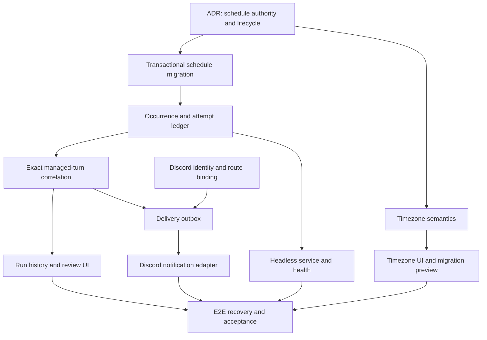

# PRD — Extalia Schedule & Automation vNext

> **Status:** Proposed / implementation-ready specification; **not implemented by this document**  
> **PRD revision:** 1.1 — 2026-11-24 (Universal Gateway / autonomous Chat-report alignment addendum)  
> **Verified source baseline:** Git tag [`v0.4.353`](https://github.com/Extalia-VO/extalia-virtual-agent/tree/v0.4.353) (source and existing tests reviewed; no live environment or real Discord test executed for this PRD)  
> **Repository path:** `docs/product/prd-schedule-automation-vnext.md`  
> **Companion PRDs:** [Universal Gateway Module v2 (`prd-universal-gateway-v2.md`)](prd-universal-gateway-v2.md) *(Revision 2.0, superseding `prd-universal-gateway-v1.md`)* — covers Discord/Telegram/WhatsApp and autonomous Knowledge/Skills reports; appendix at the end supersedes Discord-only delivery assumptions. Also aligns with [Session-first workspace, coding workers & Discord (`prd-session-first-coding-discord.md`)](prd-session-first-coding-discord.md).  
> **Ownership:** Product owner / Extalia host, platform, runtime, desktop/CLI, web and gateway maintainers  
> **Release:** Incremental releases after v0.4.353; no version number or GA claim assigned without gate acceptance.

## 0. Executive summary

Extalia already provides saved one-off, interval and five-field cron jobs; editable schedules, Run now, pause/resume, session selection, Native team assignment and creation by ordinary Native prompts. Its host executes jobs while Desktop or the local Bridge runs. It implements controlled startup catch-up and bounded busy/connection recovery. The current schedule's `lastOutcome: succeeded` represents **dispatch admission**, not verified completion of the agent's work.

**This PRD completes the scheduling product without replacing the existing Native/Hermes runtime or creating another scheduler:**

1. **Durable execution ledger:** distinguish a schedule definition, due occurrence, execution attempt, accepted model turn, completed turn, verified artifact and notification delivery. Preserve uncertain effects across crashes rather than replaying them.
2. **Per-job timezone:** persist an explicit IANA timezone for cron, produce authoritative next-run previews, preserve legacy semantics, and handle daylight saving transitions predictably.
3. **Headless reliable host:** package and manage an existing Bridge/Host as an OS-managed background service, keeping **exactly one authoritative host per data root**. UI and Discord are clients, not competing hosts.
4. **Discord result delivery:** optional, explicitly authorized delivery to a channel/thread through a durable outbox, only after a real terminal result, with retries limited to demonstrably safe cases.
5. **Operational quality:** useful run history, diagnosis, service health, security, migrations, rollback and test evidence.

**Nonnegotiable rule:** a model's statement that work finished is *not* proof of tool execution, passing tests or deployed code. A successful HTTP/model prompt admission is *not* successful task completion. No general exactly-once guarantee is claimed for provider or Discord external effects.

---

## 1. Background, baseline and evidence

### 1.1 Implemented in v0.4.353

| Existing feature | Evidence / caveat |
| --- | --- |
| `once`, `interval` and five-field `cron` triggers | `packages/platform/src/schedules.ts` |
| Simple editor and Advanced settings, Suggested cards, saved jobs, pause, Run now, edit/delete | `apps/web/src/schedules/SchedulesPage.tsx`; `docs/getting-started/schedules.md` |
| Exact existing session; create-and-reuse; derive-from-session; new-each-run | `ScheduleSessionTarget` plus `packages/host/src/service.ts` |
| Native prompt-created schedules (`schedule_jobs`) | `packages/runtime/src/scheduleTool.ts`, `packages/host/src/nativeScheduleJobs.ts` |
| Scheduled lead/team mode, model, effort and permission options | Platform schedule types, host runtime binding |
| Persisted job catalog and bounded creation/recovery receipts | `packages/host/src/schedules.ts`, `config/schedules.json` |
| Catch-up policy (`run-once` or `skip`) after restart/sleep | `GeneralScheduleManager` |
| Busy-session retries and pre-dispatch connection recovery | Manager and `scheduleUpstreamRecovery.test.ts` |
| Existing CLI background-capable entry point | `extalia start --no-open --no-update-check` in `apps/cli/src/cli.ts` |
| Session/turn events (`turn.completed`, `turn.failed`), event correlation support | `packages/protocol/src/events.ts` |

### 1.2 Gaps evidenced at baseline

- Cron follows the **executing host's local timezone**; the timezone is not stored on each job.
- Schedules need a running Host; Extalia does not install OS-managed persistent service units by default and does not wake a sleeping computer.
- The general job record's `runCount`, `lastOutcome` and `lastRunAt` track dispatch attempts/admission, not the terminal outcome of every agent turn.
- No authoritative per-occurrence durable turn/result/evidence ledger and no complete cross-crash external exactly-once guarantee.
- No built-in Discord schedule-result delivery outbox or destination scope policy.
- General schedules currently require `workspaceId`; a future session-first/no-workspace feature is **a separate contract change**, not silently implemented here.
- Native terminal execution, production Mission integration tests and Apply remain limited by the separate verified isolated-executor gates. Schedule cannot imply those features exist.

### 1.3 Scope compatibility

Read alongside [app-flow PRD](prd-app-flow-and-live-agents.md), [Universal Gateway Module v2](prd-universal-gateway-v2.md), [Session-first workspace, coding workers and Discord (`PRD-SF-1.0`)](prd-session-first-coding-discord.md), [v2 acceptance map](prd-v2-acceptance-map.md), [Native module](../modules/native-agent.md), [security](../architecture/security.md), [storage](../architecture/storage.md), [runtime adapters](../architecture/runtime-adapters.md), and [Schedules guide](../getting-started/schedules.md). This PRD is an *additive product specification*; do not replace the existing app-flow PRD or declare v0.5 release gates closed. When implemented, update its main tracker, the module guide, changelog and requirement crosswalk.

---

## 2. Goals, success metrics, and non-goals

### 2.1 Goals

- G1: A user can create, edit and run a timezone-stable scheduled agent job from Extalia UI or a supported Native conversation.
- G2: Every due occurrence is uniquely identified and produces an inspectable admission/terminal history, even after restart.
- G3: An operator can run scheduling without an open browser using a supported OS-managed host service.
- G4: A user can optionally send a minimally scoped, trustworthy result summary to a verified Discord channel/thread.
- G5: Scheduled work never escalates workspace access or retries an uncertain external effect automatically.
- G6: One source of truth supplies Chat, Schedule UI, Office activity and Discord notifications without spawning duplicate agents or buildings.

### 2.2 Suggested measurable objectives (must be verified, not assumed)

| Objective | Proposed release target | Conditions / exclusion |
| --- | --- | --- |
| Due-time admission | 99% of eligible jobs admitted within 60 seconds | Host healthy/awake, no blocked destination, provider availability separate |
| Duplicate automatic admission | Zero duplicates across the defined crash/recovery test matrix | Unknown must stay quarantined; cannot promise universal external exactly-once |
| Terminal status visibility | 99% of locally observed managed turns reflected within 5 seconds | Running host and functioning local event store; verified harness |
| Discord delivery | 99% of acknowledged sends recorded within 10 seconds of provider response | Discord available; rate limit, network and user permission exceptions reported |
| UI first schedule workflow | Create a basic daily schedule within three primary steps after workspace selection | Product UX acceptance with representative testers |
| System stability | 24-hour soak with repeated schedule runs and restart injection; no unbounded leaks | Real packaged build plus synthetic provider; report RSS/CPU |

These are proposed acceptance targets, not baseline measurements or claims of support for every platform.

### 2.3 Non-goals in the initial release

- Building an independent second scheduler in Discord, Hermes, or a plugin.
- Auto-executing arbitrary shell commands or enabling blocked Native command/executor capabilities.
- Guaranteed exactly-once completion of third-party calls or Discord sends.
- Remote network exposure of the privileged Bridge or unauthenticated remote control.
- Automatic waking of sleeping Macs/PCs; cloud hosting or multi-node distributed leadership.
- Scheduling observed third-party agent sessions unless a distinct certified managed-control capability is added later.
- New 3D Office buildings; keep **one shared office**.
- Rewriting the Host from TypeScript into Rust/Python without measured justification.
- Broadening schedule quotas without performance and storage evidence.

---

## 3. Terminology and model of truth

| Term | Definition |
| --- | --- |
| **Schedule (job)** | User-approved recurring or one-off configuration with immutable ID and revision. |
| **Occurrence** | A particular scheduled slot, e.g., Monday 09:00 at the job's timezone, or a distinct manual Run now. |
| **Attempt** | An admission/delivery attempt against one occurrence; may be deferred or enter uncertainty. |
| **Execution** | A managed session turn accepted by Native or managed Hermes. |
| **Turn outcome** | Host-observed terminal result (`completed`, `failed`, `cancelled`, or `unknown`), separate from prompt acceptance. |
| **Verification** | Independent evidence that a requested result exists or passes a known test/check; optional and capability-gated. |
| **Delivery** | A message sent to Discord or another notification destination, independent of execution success. |
| **Execution authority** | The single Host owning the profile root and permitted runtime; a second UI is only a client. |

An occurrence may be *not dispatched*, *deferred*, *rejected*, *sent but unknown*, or *settled*. `turn.completed` confirms only that the turn settled normally; it does **not** prove the application build passed, changes were applied or the request was fully satisfied.

---

## 4. End-to-end user journeys

### UJ-01 Create a simple job

1. User opens Schedules in a managed workspace and picks **New schedule** or a Suggested card.
2. User provides name, instructions, recurrence and target session. Timezone is displayed explicitly.
3. Host validates runtime, permissions, next occurrence, timezone, quotas and revision, then persists the schedule.
4. UI shows next run, timezone, missed-run policy, run-history link and optional delivery setup.

### UJ-02 Create a job through Native Chat

1. User explicitly asks the Native lead to run a future/recurrent task.
2. `schedule_jobs` lists host clock/timezone and existing jobs first; ambiguous timing prompts for clarification.
3. Host creates with a deduplicated creation receipt; no observed worker or scheduled invocation can create another schedule recursively.
4. The reply includes a real saved job ID, next due time, timezone and session mode. No promise is made that future work has finished.

### UJ-03 Scheduled coding/review task

1. When due, the Host atomically reserves occurrence identity and validates the current workspace/connection/session boundary.
2. The Host resolves the exact existing/reusable/derived/new session. It records the session and turn correlation before allowing external effects where possible.
3. On admission the UI displays **Running**; the Schedule ledger follows actual managed-turn events.
4. The result is marked `completed`, `failed`, `cancelled` or `unknown` according to authoritative evidence. If test evidence exists, verification is recorded separately.
5. An optional notification is produced after settlement (never solely because the prompt was accepted).

### UJ-04 Downtime and reactivation

1. Host is stopped or OS sleeps across several due slots.
2. On restart, a single owner rehydrates the catalog and ledger. `run-once` coalesces missed slots; `skip` advances. No burst execution.
3. An occurrence that may have started before the crash becomes `unknown`; it is **not replayed**. The operator can inspect and explicitly start a new run.

### UJ-05 Discord delivery

1. User enables delivery for a schedule and selects a verified channel/thread binding in the same authorized workspace.
2. Runtime completes/fails; Host constructs a sanitized summary from trusted status and separately labeled model claims.
3. Outbox records destination snapshot and payload digest before sending.
4. Discord acknowledgement records message ID; temporary *definite no-send* conditions may retry. An ambiguous send becomes `unknown` pending reconciliation/review.
5. Notification contains job name, occurrence, status, safe short summary and safe Extalia link where supported; no secrets/log dumps.

### UJ-06 Headless operation

1. User enables a supported service mode in Settings or via a reviewed CLI install command.
2. Setup previews the service unit, executable, resolved data root, runtime dependencies and system access; user approves changes.
3. Host operates while the UI is closed; the Browser UI reconnects through the authenticated local Bridge.
4. Starting Desktop on the same data root never creates a second owning Host. Until optional client-attach support is implemented, Desktop shows an actionable conflict/Bridge link rather than taking over silently.

---

## 5. Functional requirements

### 5.1 Schedule definition, timezone and calendar semantics

| ID | Priority | Requirement |
| --- | --- | --- |
| SCH-FR-001 | P0 | Preserve existing `once`, `interval` and standard five-field cron jobs; existing IDs, revisions, session targets and assignments survive migration. |
| SCH-FR-002 | P0 | Persist an IANA `timeZone` per cron job; reject invalid zones. UI offers host timezone as explicit new-job default. |
| SCH-FR-003 | P0 | Compute authoritative `nextRunAt` in Host, with ISO UTC timestamp plus local time and IANA zone in UI. No browser-only authoritative preview. |
| SCH-FR-004 | P0 | Migrate legacy host-local cron jobs without silently shifting planned occurrences; record migration zone, ambiguity and snapshot for rollback. |
| SCH-FR-005 | P1 | Preserve existing DST policy: repeated fall-back wall-clock times may yield two distinct UTC occurrences; skipped spring-forward times advance to the next valid matching local occurrence. Document and test. |
| SCH-FR-006 | P0 | Interval schedules use elapsed-time slot anchoring, not cron wall-clock semantics or work completion drift. |
| SCH-FR-007 | P0 | Once triggers persist an absolute timestamp with offset; editing calendar time displays zone/offset unambiguously. |
| SCH-FR-008 | P0 | Preserve `run-once` and `skip` missed policy. Pauses, edits, deletes, and Run now follow documented revision and due-slot semantics. |
| SCH-FR-009 | P1 | Validate quotas at Host: initial limits remain 64 jobs/profile, 32k prompt chars, 1–10,080 min intervals and existing worker/model grants unless separately changed by evidence-backed ADR. |

### 5.2 Durable occurrence and turn truth

| ID | Priority | Requirement |
| --- | --- | --- |
| SCH-FR-010 | P0 | Every due slot has a stable unique occurrence key derived from job ID, schedule revision/series identity, trigger slot UTC and kind; manual Run now gets a distinct operator-request ID. |
| SCH-FR-011 | P0 | Atomic state transition reserves an occurrence before a new external dispatch. Concurrent callbacks and client requests cannot both reserve it. |
| SCH-FR-012 | P0 | Persist execution attempts, workspace/session identity, runtime target, correlation, timestamps, admitted status and terminal evidence in a durable ledger. |
| SCH-FR-013 | P0 | Split *dispatch state* from *turn state* and *verification state*. `runCount` legacy meaning is retained or explicitly renamed/migrated; do not relabel historical dispatches as completed turns. |
| SCH-FR-014 | P0 | Bind managed turn events to exact run via generation, session, correlation and turn/attempt identity. Never infer result from a nearby unrelated `turn.completed`. |
| SCH-FR-015 | P0 | After crash, classify effects with no conclusive settlement as `unknown`; never auto-repeat a possibly executed prompt/tool. Uncertainty is operator-visible. |
| SCH-FR-016 | P0 | Preserve bounded existing busy/connection retry where provably pre-admission; first-request transient retry requires exact zero-work receipt and unchanged history/session authority. |
| SCH-FR-017 | P0 | Persist revisions, receipts and status transitions with compare-and-swap/transactional guards. Fail closed on unavailable/corrupt data, with recovery diagnostics. |
| SCH-FR-018 | P1 | Provide per-run history, status, duration, source, error code, model/usage when available, session link and read-only evidence references. |
| SCH-FR-019 | P1 | An optional verification adapter can attach independently confirmed test/artifact evidence only behind existing runtime capabilities and grants. Absence is `not-checked`, never `passed`. |
| SCH-FR-020 | P1 | Support retention/export of terminal run metadata, while unresolved runs and audit-critical references are protected from automatic deletion. |

### 5.3 Session, runtime and permissions

| ID | Priority | Requirement |
| --- | --- | --- |
| SCH-FR-021 | P0 | Retain existing target modes: exact session, create/reuse, derive (with explicit source validation), and fresh each run. Missing targets fail closed. |
| SCH-FR-022 | P0 | Runtime capabilities must be checked at save and again at admission; Native, managed Hermes and observed sources are never presumed to offer identical control/settlement evidence. |
| SCH-FR-023 | P0 | Session team/operating profile defaults and overrides obey existing snapshot, connection/model authorization and workspace boundaries. No privilege inheritance from Discord or display profile. |
| SCH-FR-024 | P0 | A scheduled invocation cannot create schedules recursively via the `schedule_jobs` tool. Plan mode, observed sources and delegate workers keep existing restrictions. |
| SCH-FR-025 | P0 | A schedule cannot grant Native command execution, file access, integration Apply or external skills beyond existing admission/approval gates. |
| SCH-FR-026 | P1 | Expose a capability/diagnostics reason when a selected runtime cannot report terminal results or perform a requested action. |

### 5.4 Headless host and lifecycle

| ID | Priority | Requirement |
| --- | --- | --- |
| SCH-FR-027 | P0 | Reuse the Host/Bridge and `extalia start --no-open` behavior; add a supported documented service installer/manager without starting a second Host. |
| SCH-FR-028 | P0 | Enforce one host owner per `EXTALIA_HOME` using existing host locks; a conflict never silently forks state or runs a second scheduler. |
| SCH-FR-029 | P0 | Support reviewed setup/status/start/stop/uninstall for macOS `launchd`, Linux `systemd`, and supported Windows service/task mechanism, with platform-specific capability gates. |
| SCH-FR-030 | P0 | Service installation previews OS configuration changes, requires user authorization, provides backup/undo and does not expose privileged HTTP endpoints publicly. |
| SCH-FR-031 | P0 | Implement graceful shutdown/drain, verified state persistence, startup recovery and secure per-user environment/secret handling. |
| SCH-FR-032 | P1 | Display `Host running`, service manager state, next due run, clock/timezone and last health check; include actionable diagnostic messages. |
| SCH-FR-033 | P1 | Provide controlled update/restart behavior so in-flight work is drained or marked uncertain; do not promise a lost execution completed. |

### 5.5 Discord delivery and routing

| ID | Priority | Requirement |
| --- | --- | --- |
| SCH-FR-034 | P0 | Discord delivery is opt-in and requires verified destination + workspace authorization; saving a schedule never creates a Discord channel/permission grant. |
| SCH-FR-035 | P0 | Persist a destination-binding revision and exact channel/thread IDs per scheduled delivery. No name/title-only routing. |
| SCH-FR-036 | P0 | Queue notification only after terminal run-state receipt; statuses must distinguish `turn completed` and `verification passed`. |
| SCH-FR-037 | P0 | Store delivery payload digest, notification ID, destination snapshot, attempt and receipt through a durable outbox. |
| SCH-FR-038 | P0 | Handle Discord rate limits and proven no-send errors with bounded backoff; ambiguous sends are `unknown` pending review/reconciliation, not blindly replayed. |
| SCH-FR-039 | P0 | Sanitize and redact content, enforce guild/channel/thread allow-lists, confirm bot send permission and prevent cross-workspace disclosure. |
| SCH-FR-040 | P1 | Support delivery preference for completion, failure, cancellation and unknown outcomes; include a safe link into the session/run when supported. |
| SCH-FR-041 | P1 | On archived, deleted or inaccessible threads, show actionable delivery failure. No automatic reroute into a general channel. |
| SCH-FR-042 | P1 | Reuse future Discord Gateway bindings; do not implement a second independent Discord scheduler or duplicate agent session. |

### 5.6 UI/notifications/operations

| ID | Priority | Requirement |
| --- | --- | --- |
| SCH-FR-043 | P0 | Display distinct badges for job schedule state, occurrence/turn state, verification state and delivery state; avoid an ambiguous single green `Success`. |
| SCH-FR-044 | P1 | Provide run detail with correlation/session link, attempt history, next retry, result provenance, service health and retention status. |
| SCH-FR-045 | P1 | Keep UI English and Indonesian, keyboard/screen-reader accessible and functional without WebGL. |
| SCH-FR-046 | P1 | Office projects the same canonical session/agent status, within one shared building; no automatic avatar per schedule or duplicate runtime. |
| SCH-FR-047 | P1 | Provide filtered views by workspace, job, status, timezone and destination; redact private run details across workspace boundaries. |
| SCH-FR-048 | P1 | Add inspectable audit events for user actions, automatic status changes, gate decisions and delivery acknowledgements, with bounded retention. |

---

## 6. Durable data contracts (proposed, not yet existing)

### 6.1 Storage decision

**Preferred initial design:** keep the existing JSON schedule catalog as a readable migration source, then move authoritative schedule definitions *and* occurrence/attempt transitions into a single transaction-capable local store, e.g., `state/schedules.sqlite`. This avoids a cross-file JSON/SQLite atomicity gap. The decision to reuse a current SQLite authority instead must be benchmarked and accepted in an ADR; do not create two competing canonical stores.

A reviewed migration performs an immutable backup, validates old payloads and receipts, imports exactly once with a version/revision marker and supports export/downgrade inspection. After cutover there is **one scheduler writer**. No live dual-write attempt may be described as atomic. The 64-job limit remains in force until reassessed.

### 6.2 Logical schema

```ts
interface ScheduleDefinitionV2 {
  id: string;
  revision: number;
  workspaceId: string;           // Required in this release
  name: string;
  prompt: string;
  enabled: boolean;
  trigger:
    | { kind: 'cron'; expression: string; timeZone: string; dstPolicy: 'each-valid-instant' }
    | { kind: 'interval'; intervalMinutes: number }
    | { kind: 'once'; runAt: string };
  sessionTarget: ScheduleSessionTarget;
  assignment: ScheduleAgentAssignment;
  missedPolicy: 'skip' | 'run-once';
  deliveryTargetId?: string;      // Optional; authorization-bound
  nextRunAt?: string;             // UTC instant, computed by Host
  createdAt: string;
  updatedAt: string;
}

type RunState =
  | 'pending' | 'admitting' | 'deferred' | 'dispatched' | 'running'
  | 'completed' | 'failed' | 'cancelled' | 'blocked' | 'unknown';

interface ScheduleRunV1 {
  id: string;
  scheduleId: string;
  scheduleRevision: number;
  occurrenceKey: string;         // Unique across automatic and manual occurrences
  occurrenceKind: 'automatic' | 'manual' | 'catch-up';
  scheduledFor: string;          // UTC instant of original slot
  requestedAt?: string;
  workspaceId: string;
  runtimeId?: string;
  sessionId?: string;
  turnId?: string;
  correlationId?: string;
  executionGeneration?: string;
  state: RunState;
  admittedAt?: string;
  settledAt?: string;
  verification: 'not-checked' | 'passed' | 'failed';
  terminalEvidenceRef?: string;  // No secrets or large logs embedded
  statusReason?: string;
  attemptCount: number;
}

type DeliveryState = 'pending' | 'sending' | 'sent' | 'failed' | 'unknown' | 'cancelled';
interface ScheduleDeliveryV1 {
  id: string;
  runId: string;
  destinationBindingId: string;
  destinationRevision: number;
  targetGuildId: string;
  targetChannelId: string;
  targetThreadId?: string;
  payloadDigest: string;
  state: DeliveryState;
  attemptCount: number;
  discordMessageId?: string;
  lastErrorCode?: string;
  acknowledgedAt?: string;
}
```

These interfaces describe logical persistence; final field schemas/types, migrations and index sizes require ADR review. `ScheduleSessionTarget` and `ScheduleAgentAssignment` refer to existing platform concepts. Model output can be recorded as attributed **claim**, not as independently verified evidence.

### 6.3 Required indexes/invariants

- Unique job ID; revision-based optimistic write checks.
- Unique automatic `(schedule_id, occurrence_utc, trigger_generation)` key; unique manual `(schedule_id, operator_request_id)` key.
- Unique accepted `(run_id, attempt_id)`; a run links only to its actual session/turn generation.
- Delivery uniqueness by `(run_id, destination_binding_revision, notification_kind)`; this is local deduplication, **not** Discord global exactly-once.
- Database transactional admission plus durable receipt before an external effect wherever the runtime admits it; ambiguous effects never become admitted-to-retry merely because a process restarted.
- Source workspace and runtime capability version verified at save, admission and delivery.
- No automatic retargeting when a session or Discord destination disappears or moves.

### 6.4 State machines

```text
Schedule: enabled | paused | archived

Occurrence:
  pending -> admitting -> dispatched -> running -> completed
               |                |          |-> failed
               |                |          |-> cancelled
               |                |          `-> unknown
               |                `-> unknown
               |-> deferred -> admitting (only with safe no-work proof)
               `-> blocked / failed

Verification (independent): not-checked | passed | failed
Delivery (independent): pending -> sending -> sent
                                  |-> failed
                                  `-> unknown (no blind resend)
```

Invalid transitions fail closed with a diagnostic; runtime/model output cannot issue authoritative transitions itself. `unknown` requires explicit human reconciliation/decision or trusted provider receipt; a model summary cannot clear it.

### 6.5 Retention defaults (proposal)

Keep the last 90 days of terminal execution metadata or a reviewed bounded maximum, whichever is smaller; protect all unresolved/unknown run records from automatic pruning. Store short redacted diagnostic fields and references to session-owned logs, not duplicate full transcripts. Use explicit retention limits for outbox receipts; show disk usage and allow export/review before cleanup. This policy is tunable only with versioned migration and tests.

---

## 7. Scheduling semantics, recovery and idempotency

1. The Host computes occurrences deterministically in UTC using each cron job's saved IANA zone, not browser local time. Manual Run now creates a distinct occurrence; when invoked at/after due time, preserve existing documented due-slot consumption behavior.
2. An automatic slot has one owning admission record. On clock adjustments, scheduler re-evaluates next due using monotonic admission identities, avoiding duplicate wall-clock dispatch.
3. `run-once` coalesces multiple missed slots into one explicitly labeled catch-up occurrence with the original overdue range; `skip` logs a miss and advances. Never execute hundreds of missed jobs as a burst.
4. An occurrence interrupted **before any admitted effect** may be retried only with a trusted, versioned proof. Current connection retry limits and historical session checks continue to apply.
5. A prompt accepted by the runtime cannot be automatically replayed after an ambiguous failure or process crash. Persist `unknown` and link to original session evidence.
6. For a recurrent job, one `unknown` occurrence need not block all future slots, but the UI must warn of uncertain overlap and obey the configured concurrency policy; release gate defaults to **no overlapping execution of the same job/session** until operator reconciliation or explicit policy.
7. Run now is explicit user intent, not an arbitrary retrier. It must show a warning for unresolved prior effects and require explicit confirmation to create an additional occurrence.
8. Pausing stops new occurrences; it does not silently abort an already accepted run. Cancelling accepted work requires a supported runtime-specific cancellation path and cannot fabricate settlement.
9. Editing or deleting a definition affects future slots; immutable previously dispatched occurrence records and destination snapshots remain available for audit.
10. Storage errors disable new automatic admission, with an error visible to UI/service health. Never proceed with effects when durable admission cannot be recorded.

---

## 8. Headless service and single-authority design

### 8.1 Architectural boundary

`Desktop` and `extalia` Bridge currently share a profile root and lock. A service deployment MUST use the same Host API and stores, rather than running an independent scheduler. `extalia start --no-open --no-update-check` is an existing foundation, *not* the completed service manager. The privileged Bridge remains loopback-only; remote Discord input enters through a separately authenticated gateway adapter/service, never through a publicly bound existing Bridge port.

### 8.2 Platform integration (proposed)

| OS | Supervision | Requirements |
| --- | --- | --- |
| macOS | `launchd` LaunchAgent per user | Approved plist, stable executable/working directory, user keychain availability, login launch, reviewable uninstall. Sleep does not run tasks. |
| Linux | `systemd --user` or explicitly selected system service | Correct OS user, fixed `EXTALIA_HOME`, `Restart=on-failure`, scoped environment/secrets, log management, optional boot/lifecycle configuration. |
| Windows | Task Scheduler or service wrapper verified per supported edition | Single interactive/noninteractive identity contract, secrets availability, clean stop/restart, status and uninstall. No unverified blanket Windows service claim. |

A possible CLI contract (subject to platform implementation and security review):

```text
extalia service install --dry-run
extalia service install
extalia service status
extalia service start
extalia service stop
extalia service uninstall --dry-run
extalia service uninstall
```

These commands **do not exist at baseline**. `--dry-run` shows exact service changes; applying requires the user's explicit approval, a backup and undo. Never rewrite unrelated launchd/systemd/task registrations.

### 8.3 Host attachment

- The service is the sole authority. Browser connects through existing authenticated loopback Bridge.
- Desktop currently owns its Host and cannot silently share the data root with an already running Bridge; first release may show a conflict and link to Browser. True Desktop UI-as-client attachment is a **separate gated work package**, not assumed to already work.
- Host shutdown drains accepted work when supported, preserves incomplete status, and atomically records uncertainty when certainty is unavailable.
- Updates do not launch a new process over an old profile owner. A service install should pin executable path/revision and perform reviewed upgrade/migration.
- No implicit machine wake behavior or 24/7 promise on a sleeping laptop. A continuously running server is the recommended option for always-on scheduling.

---

## 9. Discord delivery subsystem

### 9.1 Preconditions and ownership

The Discord integration is an **optional downstream notification adapter**. It can reuse future category/channel/thread → workspace/session bindings. A category or operating profile does not grant access to every project. A schedule source may be Chat or Discord; the job is still owned by the Extalia Host.

The adapter must obtain a configured bot connection via a secure host-backed credential reference, verify allowed guild/channel/thread and exact workspace permission, and snapshot a binding revision when the run's delivery is created. User-controlled Discord content is untrusted data; never use it to change scheduling policy or tool grants.

### 9.2 Delivery format

Minimal Discord example (illustrative; no private content):

```text
Scheduled task: Weekly repository review
Occurrence: 2026-11-30 09:00 (Asia/Jakarta)
Agent turn: Completed
Verification: Not checked
Summary: 3 follow-up items identified (agent-reported)
Session: [safe local link or reference]
```

For failure, cancellation or `unknown`, the title and status must reflect that condition. Do not claim that code was built, tests passed or a deploy succeeded without actual evidence. Never include raw credentials, unredacted file diffs, provider history, approval contents or private folder paths in public notification payloads.

### 9.3 Outbox behavior

- Persist delivery intent and sanitized payload fingerprint **before** HTTP send. Store the returned Discord message ID only after a trustworthy success receipt.
- Handle explicit `429` and known transient *no-send* conditions with bounded retry-after/backoff. API accepted-but-response-lost becomes `unknown`, not automatic resend.
- Check channel/thread existence and send permission at send time; an archived/deleted/inaccessible target is a visible failure, **not** fallback to a broader channel.
- Different schedule runs may share a thread, but their message IDs, run IDs and receipts remain distinct.
- Do not process inbound Discord commands as authenticated schedule mutations until exact actor, guild, channel, binding and permission checks exist; command/control may be a later Gateway-specific PRD.
- Rate limits, message-length truncation/splitting and Discord API format are adapter-tested against current official API behavior at implementation time.

---

## 10. Host API, protocol and UI contracts

### 10.1 Proposed Host methods

```ts
listScheduleRuns(filter: { workspaceId: string; scheduleId?: string; cursor?: string }): Promise<RunPage>;
scheduleRunDetail(runId: string): Promise<RunDetail>;
listScheduleDeliveries(runId: string): Promise<DeliverySummary[]>;
previewScheduleNextRuns(input: ScheduleDraft, count: number): Promise<NextRunPreview>;
reviewUnknownScheduleRun(runId: string, revision: number, decision: ReviewDecision): Promise<RunDetail>;
serviceStatus(): Promise<ServiceStatus>;
```

Mutations require server-side authorization and revision checks. New methods must be added to the shared platform API, transport whitelist/Bridge and Desktop IPC only after protocol validation; React may not instantiate scheduler, provider, filesystem or Discord clients directly. Names are proposals, not current APIs.

### 10.2 Event addition strategy

The existing Extalia Protocol has per-session event IDs, `correlationId`, `turn.completed` and `turn.failed`. Schedule events need their own validated identity and source label; recommend versioned events such as `schedule.run.admitted`, `schedule.run.settled`, `schedule.delivery.acknowledged`, with exact `runId`/`scheduleId`/turn correlation and no raw sensitive payload. Do not alter legacy event behavior or claim missing Hermes turn receipts by synthesizing success.

### 10.3 UX requirements

- A clear **Schedules** list shows local cron time and zone, next occurrence, paused/running/unknown, session target and optional delivery indicator.
- A **Run history** view differentiates `Prompt admitted`, `Agent turn completed`, `Verification passed` and `Discord sent` with separate timestamps.
- The Advanced editor exposes timezone, missed-run policy, session mode, team, permissions and notification destination. Simple flow stays compact.
- Safe preview: show next five occurrences, timezone, any DST ambiguity, offline catch-up behavior and whether a job can run headlessly.
- Service status explains *host running but provider offline*, *OS sleeping/unreachable*, *workspace changed*, *waiting for approval*, *storage unavailable* and *delivery failed*.
- All controls remain operable with WebGL disabled, EN/ID translation, keyboard navigation and mobile-size layout.

---

## 11. Security, privacy and trust

- **Local first:** never add remote network binding to the existing privileged Bridge for convenience. Keep existing Host/Origin/token defenses.
- **Single authority:** reuse `state/host.lock`/host ownership; no background sidecar independently writes schedule definitions or session history.
- **Least privilege:** job execution cannot access other workspaces because they share an operating profile, Discord category or team roster.
- **Secrets:** bot tokens and model keys in credential store or existing host secret interfaces; never serialized to schedule/outbox exports.
- **Approval:** existing workspace tool/file/command policies apply at the time of execution. If required human approval is unavailable in headless mode, stop/queue safely and notify with a review link; do not auto-approve.
- **Prompt injection:** project files, previous agent output, Discord messages and tool results are untrusted; none can self-create schedules, change notification destination or escalate grants.
- **Protected changes:** Native terminal and Mission Apply continue to refuse while isolation/approval gates are incomplete; schedule additions do not bypass this.
- **Auditing:** persist minimal actor, revision, operation, timestamp, result and trusted receipts; redact any sensitive context.
- **Data lifecycle:** bound logs retained according to policy, exports scrub secrets and private identity, and users can disable/uninstall delivery without erasing run evidence.

---

## 12. Non-functional requirements

| ID | Priority | Requirement |
| --- | --- | --- |
| SCH-NFR-01 | P0 | Crash consistency: atomic durable transitions, recoverable checkpoints, corruption refusal and no ambiguous automatic replay. |
| SCH-NFR-02 | P0 | Security: no cross-workspace context leakage, no secret disclosure, no UI/gateway direct provider execution. |
| SCH-NFR-03 | P0 | Concurrency: one profile owner, one automatic occurrence admission; bounded concurrent jobs per runtime/workspace. |
| SCH-NFR-04 | P0 | Time: timezone and DST deterministic; time jumps and suspend/resume cannot re-admit identical occurrence. |
| SCH-NFR-05 | P0 | Compatibility: legacy saved jobs, session modes, model/team grants and existing retry behavior preserved. |
| SCH-NFR-06 | P0 | Observability: all status claims cite trusted host receipts and event/attempt IDs. |
| SCH-NFR-07 | P1 | Performance: bounded startup scan, scheduling tick and status pagination; no full transcript loading for list views. |
| SCH-NFR-08 | P1 | Portability: tested macOS, Linux and Windows service modes individually; unsupported platforms clearly marked. |
| SCH-NFR-09 | P1 | Operability: uninstall, versioned backups, durable diagnostics and safe rollback paths. |
| SCH-NFR-10 | P1 | Accessibility: EN/ID, keyboard, screen reader, mobile responsive, no-WebGL fallback. |
| SCH-NFR-11 | P1 | Delivery resilience: bounded rate-limited send, no blind retry after uncertain external send. |
| SCH-NFR-12 | P1 | Bounded storage: retention, size ceilings, pagination, protected unresolved records and disk warnings. |
| SCH-NFR-13 | P1 | No required telemetry or remote analytics; scheduling remains local-first. |
| SCH-NFR-14 | P1 | Privileged service installation follows OS least privilege; no unexpected startup processes or public ports. |

---

## 13. Migration, rollout and rollback

### 13.1 Compatibility matrix

| Item | Existing behavior | vNext migration rule |
| --- | --- | --- |
| Job ID/revision | `sch_*`, monotonically revised | Preserve IDs, map revisions with explicit migration marker |
| `config/schedules.json` | Canonical definitions and recovery receipts | Read-only input/backup after approved authoritative cutover; no undocumented dual writers |
| Cron timezone | Host-local at execution time | Snapshot prior host timezone when unambiguous; otherwise retain legacy host-local until user review; never silently shift slots |
| `runCount` | Successful dispatch count | Preserve as `legacyDispatchCount` or keep field clearly labeled; new `completedRunCount` starts from observed evidence only |
| Existing session bindings | Exact/reusable/derived/fresh | Preserve; dangling/mismatched target fails visibly |
| Running/unknown prior jobs | Interrupted status in old catalog | Never infer historical turn success; import as unverified/unknown if evidence incomplete |
| Secrets | Host credential store | Keep current references; never embed in DB copies or exports |
| Discord | No general schedule outbox | Disabled by default; opt-in only after verified channel binding |

### 13.2 Rollout stages

1. **Shadow-read/preflight:** add versioned schemas and compatibility readers with no new external effects. Validate old files, size, host timezone, quotas and sample next-run parity.
2. **Transactional store and read-only history:** migrate backed-up definitions under exclusive host lock, record import marker, expose history without enabling new dispatch behavior.
3. **Controlled admission and event correlation:** enable for synthetic/fixture providers; inject crashes at every transition and prove fail-closed unknown handling.
4. **Timezone UI:** opt in for new/edited cron jobs, preserve legacy jobs and provide dry-run next-occurrence diff before migration.
5. **Service packaging:** opt-in per OS; verify profile lock, startup and safe stop; do not enable unsupported platform combinations.
6. **Discord pilot:** allowlisted test guild/channel, sanitized messages, no auto-notifications for old schedules, validate rate limits and unknown receipts.
7. **Release:** gated real-provider, packaged host, service and Discord tests; document remaining exceptions and rollback consequences.

### 13.3 Rollback

Before migration, create an immutable export of the original JSON and DB snapshot/checkpoint with schema/version/digest. Downgrade must refuse to start an older scheduler against a newer active store unless an explicit reviewed compatible export is restored while the Host is stopped. Existing newer run/outbox evidence must never be silently discarded. Rollback of a service install removes only managed service artifacts and leaves user workspaces/histories intact. Discord delivery can be disabled independently while retaining outbox audit state.

---

## 14. Work packages and dependency map

| WP | Deliverable | Dependencies | Priority | Proposed effort |
| --- | --- | --- | --- | --- |
| WP-SCH-01 | ADR: authority/store schema, event correlation, migration | Baseline audit | P0 | 1–2 days |
| WP-SCH-02 | Transactional schedule definition + legacy migration | 01 | P0 | 2–3 days |
| WP-SCH-03 | Occurrence admission, attempts, unknown quarantine, collision tests | 02 | P0 | 3–4 days |
| WP-SCH-04 | Managed turn correlation and terminal evidence | 03 | P0 | 2–3 days |
| WP-SCH-05 | Run history UI, runtime limitations, manual review | 04 | P1 | 2 days |
| WP-SCH-06 | IANA timezone parser/next-run and DST compatibility | 01/02 | P1 | 2–3 days |
| WP-SCH-07 | Timezone editor, migration preview and UX tests | 06 | P1 | 1–2 days |
| WP-SCH-08 | Service manager packaging and health (per platform) | 02/03 | P0 | 3–5 days |
| WP-SCH-09 | Discord destination authorization/binding contract | Gateway ADR | P0 | 1–2 days |
| WP-SCH-10 | Durable delivery outbox, security policy, retries | 04/09 | P1 | 3–4 days |
| WP-SCH-11 | Discord adapter + notification UI, real API acceptance | 10 | P1 | 2–4 days |
| WP-SCH-12 | Soak, restart/fault-injection, CI/release evidence | All | P0 | 3–4 days |
| WP-SCH-13 | Documentation, localization, changelog, status tracker | Each slice | P1 | Ongoing |
| WP-SCH-14 | Optional Desktop-as-client attaching to service-owned Host | Separate IPC ADR | P2 | Separate estimate |

The packages are slices, not an additive fixed commitment: platform/Discord work can overlap after shared contracts stabilize. First useful deliverable is **WP-SCH-01 to 04**; no Discord result claims before true terminal correlation exists. Estimated focused delivery **20–30 developer-days** for the bounded scope with one primary supported host platform; additional platform certification and gateway changes require re-estimation.

### Dependency graph



---

## 15. Acceptance tests and release gates

Each test must specify build/tag, platform, configuration, executable command, fixture, expected observable state, obtained evidence (event/correlation/DB revision), reviewer and pass/fail. A source-level test, simulated provider, installed service, real provider and real Discord test are **different evidence levels**.

| ID | Test scenario | Expected acceptance |
| --- | --- | --- |
| SCH-AT-01 | Import v0.4.353 schedule catalog | Job IDs, targets, assignments and quota checks survive; no implicit dispatch |
| SCH-AT-02 | Duplicate migration/restart | Import marker is idempotent; no new occurrence or lost job |
| SCH-AT-03 | Legacy timezone differs from new host | No silent shift; review or legacy policy explains difference |
| SCH-AT-04 | Cron in two IANA zones | Exact next five UTC instants match expected local times |
| SCH-AT-05 | DST skipped spring-forward time | Moves to next valid matching local date per documented policy |
| SCH-AT-06 | DST repeated fall-back time | Two distinct UTC occurrences or the exact documented compatibility behavior; no duplicate key |
| SCH-AT-07 | 1-minute interval over long model call | Planned time remains anchored; no uncontrolled overlap or drift |
| SCH-AT-08 | Concurrent timer + Run now | Unique manual vs automatic IDs; no duplicate automatic admission |
| SCH-AT-09 | Crash before dispatch admission | Safe recovery may advance only with proof of no effects |
| SCH-AT-10 | Crash after model accepts prompt | Run unknown; no automatic second model/tool execution |
| SCH-AT-11 | Restart with 40 missed cron slots | Default coalesces to one catch-up; skip policy skips; no burst |
| SCH-AT-12 | Busy existing session | Bounded persisted retries, no parallel turn or history substitution |
| SCH-AT-13 | Router unavailable before work | Safe defer, bounded retry and preserved exact pending destination |
| SCH-AT-14 | Router fails after stream/tool | No replay; visible terminal failure/unknown as evidence warrants |
| SCH-AT-15 | Deleted/moved source session | Explicit error, no substitute conversation, no cross-workspace access |
| SCH-AT-16 | Terminal event from unrelated session | Cannot settle a run with mismatched correlation/generation |
| SCH-AT-17 | `turn.completed` without tests | Turn completed; verification `not-checked`; no “tests passed” claim |
| SCH-AT-18 | Verified test evidence via eligible executor | `passed` only with trusted test receipt; blocked Native command remains blocked |
| SCH-AT-19 | Storage corruption/write error | New admission fails closed; readable diagnostics and recovery plan |
| SCH-AT-20 | Two Host processes same data root | One owner, second refuses/handoff UI; no second scheduler |
| SCH-AT-21 | Browser closed, headless service running | Due occurrence admitted; run status available upon reconnect |
| SCH-AT-22 | OS sleep / process stop | No promise to execute during sleep; catch-up follows policy after wake |
| SCH-AT-23 | Headless service restart during active turn | No duplicate effect; pending state preserved/unknown quarantined |
| SCH-AT-24 | Discord valid destination + completed turn | One sanitized message with exact run/destination receipt |
| SCH-AT-25 | Discord 429 verified no-send | Bounded retry respects rate limit; no excess requests |
| SCH-AT-26 | Discord connection lost after possible send | Delivery `unknown`; no blind duplicate notification |
| SCH-AT-27 | Discord thread archived/deleted or binding revised | No unauthorized fallback; old destination snapshot remains auditable |
| SCH-AT-28 | Discord channel in unrelated workspace | Host refuses delivery, no leakage of history or paths |
| SCH-AT-29 | Approval required in unattended run | No automatic approval; blocked/waiting state and safe notification |
| SCH-AT-30 | External skill/file prompt injection tries to create schedule | No unauthorized schedule or permission change |
| SCH-AT-31 | EN/ID and no-WebGL UI | Schedule/run/delivery accessible and correctly translated |
| SCH-AT-32 | 24-hour service soak with 64 jobs | Resource, storage and timing results within measured declared targets |
| SCH-AT-33 | Source state read-only on downgrade failure | Newer store not overwritten by older binary; export/rollback path works |
| SCH-AT-34 | Delivery disabled while running | No new messages; existing immutable run evidence retained |

**Mandatory release gates:** SCH-AT-01/02, 04–17, 19–24, 26–30, 33 for the relevant feature slices; other scenario gates apply when that feature is promised. Claim Discord readiness only after real bot/guild/channel acceptance. Claim supported OS service readiness only after packaged-service startup, stop, restart, login/session and secret-store tests on that OS. Run project `pnpm check`, plus dedicated integration/fault-injection suites and representative real-host verification. Document real results; do not close gates from proposed test IDs or code presence.

---

## 16. Implementation guidance by repository area

| Existing area | Proposed change |
| --- | --- |
| `packages/platform/src/schedules.ts` | Introduce versioned schedule/timezone/run/delivery types, validation and host-facing API contracts. |
| `packages/host/src/schedules.ts` | Refactor manager to use canonical transactional definitions/admission; keep compatibility and retry behavior. |
| `packages/host/src/service.ts` | Connect schedule run to real managed runtime turn correlation and permissions; avoid UI-owned execution. |
| `packages/host/src/nativeScheduleJobs.ts` | Preserve explicit user schedule creation and durable creation receipts; expose authoritative timezone. |
| `packages/runtime/src/scheduleTool.ts` | Update schema only for verified new fields; never expose scheduling tool to scheduled jobs/workers. |
| `packages/protocol/src/events.ts` | Add validated schedule events or companion schema with exact correlation/sequence; preserve legacy consumers. |
| `apps/web/src/schedules/SchedulesPage.tsx` | Timezone preview, run history, service health, delivery settings, errors, EN/ID and accessible UI. |
| `apps/cli/src/start.ts`, `apps/cli/src/cli.ts` | Service status/install commands via reviewed OS integration; reuse `--no-open`. |
| `apps/cli/src/bridge/server.ts` | New authenticated/scope-validated Host methods; preserve loopback/Origin defenses. |
| New Host scheduling store and run/outbox modules | Durable transaction, lifecycle, history pagination, bounded delivery and audit. |
| New Discord adapter | Verified route binding, opt-in notification delivery, rate limits, receipts, sanitization. |
| `packages/host/test/schedule*.test.ts` | Reuse tests; add clocks/DST/crash/ownership/Discord and service E2E. |
| `docs/getting-started/schedules.md` and product trackers | Reconcile actual statuses as features ship; no inferred production certification. |

Before implementation, review **AGENTS.md** and `docs/architecture/overview.md` and preserve the dependency direction `protocol ← core ← platform ← apps`. React is presentation-only, while backend placement follows measured evidence (ADR 0071). Never change public documentation or test fixtures to include actual private names/paths, tokens or real Discord identifiers. For every implemented increment use the repository's required changelog, version and `pnpm check` workflow.

---

## 17. Risks and mitigations

| Risk | Severity | Mitigation |
| --- | --- | --- |
| Partial dispatch/DB commit creates replay ambiguity | Critical | Durable admission boundary, exactly one owner, unknown quarantine, targeted crash tests |
| Discord API accepted send but response lost | High | Unknown delivery, manual reconciliation, no blind resend |
| JSON/SQLite dual source of truth | High | Single canonical store with transactional migration and locked cutover |
| A headless service cannot access user keychain | High | Per-platform secret availability test and explicit blocked diagnostics |
| Two Desktop/Bridge hosts compete | High | Existing lock, client-only attachment or clear conflict refusal |
| Timezone migration silently moves jobs | High | Migration snapshot, legacy policy, next-run dry-run diff |
| Models overstate success | High | Distinct turn completion and independently verified evidence |
| Discord channel visibility differs from workspace grants | Critical | Explicit binding, least privilege, scoped sanitization, no fallback |
| Running scheduled tasks trigger additional schedules | High | No `schedule_jobs` write capability in scheduled turns/delegates |
| Catch-up overload after long downtime | Medium | Coalesced run-once, bounded concurrency, queue budget |
| Unverified Native command execution | Critical | Preserve existing executor gate; no command escalation through schedule |
| Retention truncates unresolved records | High | Protect unknown/unsettled evidence and export warnings |

---

## 18. Open decisions and recommended defaults

The following are *ADR-level decisions* to record before coding, not blockers to drafting this PRD:

1. **Canonical store placement:** dedicated Host-owned SQLite scheduler store preferred; compare with existing Rust/Core store for transaction ownership and measured overhead. One writer only.
2. **DST repeated time:** default `each-valid-instant` to preserve current local-cron behavior; explicit migration evidence required.
3. **Concurrency:** default no overlapping executions per schedule/session; future per-workspace limits need separate budget policy.
4. **Uncertain effects:** `unknown` cannot be automatically retried; manual review required to create a new occurrence.
5. **Delivery:** Discord opt-in, send terminal status (not prompt accepted), separate verification, outbox with no blind uncertain resend.
6. **Service ownership:** one active Host per data root, Browser attachment first, Desktop client attachment gated separately.
7. **Timezone migration:** snapshot known zone; if undeterminable, show legacy behavior and require explicit confirmation before converting.
8. **History retention:** proposed 90-day terminal metadata plus size caps; unresolved cases protected.
9. **Session-first roadmap:** schedules keep required workspace in this release; support for truly unassigned-session schedules follows the separate session/workspace PRD and permission model.
10. **Discord gateway boundaries:** gateway is an adapter/client of the one Host, not an independent job-execution authority; no multiple Discord/Hermes schedule ownership without explicit separation.

---

## 19. Definition of Done

This PRD is implemented **only if**: (a) every in-scope FR has code plus applicable proof, (b) legacy jobs migrate without silent behavioral changes, (c) due occurrence, turn completion, verification and delivery are distinguishable in persistent state and UI, (d) no unsafe replay follows crash or ambiguous external effects, (e) at least one packaged headless service platform has real lifecycle acceptance before being called supported, (f) Discord claims have real scoped API delivery evidence, (g) security and permission boundaries are preserved, (h) applicable test matrix and `pnpm check` pass, (i) docs/trackers/changelog record actual evidence and remaining limitations.

**Explicit non-completion:** merely creating this PRD, tests not yet run, a mock API response, a displayed status badge, an accepted prompt, or a `turn.completed` event alone does not satisfy all of those gates.

### Source references

- [Schedule guide @ v0.4.353](https://github.com/Extalia-VO/extalia-virtual-agent/blob/v0.4.353/docs/getting-started/schedules.md)
- [Host scheduler @ v0.4.353](https://github.com/Extalia-VO/extalia-virtual-agent/blob/v0.4.353/packages/host/src/schedules.ts)
- [Platform schedule types @ v0.4.353](https://github.com/Extalia-VO/extalia-virtual-agent/blob/v0.4.353/packages/platform/src/schedules.ts)
- [Host runtime binding @ v0.4.353](https://github.com/Extalia-VO/extalia-virtual-agent/blob/v0.4.353/packages/host/src/service.ts)
- [CLI entry point @ v0.4.353](https://github.com/Extalia-VO/extalia-virtual-agent/blob/v0.4.353/apps/cli/src/cli.ts)
- [Protocol events @ v0.4.353](https://github.com/Extalia-VO/extalia-virtual-agent/blob/v0.4.353/packages/protocol/src/events.ts)
- [Schedule recovery tests @ v0.4.353](https://github.com/Extalia-VO/extalia-virtual-agent/tree/v0.4.353/packages/host/test)
- [Product tracker](https://github.com/Extalia-VO/extalia-virtual-agent/blob/v0.4.353/docs/product/prd-app-flow-and-live-agents.md)


---

## Appendix A — Universal Gateway and autonomous Knowledge/Skills alignment (revision 1.1)

**Status: design amendment only; not implemented.** The source-baseline scope of this PRD remains the pinned `v0.4.353` scheduler. This addendum **supersedes all Discord-only assumptions for future notifications** while retaining Discord as the first high-detail adapter. See the companion [**Universal Gateway Module v2**](prd-universal-gateway-v2.md) PRD (Revision 2.0, superseding `prd-universal-gateway-v1.md`) for full provider, routing, identity, policy, Chat report and acceptance contracts.

### A.1 One schedule / multiple delivery surfaces

- A `ScheduleRun` has **one Extalia execution owner**, one exact source session and a durable result. It does **not** spawn three independent Discord/Telegram/WhatsApp jobs.
- A terminal result feeds a `ReportEvent` with zero or more **authorized** delivery targets. Extalia Chat/workspace Reports is the first-party durable projection; Discord, Telegram and WhatsApp are optional policy-controlled external deliveries.
- Discord is the **detailed** task/worker timeline and agent-profile presentation; Telegram is **milestone** output; WhatsApp is **compact monitoring and reports** (accepted, heartbeat, attention, terminal, subject to official API policies/templates/consent).
- Gateway Bot is distinct from Lead/Worker profiles. Worker output, when sourced from actual events, displays session-bound name, role and exported Office avatar through the Discord webhook presenter. System schedule/learning reports use the Gateway Bot identity instead of impersonating workers.
- A completed runtime turn, a verified artifact and a sent notification remain separate facts. Every delivery has its own outbox state; an unreachable provider never re-runs the schedule prompt.
- The existing Discord rows in this document are an **adapter-specific first slice**, not a limitation that prevents other adapters or an independent Chat report.

### A.2 Autonomous Knowledge/Skills are not ordinary schedule jobs

The existing `LearningSchedule` owns quiet-period, post-task Knowledge/Skills curation, a bounded queue, project Knowledge builds and team Knowledge meetings with separate Rust artifact publication. It already records project/knowledge/meeting/skill outcomes and verified source session IDs. The General Schedule Manager separately owns user-defined `once`/`interval`/`cron` occurrences.

Integrate them through a common **event/report projection**, not a second scheduler or replay path:

1. A post-task learning run or authorized recurring Knowledge/Skills maintenance run produces a **durable autonomous report receipt** with workspace, profile, source session/job, actual artifact state and provenance.
2. Persist the report in the workspace report ledger; **default to the latest eligible retained Chat session in that exact workspace** at report-commit time. Session-specific access/visibility and source audience must pass authorization; otherwise use the source eligible Chat or workspace Reports inbox. Never select the latest chat globally.
3. Insert the result as a **system-owned Chat report card**. Do not create `prompt.submitted`, a fabricated Lead/Worker message, a new agent turn, automatic learning recursion or an external observed-app transcript edit.
4. Show distinct states: Knowledge `saved/indexed/failed/unchanged/partial`; Skill `new/revised/saved candidate`, **not activated**; downstream Gateway delivery receipts do not modify artifact success.
5. Deliver external fanout only where an authorized bound session/route and explicit opt-in exist. A last eligible Chat has no implied Discord/Telegram/WhatsApp destination.
6. Deduplicate by exact source job + artifact revision; later partial/terminal updates revise one logical report. Never auto-replay uncertain artifact writes, provider inference or an ambiguous remote send.
7. Distinguish an **idle-triggered curator** from a **cron-triggered maintenance** run in the UI, audits and cost/accounting. Coalesce overlapping equivalent evidence windows rather than performing duplicate publication.

### A.3 Addendum requirements

| ID | Priority | Requirement |
|---|---|---|
| SCH-GW-01 | P0 | Replace single Discord delivery ownership with provider-neutral Universal Gateway outbox and per-adapter capabilities. |
| SCH-GW-02 | P0 | Deliver to Chat report ledger independently of external providers, without executing new model work. |
| SCH-GW-03 | P0 | Ensure latest-eligible Chat routing is source-workspace- and audience-scoped and pinned atomically at report commit. |
| SCH-GW-04 | P0 | Never conflate user-defined schedules with automatic Knowledge/Skills idle curation. |
| SCH-GW-05 | P0 | Agent-profile Discord presentation and bot-owned reporting remain distinct identities. |
| SCH-GW-06 | P0 | Telegram milestone and WhatsApp compact report/heartbeat follow explicit opt-in/provider-policy gates. |
| SCH-GW-07 | P0 | Retry/outbox and report dedup never replay an uncertain agent turn or artifact publication. |
| SCH-GW-08 | P0 | Skill candidate is not reported activated until separate existing scanner/review/approval/activation evidence. |
| SCH-GW-09 | P0 | Report persisted with no eligible Chat remains inspectable in correct workspace Reports inbox. |
| SCH-GW-10 | P1 | Headless/watchdog availability signals are distinct from agent progress and delivery status. |

### A.4 Additional mandatory acceptance

| ID | Scenario | Gate |
|---|---|---|
| SCH-GW-AT-01 | Completed Knowledge update in workspace A while workspace B chat is newer | Report only in eligible A Chat/Reports inbox |
| SCH-GW-AT-02 | Skill candidate persisted and not activated | Chat and Discord say **candidate**, not active skill |
| SCH-GW-AT-03 | Automatic report created during running Native turn | No new prompt/learning loop, draft/history preserved |
| SCH-GW-AT-04 | Source session observed external app | Local overlay only; source transcript unchanged |
| SCH-GW-AT-05 | Same Knowledge publication receipt after restart | One report and no repeated artifact write |
| SCH-GW-AT-06 | Discord, Telegram, WhatsApp bound to same run | One execution; three independent delivery receipts and correct detail policy |
| SCH-GW-AT-07 | WhatsApp customer-service window closed and no approved template | External delivery blocked without failing underlying schedule/learning |
| SCH-GW-AT-08 | Gateway Bot reporting alongside real worker events | System report uses bot, worker activity uses worker snapshot |
| SCH-GW-AT-09 | Discord webhook reply points to worker | Route via authorized Lead/task context, not independent worker execution |
| SCH-GW-AT-10 | All external providers down | First-party Chat report persists and remains inspectable |
| SCH-GW-AT-11 | New Chat opened after report was committed | Prior report stays pinned, no dynamic silent retargeting |
| SCH-GW-AT-12 | Skill and Knowledge publication partially fail | Each actual receipt independently represented, no false completion |

The companion Gateway PRD additionally defines provider account linking, auto-managed Discord webhooks, worker portraits and detailed timeline, Telegram topics, WhatsApp compliance, E2E provider gates and third-party adapter boundaries.
