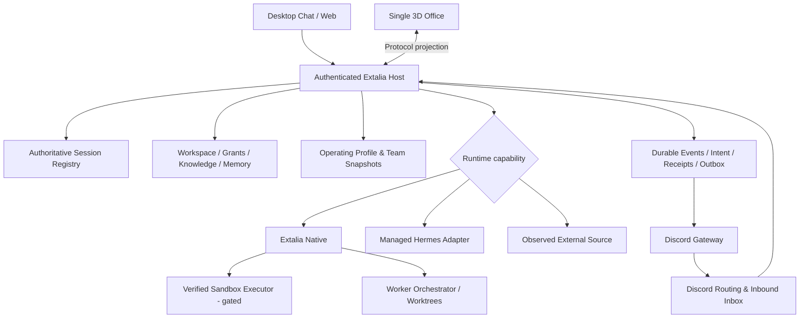

# Extalia Virtual Office — Master Product Requirements Document
## Session-First AI Workspace, Coding Workers & Discord Gateway

| Metadata | Nilai |
| --- | --- |
| Status | **In progress (Slices A & B complete & verified locally at v0.4.359; Slices C–E pending)** — Slice A1 backend (`ADR 0095` + profile `landingPage` `ADR 0096`), Slice A2 (`#127`: zero-workspace Chat UI, `Unassigned` session tree, `null → workspace` attach dialog, Chat-first default landing + lazy 3D Office), dan Slice B (`#149`, `WP-05`, `ADR 0099`: two-phase `previewProjectProvision` / `applyProjectProvision`, protected-path/symlink refusal, dirty/protected-branch Git acknowledgement, curated zero-script templates, partial-failure step receipts, Chat `ProjectProvisionDialog` & atomic `null → workspace` attach, `COD-001` unassigned proposal guidance) telah terimplementasi secara lokal; Slices C–E (isolated coding worker executor/apply, live Discord/Gateway acceptance & UI `#138`/`#142`, shared 3D Office polish) belum selesai |
| Versi dokumen | PRD-SF-1.0 |
| Tanggal | 23 November 2026 |
| Repository | [Extalia-VO/extalia-virtual-agent](https://github.com/Extalia-VO/extalia-virtual-agent) |
| Baseline kode | `main`, `package.json` v0.4.353 (terbaca saat penyusunan; bukan hasil pengujian runtime baru) |
| Milestone target | Inkremental v0.4.x → v0.5; tidak menetapkan bahwa semua cakupan masuk satu release |
| Lingkup | Desktop, Bridge/Web, Extalia Native, managed Hermes, Observe, Discord Gateway, Virtual Office 3D |
| Pemilik keputusan produk | Product owner Extalia |
| Format penyimpanan yang diusulkan | `docs/product/prd-session-first-coding-discord.md` |
| Dokumen kanonis terkait | `docs/product/prd-app-flow-and-live-agents.md`, `docs/product/prd-v2-acceptance-map.md`, ADR 0083/0084/0085, dokumentasi security/runtime |

> **Aturan interpretasi:** Dokumen ini mendeskripsikan *target state* dan perubahan yang diusulkan. Tidak boleh digunakan untuk mengklaim kemampuan yang belum lulus acceptance. PRD/ADR existing tetap kanonis untuk kontrak keamanan dan kapabilitas; perubahan yang bertentangan harus diputuskan melalui ADR dan pembaruan tracker, bukan diganti diam-diam. Contoh nama organisasi, kanal, dan project di bawah adalah ilustrasi konfigurasi pengguna, bukan data yang perlu di-hardcode ke kode atau fixture repository publik.

### Catatan Rekonsiliasi Baseline (v0.4.353)

Audit terhadap `main` pada `v0.4.353` menunjukkan fondasi yang sudah tersedia dan celah utama menuju target di atas:
- **Sudah tersedia:** Operating Profiles reusable ([ADR 0083](../adr/0083-team-and-individual-operating-profiles.md), verified locally v0.4.297), Project Session Browser ([ADR 0084](../adr/0084-project-session-browser.md), verified locally v0.4.301), Native multi-root selection & reviewed move ([ADR 0085](../adr/0085-native-session-project-roots.md)), opsi *Skip workspace* di `SetupWizard` (`apps/web/src/setup/SetupWizard.tsx`), serta satu gedung bersama 3D Office (`apps/web/src/pages/OfficePage.tsx`).
- **Celah utama:** `ChatPage.tsx` masih memblokir komposer jika `!workspace`, `SessionRecord.workspaceId` dan `createSession` masih mewajibkan `string` workspace, `resolveLandingPage` (`apps/web/src/appMode.ts`) masih mengembalikan `'office'` untuk setiap launch/setup, eksekusi perintah Native (`createCommandTool`) dan Missions Apply / integration test gate tetap fail-closed/blocked, dan Discord Gateway belum terimplementasi (0%).

---

## 1. Ringkasan Eksekutif

Extalia perlu menjadi lingkungan kerja AI *session-first*: setelah pengguna menghubungkan runtime/model, ia dapat langsung mengirim prompt tanpa terlebih dahulu membuat workspace, memilih folder, atau membangun roster subagent. Session yang tercipta bisa dikelompokkan belakangan ke workspace/project dan dapat dibuka melalui Chat, Office 3D, serta kanal eksternal yang berizin.

Extalia harus mendukung dua pola eksekusi: (1) **lead agent solo** ketika tidak ada team aktif, dan (2) **lead dengan subagents on-demand** berdasarkan Operating Profile atau override session. Satu Operating Profile dapat digunakan oleh banyak workspace tanpa membagikan memory maupun izin folder antarworkspace.

Pengguna ingin meningkatkan gateway agar Discord kategori/channel/thread dapat memetakan prompt ke workspace yang benar. **Thread baru menjadi session baru** dan mewarisi aturan routing yang sah; **thread lama melanjutkan session lama** setelah reconnect. Discord bukan pemilik independen untuk eksekusi apabila Extalia Native yang menjalankan agent. Untuk Hermes atau aplikasi agent eksternal, sumber runtime tetap pemilik eksekusi sesuai kemampuan adapter; tidak boleh ada eksekusi ganda.

Fokus produk bukan hanya visualisasi agent. Untuk kebutuhan pembuatan software, Extalia harus mengubah ide menjadi project, mengatur akses folder, mendelegasikan kerja, menghasilkan perubahan, menjalankan build/test secara aman, meminta review, dan menyampaikan bukti bahwa perubahan telah diverifikasi serta diintegrasikan. **Isolated command executor, durable worker ownership, evidence-based integration, dan recovery** adalah dependensi keamanan sebelum mengklaim coding worker siap production.

**Batasan visual:** tetap **satu building / satu scene Virtual Office**. Banyak workspace dan session berbagi scene, meja, dan resource yang sama. Tidak ada pembangunan gedung baru per kategori, workspace, atau profile pada cakupan PRD ini.

### 1.1 Keputusan produk yang sudah disepakati

| ID | Keputusan | Konsekuensi |
| --- | --- | --- |
| DEC-01 | Connection-first dan session-first | Workspace tidak wajib untuk prompt pertama. |
| DEC-02 | Workspace = konteks project pada UI | Satu workspace memuat nol hingga beberapa root/folder; tidak dibuat entitas Project terpisah dengan fungsi identik. |
| DEC-03 | 1 Operating Profile → banyak workspace | Profile mendeskripsikan cara kerja, bukan izin resource. |
| DEC-04 | 1 workspace → 1 default Operating Profile | Session dapat memilih override; tidak perlu banyak default profile sekaligus. |
| DEC-05 | Team opsional | Tanpa roster aktif: hanya lead. Roster tersedia ≠ seluruh worker harus langsung aktif. |
| DEC-06 | Discord thread ↔ satu session utama | Routing/association disimpan berdasarkan Discord IDs, bukan nama thread. |
| DEC-07 | Kategori/channel memberi *routing defaults* | Binding eksplisit atau tag resmi dapat mengalahkan default; tidak menebak dari judul bebas. |
| DEC-08 | Satu building 3D | Visual agent lintas workspace dalam shared Office; tidak menggandakan scene. |
| DEC-09 | Runtime-specific capability | Extalia Native, managed Hermes, dan Observe tidak diperlakukan seolah memiliki hak/tool sama. |
| DEC-10 | No unverified autonomous completion | Jawaban model tidak menggantikan bukti build/test/approval/integration. |

## 2. Masalah dan Peluang

### 2.1 Friksi saat ini

1. Setup dapat *skip folder*, tetapi `ChatPage.tsx` tetap menampilkan pembuatan workspace jika belum ada workspace. `createComposerSession` masih mengirim `workspaceId` wajib. Ini bukan pengalaman session-first yang utuh.
2. Pengguna yang hanya ingin bertanya/brainstorming harus memikirkan konsep project terlalu awal.
3. Operating Profile, team, workspace, runtime, dan Hermes profile berpotensi membingungkan karena beberapa konsep menggunakan kata “profile”.
4. Workspace memerlukan folder terverifikasi pada editor saat ini, sementara sebagian session tidak membutuhkan filesystem sama sekali.
5. Extalia Native sudah punya file tools dan named teams, tetapi command execution untuk produksi serta integration gate/Apply Mission belum tersedia sebagai jalur aman yang selesai.
6. Pemisahan session eksternal dari managed session dan ketiadaan binding Discord yang persisten berisiko menyebabkan context tercampur atau prompt terduplikasi.
7. Desktop dan Bridge saat ini menggunakan data root bersama dengan **satu host owner**; gateway tidak boleh menjalankan host kedua yang menulis data sama.
8. Visual 3D jangan menjadi ketergantungan eksekusi agent atau memerlukan banyak building.

### 2.2 Peluang

- Waktu dari first launch sampai first prompt lebih pendek.
- Satu session dapat dipakai lintas Chat, Office, dan Discord tanpa menggandakan pekerjaan.
- Profile bekerja reusable untuk urusan kantor dan freelance, sementara resource tetap terisolasi.
- Worker menghasilkan deliverable software yang dapat diverifikasi.
- Gateway membentuk navigasi Discord yang alami: kategori → channel/project → thread/session.

## 3. Target Pengguna dan Use Cases

| Persona | Kebutuhan utama | Contoh |
| --- | --- | --- |
| Solo operator/developer | Menjalankan satu lead agent tanpa konfigurasi team | Tanya arsitektur atau perbaiki satu bug. |
| Multi-project engineer | Memakai profil kerja yang sama dengan konteks project berbeda | Project institusi dan client freelance. |
| Multi-agent project owner | Delegasi coding/review/test pada worker terpilih | Backend + frontend + QA dalam satu session. |
| Discord-first operator | Memulai atau melanjutkan pekerjaan dari thread Discord | Thread `app-v2` ke workspace yang sudah ada. |
| Observer | Memantau Codex/Claude/Gemini/Hermes tanpa mengklaim kontrol tidak tersedia | Aktivitas coding terlihat di Office. |
| Creative user | Menulis, meriset, dan mengelola session noncoding | Workspace penulisan kreatif tanpa command executor. |

### 3.1 Contoh hierarki Discord (konfigurasi, bukan hard-code)

```text
Discord Guild
├─ General
│  └─ #general (general chat; unassigned/General context)
├─ Organization
│  ├─ #application
│  │  ├─ Thread "App V1" → workspace Application V1
│  │  └─ Thread "App V2" → workspace Application V2
│  ├─ #people-system     → default workspace People System
│  ├─ #operations        → default workspace Operations
│  └─ #infrastructure    → default workspace Infrastructure
├─ Freelance
│  ├─ #client-a          → workspace Client A
│  └─ #client-b          → workspace Client B
└─ Creative
   └─ #writing           → workspace Writing Project
```

Operating Profile `Work` boleh dipakai pada Organization **dan** Freelance; `Creative` dapat menjadi default kategori Creative. Category, channel, dan thread **tidak** secara otomatis menjadi batas keamanan: izin nyata tetap melekat pada identitas pengguna, workspace, runtime, host, serta aksi.

## 4. Tujuan, Non-Goals, dan Batasan

### 4.1 Goals

- G-01: pengguna dapat mengirim prompt pertama setelah connection siap tanpa project/workspace pilihan.
- G-02: membuat/memindahkan session ke workspace kemudian hari tanpa kehilangan history atau memberikan akses folder diam-diam.
- G-03: menyediakan Operating Profile reusable, team default, override session, dan solo default yang mudah dipahami.
- G-04: mewujudkan *complete coding loop* dari ide sampai evidence/review/integration pada runtime yang tersertifikasi.
- G-05: menyatukan session authority untuk Chat, Office, dan Discord; satu identitas session dapat dibuka melalui beberapa surface.
- G-06: memastikan routing Discord deterministik, persisten, idempotent, dan aman.
- G-07: memulihkan pekerjaan setelah crash/restart tanpa mengulang efek yang statusnya unknown.
- G-08: mempertahankan kinerja satu Office, dengan Chat tetap berguna tanpa WebGL.

### 4.2 Non-goals

- Membangun building Office tambahan, dynamic campus generator, atau editor layout bangunan.
- Menggantikan implementasi internal Hermes; Hermes tetap runtime eksternal dengan batasannya.
- Menjamin model AI mematuhi instruksi hanya karena mempunyai persona/team preset.
- Memberi shell/FS/network akses tak terbatas kepada Native maupun worker.
- Menjalankan deployment production tanpa approval eksplisit dan lingkungan eksekusi yang tervalidasi.
- Mengaktifkan semua anggota roster setiap kali prompt.
- Menjadikan Discord admin secara otomatis sebagai otoritas tunggal untuk semua aksi host lokal.
- Menganggap observed transcript atau hook sebagai bukti kontrol native atas aplikasi sumber.
- Memindahkan semua backend ke Rust atau Python demi target persentase bahasa.
- Merekam/menduplikasi secret, file penuh, atau private prompt ke Discord secara default.

### 4.3 Constraint implementasi

- Pertahankan dependency boundary `protocol ← core ← platform ← apps`; UI React hanya presentasi.
- Jangan menulis data spesifik pengguna/organisasi, token, local path pribadi, atau contoh rahasia ke repository publik.
- Simpan project files di path yang dipilih pengguna; data aplikasi tetap di root Extalia.
- Satu host pemilik data root; Desktop dan Bridge tidak boleh menulis bersamaan.
- Implementasi additive dengan migrasi backward compatible. Jangan hapus history/session lama.
- Setiap perubahan kodifikasi harus menyesuaikan PRD tracker, ADR, CHANGELOG, tests dan release gates repository.

## 5. Terminologi dan Aturan Kepemilikan

| Konsep | Definisi operasional | Pemilik konfigurasi/otoritas |
| --- | --- | --- |
| Model Provider Connection | Endpoint/credential/model catalog seperti Ollama/router/API | Host connection registry + secret store |
| Agent Runtime | Loop agent/tool: Extalia Native, managed Hermes, atau observed source | Host adapter / sumber eksternal |
| Extalia Display Profile | Nama, tema, preferensi UI; **bukan** persona agent | UI/profile settings |
| Operating Profile | Reusable purpose, personality, lead/model preference, optional team preset | Catalog `operating-profiles.json` |
| Hermes Runtime Profile | Profile native Hermes (`default`, dsb.) untuk Hermes-managed | Hermes runtime/source |
| Storage/Security Profile | Namespace storage/vault yang mungkin terisolasi | Host/daemon policy |
| Workspace / Project | Konteks izin, file roots, Knowledge, memory, team/profile default | Extalia host |
| Project Root | Salah satu folder yang terdaftar dalam workspace | Workspace grants |
| Session | Identitas conversation/turn, model history, events, binding | Owner runtime/session registry |
| Execution Snapshot | Target runtime/model/team/permission/context yang dibekukan untuk admission turn | Host |
| Lead | Agent utama per managed session | Runtime yang menjalankan session |
| Subagent | Worker yang didelegasikan dari lead; punya invocation/ownership sendiri | Runtime dan supervisor |
| External Surface Binding | Relasi Discord thread atau observed source ke session, bukan pemindahan eksekusi | Gateway + host registry |

**Aturan penting:** `Operating Profile ≠ Hermes Profile ≠ Display Profile ≠ Storage Profile`. Rename label UI yang ambigu, tetapi jangan menyatukan data/authority yang berbeda.

## 6. Alur Produk End-to-End

### UJ-01 — Fresh install → first prompt

1. Install Desktop atau CLI Bridge, host berjalan atau menampilkan diagnosa jika belum siap.
2. Pilih **Extalia Native + Provider Connection**; atau **Managed Hermes** jika tersedia; atau **Observe-only**.
3. Untuk Native, test endpoint, pilih model, dan validasi model minimal dengan jalur test yang tidak mengklaim semua capability.
4. Masuk ke **New Session composer**. Tidak ada form workspace/team yang wajib.
5. Pengguna mengirim prompt; host menyimpan satu session id secara idempotent dan memproses pesan.
6. Jika belum ada project, jalankan dengan **no project filesystem grant**, tanpa fallback ke `$HOME`, working directory host, atau path arbitrer.
7. Tampilkan session pada Chat dan, bila Office dibuka, pada representasi agent di satu building.

### UJ-02 — Prompt menjadi project baru

1. Pengguna: “Buat project inventory Laravel + Vue.”
2. Lead mengusulkan tujuan, stack, struktur project, lokasi folder, dan langkah verifikasi; hanya tanyakan keputusan esensial.
3. Pengguna memilih/create folder melalui UI host yang terverifikasi.
4. Host menampilkan **Project Creation Review**: path konkret, tindakan (`mkdir`, optional `git init`), trust, runtime, izin read/write/command, dan batas sumber daya.
5. Setelah approval, host membuat/register workspace dan project root secara atomik sejauh operasi memungkinkan; status partial dirinci bila gagal.
6. Session yang sudah ada menjalani **move/binding review**, memperoleh execution snapshot baru untuk turn mendatang; history tidak hilang.
7. Lead melanjutkan coding sendiri atau mendelegasikan pekerjaan; command hanya tersedia jika executor lulus gate.
8. Hasil akhir menampilkan files changed, test evidence, approval, dan integration receipt; tidak mengklaim selesai jika hanya generated draft.

### UJ-03 — Project existing + multi-folder

1. Pengguna menghubungkan satu workspace ke primary folder dan hingga batas additional roots yang didukung.
2. Session memilih salah satu root yang sudah terdaftar untuk relative path base.
3. Shared knowledge/workspace identity tetap sama; root selection tidak menambah grants.
4. Pergantian root untuk session idle ditinjau jika memengaruhi akses; reference file historical tetap terkait root historis.
5. Perubahan folder yang memengaruhi grants mengharuskan review sebelum next-turn execution.

### UJ-04 — Session/team per prompt

1. Tanpa team aktif: satu lead, tidak melakukan delegasi.
2. Dengan saved roster: lead memilih anggota yang dibutuhkan; tidak otomatis memanggil seluruh roster.
3. Pilihan session: `Solo`, `Use profile/workspace team`, `Custom team`.
4. Perubahan team/model sesudah pekerjaan dimulai berlaku pada **turn berikutnya**, bukan mutasi diam-diam terhadap worker sedang berjalan.
5. Solo fallback **bukan** substitusi model/provider diam-diam ketika dependency/credential rusak.

### UJ-05 — Discord thread baru dan lama

1. Event Discord diterima dari guild/channel yang di-allowlist.
2. Gateway memverifikasi actor, dedupe message ID, lalu mencari binding thread yang persisten.
3. Jika tidak ada binding: resolve route berdasarkan override eksplisit → forum tag → channel → category → safe unassigned.
4. Setelah route sah, buat session satu kali pada owner yang dipilih, simpan Discord binding dan inbox intent; retry *create* harus idempotent.
5. Kirim prompt ke target yang sama. Jika lead sibuk, antrekan sesuai per-session policy; jangan menghidupkan lead paralel untuk session yang sama.
6. Stream/status yang boleh dibagikan diproyeksikan ke Discord dengan correlation ID.
7. Saat thread lama aktif kembali/reconnect: gunakan session binding lama; jangan buat session kedua.
8. Perubahan nama/arsip thread tidak mengganti identity. Pindah workspace memerlukan review dan audit trail.

### UJ-06 — Office 3D tetap satu building

- Semua lead/worker session dalam satu spatial scene; tidak satu gedung per profile/workspace.
- Avatar mewakili **execution instance yang valid**, bukan hanya roster bernama; cegah duplikasi antar Discord dan Chat.
- Idling, waiting, active, completed, absent divisualkan dari event nyata; tidak menampilkan avatar berstatus bekerja semata karena history ada.
- Project/workspace filtering adalah tampilan, bukan operasi yang menghentikan worker atau membuka data.
- Jika WebGL tidak tersedia, seluruh fungsi Chat/approval/worker tetap tersedia di mode 2D.

## 7. Functional Requirements

**Penanda prioritas:** P0 = gate wajib untuk jalur utama; P1 = penting untuk penggunaan harian; P2 = peningkatan. Status semua requirement baru di dokumen ini **Proposed** kecuali disebut *Existing foundation*; status tidak menyiratkan lulus E2E.

### 7.1 INS — Installer, connection, onboarding

| ID | Pri | Requirement & acceptance ringkas |
| --- | --- | --- |
| INS-001 | P0 | First-run wizard cukup membuat pilihan runtime dan koneksi yang benar-benar diperlukan; tidak mewajibkan workspace/team. |
| INS-002 | P0 | Native model connection wajib ditest sebelum dipakai; bedakan endpoint reachable, model listed, inference tested, tool capability verified. |
| INS-003 | P0 | Hermes/Observe tidak dipaksa membuat provider connection Native; tunjukkan kapabilitas spesifik runtime. |
| INS-004 | P0 | Sesudah setup berhasil, default landing adalah New Session/Chat; Office tetap satu klik dan last-view dapat dipilih pengguna. Perubahan perilaku launch existing harus dicatat di ADR karena PRD lama mewajibkan Office. |
| INS-005 | P0 | Setup failure recovery: Retry, diagnostics yang disanitasi, restart host, dan switch runtime tanpa merusak setup existing. |
| INS-006 | P1 | Deteksi dependency/platform (Node/Bridge/Electron/Hermes/daemon), secret-store availability dan konflik host lock. |
| INS-007 | P1 | Update + restart tidak memutus work yang masih memiliki ownership aktif; restart mengikuti reviewed recovery. |
| INS-008 | P2 | Clean-machine installer acceptance di macOS/Windows/Linux, termasuk kebijakan signing/notarization yang berlaku per channel. |

### 7.2 SES — Session-first dan continuity

| ID | Pri | Requirement & acceptance ringkas |
| --- | --- | --- |
| SES-001 | P0 | New composer tersedia tanpa workspace buatan pengguna. |
| SES-002 | P0 | Session id dibuat pada first send atau explicit supported create; composer kosong bukan session tersimpan tanpa alasan. |
| SES-003 | P0 | `workspaceId` optional pada target domain; fase kompatibilitas boleh memakai internal unassigned context *tanpa* grant filesystem. Tidak ada default path implisit. |
| SES-004 | P0 | Managed session punya satu authoritative runtime/session owner. External source tetap source-owned untuk Observe. |
| SES-005 | P0 | Move workspace menjaga session ID, transcript, event lineage dan provenance; izin destination wajib direview. |
| SES-006 | P0 | Session menahan runtime/model/team/profile **snapshot** sesuai waktu admission. Changing defaults tidak mengubah pekerjaan aktif. |
| SES-007 | P0 | Per-session admission serializes mutating prompts/side effects; queued dan running memiliki receipt berbeda. |
| SES-008 | P0 | Crash/timeout/unknown tidak memicu prompt/tool replay otomatis tanpa bukti zero-effect yang sah. |
| SES-009 | P1 | Session dapat dibuka dari Chat, Office dan Discord tanpa duplikasi identity/character. |
| SES-010 | P1 | Resume history, rename, archive, search, move, restore dan deletion memenuhi source-bound tombstone policy. |
| SES-011 | P1 | Session metadata menunjukkan owner runtime, workspace, selected project root, profile source/revision dan team mode. |
| SES-012 | P1 | Multi-entry concurrency ditangani dengan revision/cursor, tidak dengan last-write-wins pada message. |

### 7.3 WRK — Workspace dan project roots

| ID | Pri | Requirement & acceptance ringkas |
| --- | --- | --- |
| WRK-001 | P0 | Workspace internal identik dengan konteks Project di UI; satu workspace punya satu primary folder jika file access diperlukan dan dapat punya additional roots. |
| WRK-002 | P0 | Workspace dapat merepresentasikan konteks non-file (0 folder) hanya jika semua file/tool grants benar-benar deny; validasi tidak mengarang path placeholder. |
| WRK-003 | P0 | `Create Project` menampilkan lokasi/name/ops preview dan meminta izin sebelum folder dibuat atau repo diinisialisasi. |
| WRK-004 | P0 | `Attach existing Project` memeriksa canonical path, ownership dan permission; symlink/protected path disaring. |
| WRK-005 | P0 | Workspace mempunyai satu default Operating Profile dan optional scoped overrides. |
| WRK-006 | P0 | Cross-workspace read/write authority tetap dua-sisi dan tidak ikut ditransfer dari team/profile. |
| WRK-007 | P1 | Native session bisa memilih registered project root tanpa membuat workspace baru; cross-workspace transfer tetap reviewed. |
| WRK-008 | P1 | Workspace organization metadata dapat menyimpan category/tag/source tanpa menjadikannya principal keamanan. |
| WRK-009 | P1 | File root yang hilang/unavailable menahan next execution; tidak fallback ke folder lain. |
| WRK-010 | P2 | Project templates/scaffolding recipes dikurasi dan versioned; import template tidak mengeksekusi arbitrary script tanpa executor gate. |

### 7.4 PRF — Operating Profile dan team inheritance

| ID | Pri | Requirement & acceptance ringkas |
| --- | --- | --- |
| PRF-001 | P0 | Reuse satu Operating Profile di banyak workspace; Organization/Freelance bisa memakai `Work` yang sama. |
| PRF-002 | P0 | Operating Profile tidak menyimpan atau memberikan filesystem grants, secrets, vault ACL maupun workspace memory scope. |
| PRF-003 | P0 | Resolution precedence: profile defaults → workspace overrides → session explicit choices. |
| PRF-004 | P0 | `team: null` atau roster tidak aktif membuat session solo; tidak memanggil generic delegates tanpa roster. |
| PRF-005 | P0 | Snapshot profile name/id/revision dan effective model/lead/team untuk session baru; perubahan preset berlaku ke session baru. |
| PRF-006 | P1 | Team editor menyediakan per-member role, task, persona, model/order, approved connection policy pada Native. |
| PRF-007 | P1 | Team editor untuk Hermes hanya mengekspos kemampuan yang benar-benar dimiliki Hermes, bukan Native multi-provider routing. |
| PRF-008 | P1 | Per-session team toggle dan lead personality dapat diubah saat idle, berlaku next turn, dengan concurrency checks. |
| PRF-009 | P1 | UI label membedakan Operating Profile, Hermes Profile, display preference, dan Knowledge vault profile. |

### 7.5 COD — Coding agent dan project creation

| ID | Pri | Requirement & acceptance ringkas |
| --- | --- | --- |
| COD-001 | P0 | Lead dapat menjelaskan batas kemampuan dirinya dan menawarkan project plan sebelum membutuhkan folder grant. |
| COD-002 | P0 | Provision project direview oleh pengguna (path, actions, runtime, tool scope); partial failure tercatat, tidak ditutup sebagai sukses. |
| COD-003 | P0 | Read/search/write tools tetap dibatasi canonical registered roots dan secret policy. |
| COD-004 | P0 | Production command executor hanya diaktifkan setelah OS-specific verified isolation, resource/time limits, process-tree fencing, tool approval, dan evidence. |
| COD-005 | P0 | Commands untuk install/test/build/migrate harus memiliki cwd yang dipin, environment minimal, stdout/stderr redacted/bounded, timeout, dan cancellation/settlement. |
| COD-006 | P0 | Untuk tindakan destruktif atau keluar scope: explicit exact-action approval; default deny dan revoke harus efektif sampai effect-time. |
| COD-007 | P0 | Agent tidak dapat menaikkan permission/capability dari instruksi prompt, hasil tool, profile, maupun Discord message. |
| COD-008 | P0 | Build/test report membedakan `not_run`, `passed`, `failed`, `timed_out`, `unknown`; model text bukan test evidence. |
| COD-009 | P1 | Project-specific setup scripts/skills diberi approval dan integrity/provenance sebelum use; dependency install tidak berjalan otomatis hanya dari membaca README. |
| COD-010 | P1 | New project dapat di-git-init setelah approval; existing dirty repository harus mempertahankan user changes. |
| COD-011 | P1 | Include small verified vertical-slice acceptance: scaffold → edit → test → review → integrate. |

### 7.6 AGT — Delegation, worker, mission, merge

| ID | Pri | Requirement & acceptance ringkas |
| --- | --- | --- |
| AGT-001 | P0 | Lead memilih solo atau named team; delegation on-demand ke worker yang role/scope sesuai tugas. |
| AGT-002 | P0 | Worker invocation memiliki owner, run/generation ID, task ID, pinned capability, lease, dan lifecycle event. |
| AGT-003 | P0 | Duplicate dispatch/reconnect tidak membuat worker baru untuk task yang sama tanpa verified intent. |
| AGT-004 | P0 | Cancellation tidak dianggap settled sebelum process/model/tool ownership benar-benar dibuktikan selesai/diisolasi. |
| AGT-005 | P0 | Write-capable Mission worker bekerja di isolated Git worktree, bukan checkout pengguna, sampai review selesai. |
| AGT-006 | P0 | Worker result di-join dengan evidence; dependency task tidak otomatis dibuka hanya dari jawaban model. |
| AGT-007 | P0 | Integration gate menjalankan test melalui executor tersertifikasi; tanpa gate evidence, proposal tidak boleh diterapkan. |
| AGT-008 | P0 | Apply memerlukan status tested/ready, target revision fresh, diff digest yang cocok, dan user approval; no force push/reset. |
| AGT-009 | P0 | Conflict/stale target/protected branch menunjukkan review dan replan; tidak silent overwrite. |
| AGT-010 | P1 | Backpressure, per-session/provider concurrency, model budgets, dan worker capacity disajikan sebagai queued/waiting. |
| AGT-011 | P1 | Worker model fallback dibatasi explicit approved connection/model lists; missing credentials fail closed. |
| AGT-012 | P1 | Activity panel menampilkan task graph, siapa mengerjakan, files changed, logs yang disanitasi, test receipts dan cost estimates dengan provenance. |

### 7.7 DIS — Discord Gateway dan routing

| ID | Pri | Requirement & acceptance ringkas |
| --- | --- | --- |
| DIS-001 | P0 | Discord adapter optional; disabled by default, with explicit bot connection and per-guild/channel allowlist. |
| DIS-002 | P0 | Mapping menggunakan snowflake IDs: guild/category/channel/thread/message; rename tidak mengganti identity. |
| DIS-003 | P0 | Satu thread aktif berasosiasi dengan satu session utama; session baru dibuat pada first eligible message jika belum bound. |
| DIS-004 | P0 | Existing thread resumes same binding after gateway/host restart; binding persistence transactional/idempotent. |
| DIS-005 | P0 | Priority route: explicit thread binding → approved thread override/forum tag → channel default → category default → unassigned safe context. |
| DIS-006 | P0 | Routing conflict, missing workspace, invalid grants, deleted project, role mismatch => refuse or request review; never guess from thread title. |
| DIS-007 | P0 | Map Discord actor/role to Extalia-authorized capabilities; role changes/revocation checked saat dispatch/effect. |
| DIS-008 | P0 | Inbound message dedupe, ordered per-session queue, outbox receipts dan no automatic replay unknown effects. |
| DIS-009 | P0 | A single message tidak boleh dieksekusi sekaligus oleh gateway Hermes dan Extalia Native; declare execution owner per binding. |
| DIS-010 | P0 | Tidak meneruskan secrets, private file content, raw credentials, atau output berbahaya ke channel yang tidak sesuai. |
| DIS-011 | P1 | Slash command minimal: `/session status`, `/session new`, `/project list`, `/project link`, `/project unlink`, `/team solo`, `/team preset`, `/help`. Command yang mengubah authority perlu konfirmasi. |
| DIS-012 | P1 | Forum tags boleh mapping ke workspace ID; judul thread hanya label non-authoritative. |
| DIS-013 | P1 | Discord message non-thread: default hanya channel-level General session *atau* ajakan membuat thread; policy dipilih per channel agar tugas tidak tercampur. |
| DIS-014 | P1 | Outgoing Discord update: accepted, queued, running, failed/unknown, completed, evidence ready; throttle/edit replies agar tidak spam. |
| DIS-015 | P1 | DM default disabled; multiple guild tidak bergabung hanya karena nama channel sama. |
| DIS-016 | P2 | Channel adapter abstractions memungkinkan Telegram/Slack nanti tanpa menambah hak keamanan secara implisit. |

### 7.8 OFF — Shared single-building Office

| ID | Pri | Requirement & acceptance ringkas |
| --- | --- | --- |
| OFF-001 | P0 | Hanya satu existing building/scene. Tidak ada per-profile building auto-provision. |
| OFF-002 | P0 | Chat/Discord session sama = execution identity/character yang sama; tidak membuat avatar ganda dari surface. |
| OFF-003 | P0 | No-WebGL fallback menampilkan Chat/session/approval tetap lengkap. |
| OFF-004 | P1 | Office filter by workspace/category/session/team/status tidak mengubah runtime execution maupun ACL. |
| OFF-005 | P1 | Hanya active/queued worker yang divisualisasi sesuai status; roster dormant bukan active instance. |
| OFF-006 | P1 | Adaptive rendering, LOD, texture sharing, frame budget, avatar pooling, inactive-scene throttling. |
| OFF-007 | P2 | Working/meeting/idle/absent animations mengikuti authoritative events; tidak menggambarkan aksi yang belum berlangsung. |

### 7.9 REL — Reliability, migration, observability

| ID | Pri | Requirement & acceptance ringkas |
| --- | --- | --- |
| REL-001 | P0 | Versioned schema migrations dan backup/rollback sebelum perubahan persisted data. |
| REL-002 | P0 | Restart dengan running/unknown tasks menahan replay dan menampilkan recovery inspection. |
| REL-003 | P0 | Session, binding, queue/outbox dan task events memiliki correlation/revision yang dapat diaudit. |
| REL-004 | P0 | Hanya satu host boleh memiliki data root; gateway menggunakan host API authenticated, bukan write ke file profil langsung. |
| REL-005 | P0 | Secret redaction, non-public data isolation, import/handover source safety tetap terjaga. |
| REL-006 | P1 | Host diagnostics menampilkan runtime target, provider status, orphaned worktrees, queue lag dan connector errors. |
| REL-007 | P1 | Long-running/reconnect acceptance dengan Discord outage, host update, dan provider timeout. |
| REL-008 | P1 | EN/ID UX, keyboard/screen-reader accessible approval, responsive mobile/desktop. |
| REL-009 | P1 | Per-model usage membedakan provider-reported, estimated, dan unknown; harga/kurs hanya dari data berprovenansi. |
| REL-010 | P2 | Export/import lengkap melalui preview dan restore test, tanpa menulis ke source apps. |

## 8. Arsitektur yang Diusulkan

### 8.1 Logical architecture



**Penjelasan:** 3D Office hanya konsumen projection. Gateway adalah channel adapter yang berkomunikasi dengan host owner. Observed external source tetap memerlukan source-bound control capability untuk aksi, tidak otomatis bisa diprompt seperti Native.

### 8.2 Pilihan implementasi Unassigned Session

Dua alternatif kompatibel:

- **Alternatif A — Transitional:** buat satu **host-owned unassigned context** tersembunyi per storage/profile scope, **tanpa project path/grants**. Session tetap punya `workspaceId` valid selama API legacy mensyaratkannya. Harus diberi system flag dan ditolak oleh file tool; jangan menyiasatinya dengan `$HOME`/temp sebagai grant.
- **Alternatif B — Long-term preferred:** ubah schema/API `workspaceId?: string | null`; authorization dan service mampu menjalankan model conversation-only tanpa filesystem. Pindah ke workspace harus melalui explicit binding review. Semua konsumen host/Chat/Office/mission perlu dapat menangani `null`.

**Keputusan teknis:** implementasikan A hanya jika dapat dibuktikan *no grant* dan kompatibilitas tanpa celah; target akhir B lebih jelas. Buat ADR sebelum memilih. Jangan menghapus field wajib lama tanpa migration plan dan seluruh kontrak siap.

### 8.3 Data entities / persistence (skema konseptual)

```text
Connection(id, runtime/provider metadata, modelPolicy, features, secretRef)
OperatingProfile(id, revision, purpose, personality, defaults, optionalTeam)
Workspace(id, name, primaryRoot?, additionalRoots[], grants,
          operatingProfileId?, operatingOverrides?, memoryScope, vaultBinding)
Session(id, ownerKind, ownerRuntime, runtimeSessionRef?, workspaceId?,
        projectRootOverride?, source, state, createdAt, lastActiveAt,
        operatingSnapshot?, effectiveTeam?, effectiveModel?, permissionSnapshot?)
SessionTurn(id, sessionId, clientRequestId, status, admissionRevision, startedAt?, settledAt?)
WorkerInvocation(id, parentTurnId, taskId, generation, owner, capabilityHash, state)
ExternalSurfaceBinding(id, surfaceKind, guildId, channelId, threadId?,
                       sessionId, workspaceId?, runtimeOwner, routeRevision, state)
DiscordRouteRule(id, guildId, scopeKind, scopeId, tagId?,
                 workspaceId?, operatingProfileId?, teamMode?, priority,
                 enabled, revision)
InboundMessageIntent(id, sourceMessageId, bindingId, payloadRef, status, receipt)
OutboundDelivery(id, sessionEventCursor, destinationId, redactedPayloadRef,
                 status, attempts, remoteMessageId?)
ExecutionReceipt(id, turnId, taskId?, actionDigest, effectState, testEvidence?, actor, timestamp)
```

Ini **bukan** klaim tabel sudah tersedia. Detail relasi, schema location, retention, dan storage ownership ditetapkan pada ADR. Prefer durable store transaksional untuk binding, queue dan idempotency dibanding membaca/menulis sendiri ke JSON state dari Gateway. Semua foreign reference divalidasi oleh host.

#### Constraint wajib data

1. `UNIQUE(surfaceKind, guildId, threadId)` untuk binding thread jika `threadId` ada; gunakan identity tuple deterministik untuk channel-level session.
2. `UNIQUE(guildId, channelId, messageId)` untuk inbound Discord; dedup identitas upstream.
3. `UNIQUE(sessionId, clientRequestId)` untuk first-send/admission; client retry tidak menggandakan turn.
4. `runtimeOwner` pada binding menentukan hanya satu driver yang boleh menjalankan prompt yang sama.
5. `workspaceId` dan `sessionId` pada binding tidak boleh berubah tanpa reviewed operation + revision check.
6. Tidak menyimpan Discord bot token di table session/routing; gunakan existing host secret store.
7. Message content dan file references mempunyai retention/visibility policy; jangan broadcast ke Office atau Discord sebelum scope check.
8. Unknown state dan pending intent tidak dianggap success; no blind replay of side effects.

### 8.4 Runtime capability matrix (target UI contracts)

| Kemampuan | Extalia Native | Managed Hermes | Observe Codex/Claude/Gemini/Hermes |
| --- | --- | --- | --- |
| Prompt/manage session | Ya, host-owned | Ya jika adapter Hermes mendukung | Hanya verified source-bound control, tidak universal |
| Team dengan model berbeda per member | Sesuai grants Native | Ikuti delegation Hermes, tidak menjanjikan per-member routing Native | Ikuti app sumber, default read-only |
| Workspace Native file grants | Native host-owned | **Tidak** membatasi tools Hermes secara setara | Tidak otomatis ada grant |
| Command executor tersandbox | **Gated; belum production-ready** | Mengikuti tools/izin Hermes sendiri | Mengikuti source app sendiri |
| Mission worktree/apply | Wajib gate Native | Tidak otomatis kompatibel | Observasi/handover saja tanpa capability eksplisit |
| Discord inbound prompt | Jika session owner Native | Jika bound ke managed Hermes supported route | Refuse tanpa source-bound supported route |

## 9. State Machines, Ownership, dan Eksekusi

### 9.1 Session / turn state

```text
new draft (UI only)
   -> admitted (saved id + intent)
   -> queued
   -> running
   -> completed | failed | cancelled | unknown

completed + changes
   -> evidence_pending
   -> verified | verification_failed | verification_unknown
   -> review_pending
   -> integrated | rejected | stale
   -> delivered (channel receipt; jika diwajibkan)
```

`completed` hanya berarti turn model/task selesai, **bukan** build lulus, branch digabung, atau pesan Discord sampai ke tujuan.

### 9.2 Worker state

`registered/preset` → `invoked` → `admitted` → `queued` → `running` → `settling` → `completed/failed/cancelled/unknown`. Worker `unknown` dibatasi dari reuse/cleanup sampai reconciliation yang benar-benar cukup. Jangan tampilkan roster `registered` sebagai avatar pekerja aktif.

### 9.3 Keamanan saat host mati/restart

- Persist intent/ownership sebelum external effect sesuai authority path.
- Bedakan *queued not dispatched* dari *dispatch may have happened*.
- Pada status ambiguous, blokir replay dan tampilkan recovery inspection.
- Timeout request tidak mengindikasikan provider/tool berhenti.
- Perubahan grants, connector status dan role revoke dievaluasi ulang sebelum next effect.
- Jangan menciptakan audit receipt palsu demi menyelesaikan state machine.

## 10. Discord Routing Specification

### 10.1 Routing priority

```text
1. Existing approved binding (guild + thread identity)   [authoritative]
2. Explicit thread override approved by authorized actor
3. Discord Forum tag mapping (unambiguous & approved)
4. Parent channel default workspace
5. Category default profile/workspace (jika spesifik dan sah)
6. General / unassigned no-filesystem context
7. Ambiguous/forbidden => ask review / reject
```

Jika beberapa forum tag menunjuk workspace berbeda, **jangan** memilih secara acak. Discord guild/category default terutama untuk selection awal; workspace permission tetap dicek terpisah. Message dalam parent text channel tanpa thread mengikuti channel policy (`channel-session`, `require-thread`, atau `ask`) supaya percakapan proyek tidak bercampur.

### 10.2 Binding lifecycle

- **Create:** pada pesan eligible pertama atau `/session new`; resolve routing; persist satu source binding dan satu authoritative session.
- **Resume:** thread yang sama → session yang sama, meski proses bot restart, Discord thread diarsipkan/dibuka lagi atau namanya diganti.
- **Override:** `/project link` pada active binding hanya oleh role/actor authorized, setelah workspace access review dan idle/queue settlement.
- **Unlink:** tidak menghapus session source/histori; hilangkan relationship dan jelaskan destination next messages.
- **Delete:** mengikuti retention + source-specific tombstone; jangan menghapus source Discord thread saat Extalia session dihapus kecuali user meminta melalui fitur berbeda.
- **Recreate:** thread ID baru → session baru walaupun judul sama.

### 10.3 Minimum gateway permissions

- Discord actor dipetakan ke registered/approved operator identities; identitas bukan nickname/avatar.
- Per-guild allowlist; per-category/channel read/send allowlist; optional per-project allowlist.
- Role mapping tidak cukup sebagai izin file edit atau command: action approval mengikuti host policy dan verified identity.
- Bot tidak menerima DM atau undangan arbitrary guild secara default.
- File attachment Discord dianggap untrusted; size/type/credential checks dan temp retention diterapkan sebelum model melihatnya.
- Tidak kirim source code, logs, env, maupun hasil pemeriksaan rahasia ke channel publik secara default.
- Developer/server secrets tidak dipost ke Discord dan tidak muncul di output diagnostik.

### 10.4 Slash commands minimal

| Command | Tujuan | Boundary |
| --- | --- | --- |
| `/session status` | Tampilkan owner, status, workspace, queue dan receipt | Read-only authorized |
| `/session new` | Memulai session baru pada thread baru/current authorized scope | Idempotent + konfirmasi jika reset binding |
| `/project list` | Daftar workspace yang actor boleh lihat | Scope filtering |
| `/project link` | Bind thread ke workspace | Review destination + grant rules |
| `/project unlink` | Lepas routing ke workspace | Tidak delete session/source |
| `/team solo` | Disable team untuk next turn | Idle/transition safe |
| `/team preset` | Pilih approved preset untuk next session/turn | Runtime capability validation |
| `/help` | Panduan dan batas yang berlaku | No privileged data |

### 10.5 Discord → Extalia → Discord delivery

1. Gateway memvalidasi signature/event source sesuai Discord transport yang dipakai.
2. Persist dedupe key + inbound intent, kemudian terima/ack event sesuai kebutuhan transport.
3. Resolve binding dan authorize actor.
4. Enqueue exact session prompt dengan stable idempotency key.
5. Host memberi `accepted/queued/running/settled/unknown` receipt berbeda.
6. Outbox menghasilkan reply yang di-redact, di-throttle, di-split berdasarkan limit Discord; simpan remote message ID untuk edit/update.
7. Retry outbound **delivery** aman berbasis dedupe/remote message ID; jangan retry *model execution* dari outbound failure.
8. Connector outage menahan outbox menurut retention policy; backlog dan dead-letter terlihat pada diagnostics.

## 11. Security, Privacy, dan Trust Boundaries

| Ancaman | Kontrol wajib |
| --- | --- |
| Workspace Organization bocor ke Freelance dengan profile sama | Operating Profile tidak mengandung grants; workspace namespace, ACL, Knowledge/memory scope terpisah. |
| Prompt injection dari Discord, README, web, attachment | Untrusted content tidak menjadi system policy/permission. Tool side effects lewat host authorization. |
| Host command dapat membaca seluruh filesystem | Verified isolated executor + boundary enforcement, minimal env, OS isolation, no unrestricted fallback. |
| Model meminta deploy/push/delete | Exact scoped approval, command preview, immutable digest, fresh actor rights. |
| Duplicate Discord message | Dedup source ID + idempotent admission; uncertainty blocks replay. |
| Discord role revoked saat task queued | Revalidate actor authorization before dispatch/effect. |
| Session dipindahkan tanpa review | Revision-bound workspace move + folder scope preview. |
| Secret tertulis dalam chat/log | Redaction, secret store, audience checks, opt-in sharing, limited retention. |
| Gateway dan Desktop menulis profil sama | Single host writer; gateway via authenticated API only. |
| Worker crash meninggalkan child process | Supervisor ownership, full process tree settlement, orphan quarantine/reconciliation. |
| Git worktree bercampur branch user | Isolated worker checkout, CAS/diff digest, no force, test evidence sebelum apply. |
| Sandbox tersedia pada satu OS saja | Per-platform capability manifest; unsupported OS fail closed, tidak silent downgrade. |

### 11.1 Approval model

- Approval memuat `actor`, `session`, `workspace`, `action`, `target`, `arguments/diff digest`, `expiry`, dan `generation` yang tepat.
- Permission `ask` tidak sama dengan `allow`; `allow` tidak membebaskan security deny/protected-path rules.
- Approval dari Discord untuk tindakan yang mempunyai side effects berisiko tinggi **nonaktif pada MVP** sampai identity pairing + signature/one-time challenge + replay/revocation acceptance selesai; approval Desktop/host tetap jalan utama.
- Tidak ada `--yolo`/unrestricted backend mode otomatis saat memilih profile/team.
- Platform runtime berbeda tidak boleh mewarisi permission Native sebagai klaim sandbox eksternal.

## 12. Model, Team, Budget, Memory, dan Knowledge

### 12.1 Profile inheritance

```text
OperatingProfile defaults
       ↓
Workspace configured overrides
       ↓
Session explicit choice
       ↓ (snapshot at admission)
Lead + optional named worker invocations
```

Default UX saat no-profile/no-roster: `Solo`. `Auto` jika dipakai UI berarti **delegasi on-demand dari roster yang sudah ada/authorized**, bukan model bebas menciptakan worker baru dengan akses tak terbatas. Auto-team planning/generative roster tetap perlu review eksplisit sebelum menjadi saved team.

### 12.2 Budget & workload policy

- Model main, per-worker approved provider connections, fallback order, token/turn caps, concurrency limits, request timeouts.
- Batas job concurrency tidak menjamin biaya; actual cost hanya dihitung jika price table dan provider usage valid. Unknown usage ditampilkan unknown, bukan nol.
- Graceful `budget_exhausted` menghentikan admission baru tetapi tidak mengklaim membatalkan call provider yang masih berjalan.
- Profile tidak boleh menaikkan budgets atau grants di luar batas host/workspace.

### 12.3 Context isolation

- Session history untuk conversational continuity.
- Workspace memory/Knowledge untuk konteks project yang *diotorisasi*.
- Operating Profile hanya memuat cara kerja/personality/defaults, bukan kopian kode project.
- Shared skill registry mengikuti approval dan scanner gate; pilihan profile bukan aktivasi skill otomatis.
- Saat Discord category Organization dan Freelance memakai `Work`, tidak boleh ada cross-workspace recall kecuali mekanisme sharing yang independen dan disetujui.
- Handover dari observed source harus menandai provenance serta menahan tool history dari execution replay.

## 13. Desain UI / Information Architecture

### 13.1 First launch

```text
Welcome
  → Runtime: Extalia Native | Hermes | Observe
  → Native: Provider connection / test / model
  → Start working (Chat composer)
  → Optional: Choose project / Agent profile / Team / Open Office
```

Tidak tampil wizard project wajib. `Connect external apps`, `Skills`, `Knowledge`, `Settings` tetap bisa dicapai belakangan.

### 13.2 New Session composer

- Primary: input prompt, file attachment, Send.
- Compact selectors: Runtime/Connection & Model (jika ada), Workspace (`No project` default), Profile (`Default`/chosen), Team (`Solo`/`Profile team`/`Custom`).
- Advanced controls disembunyikan sampai perlu; pilih per-message hanya apabila effect didukung adapter.
- Jika user meminta file coding tanpa grants, UI menawarkan `Create project` / `Open existing` / `Continue planning without files`, bukan error membingungkan.
- Session metadata setelah first send menunjukkan source surface (`Desktop`, `Web`, `Discord`), owner, workspace, dan review state.

### 13.3 Navigation tree

```text
Sessions
├─ Unassigned
│  ├─ Ask about architecture
│  └─ Draft project plan
├─ Workspace: Application V2
│  ├─ Folder: app/ or registered root A
│  │  └─ Session: Surat keluar
│  └─ Folder: gateway/ or registered root B
│     └─ Session: API sync
├─ Workspace: People System
└─ Workspace: Writing Project
```

Existing Native tree `workspace → registered project folder → saved session` dan Observe source tree harus tetap kompatibel. Jangan mengubah external observed project grouping menjadi filesystem grant tanpa review.

### 13.4 Office UI

- Single building with filter `All`, `Workspace`, `Team`, `Status`, `Source`.
- Presence panel berdasarkan active instances dan confirmed lifecycle, bukan jumlah profile/team roster.
- Klik avatar membuka exact session; jika source Discord, tampilkan origin dan latest delivery receipt.
- Ringan saat GPU terbatas: avatar cap/virtualization, reduced motion, static fallback, no-WebGL path.
- Office boleh di-background tanpa menghentikan host worker.

## 14. Non-Functional Requirements dan Target Pengukuran

**Target di bawah adalah usulan acceptance untuk diukur, bukan angka performa yang sudah terbukti.** Milestone gate yang sudah ada tetap berlaku jika lebih ketat.

| ID | Kualitas | Target/verifikasi |
| --- | --- | --- |
| NFR-01 | First-run simplicity | Satu test connection dan first prompt tanpa workspace; wizard jalur pendek tervalidasi oleh usability test. |
| NFR-02 | Safety | Nol unauthorized file/command effects dalam regression suite lintas boundary, symlink, role revoke, workspace move. |
| NFR-03 | Idempotency | 100% duplicate event fixture menghasilkan satu session binding dan maksimal satu admitted execution. |
| NFR-04 | Recovery | Crash fixtures: tidak ada double-dispatch unknown side effects; pending/unknown/settled dapat dibedakan. |
| NFR-05 | Event propagation | Sasaran awal local host→UI p95 <1 detik pada benchmark spesifik; laporkan kondisi uji. |
| NFR-06 | Discord delivery | Inbound ack, queue, response lag diukur end-to-end; catat API rate-limit dan outage, jangan menjanjikan SLA tanpa benchmark. |
| NFR-07 | Performance | 1 building; benchmark target minimal 30 FPS untuk workload 20 avatar pada perangkat representatif (scope per hardware, bukan universal). |
| NFR-08 | Resource budgets | CPU/RAM/GPU/latency tiap platform pada idle, active 1 lead, active 8 workers, Office visible/hidden. |
| NFR-09 | Accessibility | Target WCAG 2.2 AA untuk alur Chat/onboarding/approval/diagnostics; keyboard dan screen reader functional. |
| NFR-10 | Localization | EN/ID seluruh string baru; user-authored content tidak diterjemahkan otomatis. |
| NFR-11 | Provider transparency | Fallback/capability failure/usage unknown terlihat, tanpa klaim tools unsupported. |
| NFR-12 | Portability | Backup/restore/migration dry run teruji pada data root sementara dan installed builds. |
| NFR-13 | Offline behavior | Chat history/Office/profiles dapat dibaca tanpa endpoint; prompt ditolak/queued sesuai capability, tidak lost. |
| NFR-14 | Data minimization | Credentials tidak ditulis ke JSON export, logs, Discord event output atau example fixture. |

## 15. End-to-End Acceptance Scenarios (HARUS ADA BUKTI)

| ID | Skenario | Hasil wajib |
| --- | --- | --- |
| AC-01 | Fresh install Native tanpa workspace | Prompt pertama membuat 1 session yang berjalan tanpa folder grants. |
| AC-02 | Fresh install Hermes tanpa Native provider | Managed Hermes hanya tersedia jika runtime detected/supported; tidak memaksa Native API key. |
| AC-03 | Blank composer, cancel sebelum Send | Tidak menghasilkan session history tidak perlu atau request model. |
| AC-04 | New project dari conversation-only | Proposal + exact path review; setelah approval folder dibuat dan session terikat aman. |
| AC-05 | Existing project multi-root | Session dapat memilih root yang terdaftar; tidak bisa mengakses root tak terdaftar. |
| AC-06 | Pindah session project A → B | ID/history tetap; new grants butuh review; old historical file previews tidak retarget. |
| AC-07 | Profile Work dipakai dua workspace | Model/team preset sama tetapi memory/ACL kedua workspace terisolasi. |
| AC-08 | Tidak ada team | Hanya lead; tidak ada worker palsu dan tidak ada generic delegation bypass. |
| AC-09 | Saved team mengaktifkan dua worker | Named role, model grants, concurrency, hasil dan event/scope akurat. |
| AC-10 | Worker menulis file + menjalankan test | Only sandboxed accepted route; log/evidence tersedia; failure tidak ditulis `passed`. |
| AC-11 | Integrasi worker changes | Fresh digest + test evidence + approval; reject untuk stale/conflict/unrun gate. |
| AC-12 | Crash saat worker/command | Unknown quarantined; tidak replay otomatis; user dapat inspect recovery. |
| AC-13 | Discord thread baru dengan channel default | Tepat satu session baru dan workspace yang sesuai. |
| AC-14 | Discord thread lama setelah reconnect | Session ID lama digunakan; history tidak digandakan. |
| AC-15 | Dua thread bernama identik | Dua ID Discord berbeda → dua session berbeda. |
| AC-16 | Thread dengan dua tag workspace konflik | Routing ditahan untuk review; tidak menebak folder dari judul. |
| AC-17 | Discord unauthorized role/DM | Tidak membuat session privileged atau menjalankan aksi. |
| AC-18 | Replay event message yang sama 10x | Satu admission; satu final source binding; outbound ack/dedupe valid. |
| AC-19 | Prompt bersamaan dari Discord dan Desktop | Per-session serialization, queue receipts, tanpa overlapping incompatible side effects. |
| AC-20 | Discord bot mati, host berjalan | Agent execution tetap mengikuti host owner; outbox pulih tanpa re-run agent. |
| AC-21 | Gateway saat Desktop host sudah aktif | Tidak membuka owner data root kedua; authenticated path saja. |
| AC-22 | Observe-only Codex/Claude | Activity bisa diamati; tidak ada klaim managed control tanpa verified route. |
| AC-23 | 3D Office dan Chat buka session sama | Satu lead/session identity, tidak ada avatar ganda akibat surface. |
| AC-24 | GPU/WebGL unavailable | Pengguna tetap bisa chat, melihat tasks, memberikan approval dan export evidence. |
| AC-25 | Upgrade dari data existing | Existing sessions, workspace identities, source histories, team snapshots, vaults dan permissions tetap benar. |
| AC-26 | Unassigned session mencoba read/write files | Host deny; tidak menyentuh home/current working directory. |
| AC-27 | Approval expired/revoked sebelum command | Effect ditolak walaupun model sebelumnya menerima proposal. |
| AC-28 | Existing dirty repo/protected branch | Tidak overwrite; kerja isolasi/review/refuse sesuai policy. |
| AC-29 | Provider/model tool unsupported | Capability dijelaskan dan action ditolak, tidak silent fallback. |
| AC-30 | Tests timeout atau command cancellation | Receipts menunjukkan `timed_out`/`unknown` sesuai settlement, bukan passed. |

### 15.1 Evidence wajib per AC

Setiap AC menyertakan: `commit/release build`, OS/arch, runtime/provider/connector version, fixture scope, langkah reproduksi, expected vs observed, log teredaksi, test assertion, artifact digest, reviewer, tanggal, dan rollback strategy. Fixture menggunakan temp profile + temp project, bukan profile pengguna. Mock provider mendukung regresi tetapi **tidak** menggantikan uji setidaknya satu provider/worker nyata pada jalur yang diklaim production.

## 16. Migration & Backward Compatibility

### 16.1 Baseline existing yang wajib dijaga

- `SessionRecord.workspaceId` saat ini bertipe `string`, dan Chat composer saat ini memanggil `createSession(workspaceId, ...)`.
- Workspace editor saat ini meminta folder yang diverifikasi. Existing workspaces dan Native multi-root tetap valid.
- Operating Profile catalog, workspace defaults, individual session snapshot dan active team on/off sudah mempunyai persistence semantics.
- Existing Hermes session/profile ownership serta Observe source links **tidak** boleh diubah otomatis menjadi Native.
- Imported/observed session source IDs dan tombstone behavior tetap berlaku.
- Desktop/Bridge menggunakan satu data root; tidak membuka gateway write store di luar host.

### 16.2 Migration sequence

1. Tambahkan versioned schema + compatibility adapters tanpa mengganti saved session existing.
2. Definisikan no-workspace state dan grant-deny secara eksplisit di core/platform/host; tes fail-closed dahulu.
3. Update service session admission dan `createSession` dengan idempotency; UI baru sesudah backward compatibility pass.
4. Tambahkan session grouping Unassigned, preserving old IDs dan sorting.
5. Reuse existing operating profiles/team fields; tidak memindahkan skill/vault/data profile.
6. Baru aktifkan Discord binding registry dan inbox/outbox setelah single-host authority terpenuhi.
7. Executor dan evidence integration diaktifkan per-platform/per-runtime melalui feature gate verified, bukan global toggle.
8. Uji clean install, in-place upgrade, downgrade compatibility (atau tampilkan blocker eksplisit), backup/rollback dan crash mid-migration.

### 16.3 Rollback

- Snapshot data root *saat host berhenti* sebelum migrasi schema.
- Tidak mendowngrade schema yang tidak dipahami binary lama secara diam-diam.
- Feature flag memisahkan `session_first`, `discord_gateway`, `native_executor`, `integration_apply` dan `office_projection` sesuai kontrak; disabled tidak menghapus data.
- Ketika rollback binary memerlukan rollback schema, gunakan backup konsisten yang dipasangkan dengan runtime, bukan mengedit JSON/SQLite manual.
- Session/worktree/task unknown jangan dibersihkan otomatis saat rollback.

## 17. Delivery Plan, Dependencies, dan Exit Gates

### Release Slice A — Session-first Core (P0)

**Deliverables:** ADR for optional session context, first-run UI, unassigned session support, service/transport changes, project grouping UI, team inheritance UX, migration and tests.

**Dependencies:** session runtime ownership, deny-by-default no-root, existing profile model and reviewed move flow.

**Exit gate:** AC-01–09, AC-25–26 passed; existing workspace/multi-root/Hermes/Observe regressions passed.

### Release Slice B — Safe Project Provisioning (P0)

**Deliverables:** create/open project proposal, folder approval/provision API, session workspace attach, permission UX, dirty-repo protection, project scaffolding preview.

**Dependencies:** A complete; FS boundary and protected path rules.

**Exit gate:** AC-04–06, AC-26–28; no unauthorized path execution.

### Release Slice C — Production-capable Coding Worker (P0, security-gated)

**Deliverables:** isolated command executor per supported OS, durable owner/child settlement, command approvals, worktrees, verified test evidence, guarded integration Apply, review/recovery UI.

**Dependencies:** existing Native mission V2-03/04/05/06 gates, capability/worker contracts, required real-provider/OS certification.

**Exit gate:** AC-10–12, AC-27–30; accepted test/merge evidence; unsupported platforms fail closed.

### Release Slice D — Discord Gateway (P1; design may start parallel to A)

**Deliverables:** authenticated adapter, guild/channel/tag rules, persistent bindings, inbox/outbox, idempotent session create/queue, RBAC, slash commands, receipts and diagnostics.

**Dependencies:** stable session authority from A, reliable queue/recovery contract, secrets and identity authorization.

**Exit gate:** AC-13–21 and security threat matrix, reconnect/role revoke/outage tests.

### Release Slice E — Shared Office and hardening (P1/P2)

**Deliverables:** single-building source-aware session filters, de-duplicated avatar projection, renderer perf budget, no-WebGL path, installer/upgrade/device acceptance.

**Dependencies:** event identity mappings, stable runtime state semantics.

**Exit gate:** AC-22–25 plus NFR benchmark evidence. **Tidak** termasuk building kedua.

> Release Slice dapat dipisahkan ke beberapa patch/minor release sesuai gate dan risiko. Tidak ada tanggal atau estimasi waktu yang dijanjikan dari PRD ini; jadwal dievaluasi setelah task breakdown dan bukti kapasitas tim.

## 18. Engineering Work Packages / Issue Breakdown

| Package | Area | Contoh keluaran yang dapat ditinjau |
| --- | --- | --- |
| WP-01 | ADR no-workspace session | Schema/authority decision + compatibility plan |
| WP-02 | Session host/service | Nullable/virtual unassigned, idempotent first send, deny path |
| WP-03 | Setup/Chat UI | Connection-first wizard, new composer, Unassigned tree |
| WP-04 | Operating Profile UX | Inheritance clarity, solo/profile/custom control |
| WP-05 | Project provisioning | Reviewed create/open folder and session attach |
| WP-06 | Executor capability | OS sandbox contract, command evidence, no fallback |
| WP-07 | Worker ownership | Lease/child process settlement, no unknown replay |
| WP-08 | Mission Git/test/apply | Evidence gate, digest approval, conflict/stale review |
| WP-09 | Discord routing ADR | Identity, rule precedence, thread binding lifecycle |
| WP-10 | Gateway bridge | Authenticated inbound, durable outbox, role/ACL mapping |
| WP-11 | Cross-surface UX | Receipts, event streams, session origin, prompts queued |
| WP-12 | Single Office projection | Shared seat allocation/filter/LOD/no-WebGL fallback |
| WP-13 | Migration/recovery | Schema migration, backup/rollback, restart safety |
| WP-14 | Quality & release | E2E matrix, cross-platform smoke, load benchmark, docs |

Suggested `owner` per package is engineering-selected; existing GitHub milestone/issue IDs remain authority. Avoid creating duplicate issues for existing V2-03/04/05/06 work: new tickets should link those gates.

## 19. Risks and Mitigations

| Risiko | Dampak | Mitigasi |
| --- | --- | --- |
| Unassigned compatibility code diam-diam membuat root akses | Kritikal | Deny-by-default tests dan ADR authority; no `$HOME` fallback. |
| Mengubah `workspaceId` menyebabkan regresi luas | Tinggi | Transitional path + compatibility contracts + in-place migration tests. |
| Executor native tidak terisolasi pada semua OS | Kritikal | Per-platform capability gate dan fail-closed; Hermes externally managed dibedakan. |
| Worker di-retry ketika effect status unknown | Kritikal | Durable intent/receipt, ownership join dan recovery quarantine. |
| Discord role/channel mapping membocorkan project | Kritikal | Exact actor authorization + workspace ACL + output audience check. |
| Koneksi gateway membuat second host owner | Tinggi | Authenticated host API + single writer; host lock regression tests. |
| Folder/project auto-create memodifikasi path salah | Tinggi | Canonical path review, exact approval, partial failure receipts. |
| One scene menjadi berat saat worker banyak | Sedang–tinggi | LOD, pooling, cap, adaptive render budget, optional 2D fallback. |
| Scope melebar menjadi rewrite seluruh aplikasi | Tinggi | Incremental slices, reuse ADR 0083/0085, do not rewrite engine contracts unnecessarily. |
| PRD mengklaim feature production dari mock/test hijau | Tinggi | Explicit readiness matrix + real-provider/OS evidence gates. |

## 20. Definition of Done (DoD)

Sebuah work package hanya dianggap **Done** jika seluruh syarat berlaku terpenuhi:

1. Acceptance ID terkait mempunyai executable test + artifact evidence; bukan screenshot UI saja.
2. Tidak ada regresi terhadap source/session/permission invariants yang didukung existing.
3. EN/ID strings, accessibility untuk kontrol utama, diagnostics dan privacy redaction sudah ada.
4. Feature tidak mengklaim capability unsupported; platform/runtime gate diuji fail-closed.
5. Migration + rollback teruji untuk data lama; no destructive reset.
6. Security review menyetujui threat boundary dan no-side-effect replay.
7. `CHANGELOG.md`, PRD status tracker dan ADR/update docs sinkron; perubahan code menjalankan `pnpm check` pada checkout yang sesuai.
8. Worker executor/Apply tidak diaktifkan production sampai physical ownership, test evidence, exact approval dan security gate lulus.
9. Tidak ada hard-coded contoh data pribadi/organisasi dari percakapan ini di code/fixture repository publik.
10. PR/merge mengikuti review repository dan memperlihatkan risks, verified scope, known limitations.

## 21. Keputusan Terbuka dan Default yang Diusulkan

| ID | Pertanyaan | Default rekomendasi untuk memulai |
| --- | --- | --- |
| OQ-01 | Internal unassigned workspace atau nullable `workspaceId`? | ADR menilai keduanya; jangka panjang nullable, transitional hanya jika no-root proven. |
| OQ-02 | Landing page setelah setup? | Chat composer; tombol Office utama tetap terlihat; ini sengaja mengubah kebijakan PRD lama. |
| OQ-03 | Channel non-thread di Discord? | `require-thread` untuk project channels; `channel-session` untuk #general; configurable. |
| OQ-04 | Scope Discord approval? | Read/chat commands pada MVP; high-risk host actions via local approval sampai identity gate lulus. |
| OQ-05 | Team `Auto` pada UI? | Hanya call member saved roster yang needed; no autonomous unauthorized roster creation. |
| OQ-06 | Executor technology per OS? | Tentukan setelah threat model dan actual sandbox measurements; tidak menetapkan Docker/VM sebagai jaminan tunggal. |
| OQ-07 | Native production platform awal? | Pilih berdasarkan hardware/OS evidence; unsupported tetap diblokir. |
| OQ-08 | Project template awal? | Basic empty repo + satu stack reference setelah executor verified; jangan menduplikasi generator framework. |
| OQ-09 | Discord gateway dijalankan in-host atau sidecar? | Sidecar authenticated to existing host diperbolehkan; tetap satu session authority dan satu data writer. |
| OQ-10 | Usability/perf thresholds final? | Benchmark baseline dahulu; gunakan proposed NFR targets sebagai acceptance plan, bukan klaim. |

**Keputusan terbuka di atas tidak memblokir penulisan PRD atau pembagian tugas**, tetapi arsitektur authority (OQ-01/04/06/09) harus diputuskan dalam ADR sebelum implementasi side effects dimulai.

## 22. Keterkaitan Dokumen Existing (Traceability)

- [App-flow and live agents PRD](prd-app-flow-and-live-agents.md): status tracker implementasi existing; perubahan first landing harus dicatat sebagai amendment.
- [PRD v2 canonical acceptance map](prd-v2-acceptance-map.md): requirement/acceptance gate lama tidak ditutup hanya karena PRD baru.
- [ADR 0083 — Operating Profiles](../adr/0083-team-and-individual-operating-profiles.md): reuse profile, workspace override, session snapshot, solo semantics.
- [ADR 0084 — Project session browser](../adr/0084-project-session-browser.md): observed and imported app/project/session grouping.
- [ADR 0085 — Native session project roots](../adr/0085-native-session-project-roots.md): existing registered root selection/move boundaries.
- [ADR 0059 — Workspace folder authority](../adr/0059-native-workspace-folder-authority.md): multi-folder grants, canonical permissions.
- [Runtime adapters](../architecture/runtime-adapters.md): managed vs observed, Hermes vs Native capability contract.
- [Native Agent status](../modules/native-agent.md): incomplete command executor/worker release readiness.
- [Mission Changes](../getting-started/mission-changes.md): test gate not run, Apply blocked.
- [Security model](../architecture/security.md): file, command, secret and approval boundaries.
- [Sessions architecture](../architecture/sessions.md): portable sessions and external continuity.
- [Platform and storage](../architecture/storage.md): single data root; Desktop/Bridge ownership.
- [Repository development instructions](../../AGENTS.md): implementation protocol and public-safety constraints.
- [ADR 0095 — Unassigned session context (Proposed)](../adr/0095-unassigned-session-context.md): arsitektur sesi *unassigned* tanpa izin filesystem (menjawab `OQ-01`).
- [ADR 0096 — Session-first Chat landing page (Proposed)](../adr/0096-session-first-chat-landing.md): amandemen Phase A1 untuk default landing Chat composer (menjawab `OQ-02`).
- [Schedule & Automation vNext (`Rev 1.1`, Proposed)](prd-schedule-automation-vnext.md): ledger eksekusi terjadwal, per-job IANA timezone, layanan host headless, serta pemisahan *general schedules* (`workspaceId` wajib saat ini) dari kurator otonom Knowledge/Skills.
- [Universal Gateway Module v2 (`Rev 2.0`, Proposed)](prd-universal-gateway-v2.md): memperluas spesifikasi gateway Discord (`Slice D` / `DIS-*`) ke arsitektur provider-neutral (`M0`–`M5`: Discord bot + webhook per-agent portraits & reply routing, Telegram, WhatsApp policy-gated reporting, dan laporan otonom Knowledge/Skills ke Chat terbaru yang berhak pada workspace sumber).

### Suggested canonical FR crosswalk

| PRD ini | Existing area |
| --- | --- |
| INS/REL | FR-013/016/033/037/040 dan NFR reliability/platform |
| SES/WRK | FR-001/002/011/012/017, ADR 0084/0085 |
| PRF/AGT | FR-027/039, ADR 0083/0058 |
| COD/AGT | FR-004/005/006/007/008/009/010/025, V2-03/04/05/06 |
| DIS | FR-012/029/031/032, observer/bridge/security contracts |
| OFF | FR-014/036, existing Office performance requirements |

## 23. Change Control

- PRD ini **tidak** mengganti dokumen lama tanpa review. Setelah disetujui, tambahkan link pada `docs/product/README.md`, catat amendment di `prd-app-flow-and-live-agents.md`, dan hubungkan AC IDs ke canonical v2 map.
- Setiap keputusan authority baru memiliki ADR (minimal: session no-workspace, project provisioning, command executor, Discord binding/identity).
- Status tracker memisahkan `Proposed`, `Implemented in code`, `Verified locally`, `Certified on installed runtime/platform`, `Released`, dan `Blocked`.
- PRD, kode, tests, dan release readiness harus konsisten. Kode UI yang terlihat lengkap tidak cukup untuk menandai gate runtime sudah lulus.

---

## Appendix A — Example session/project resolution

```json
{
  "origin": {
    "surface": "discord",
    "guildId": "<guild-id>",
    "parentChannelId": "<channel-id>",
    "threadId": "<thread-id>",
    "sourceMessageId": "<message-id>"
  },
  "routing": {
    "resolvedBy": "channel-default",
    "workspaceId": "<workspace-id>",
    "operatingProfileId": "<work-profile-id>"
  },
  "session": {
    "id": "<stable-extalia-session-id>",
    "runtimeOwner": "extalia-native",
    "teamMode": "inherit-profile",
    "projectRoot": "<registered-root-or-null>"
  },
  "authority": {
    "actorId": "<verified-actor-id>",
    "filesystemGrants": "derived-from-host-review-not-profile",
    "dispatchKey": "discord:<guild-id>:<channel-id>:<message-id>"
  }
}
```

Contoh kontrak saja, **bukan** representasi API/DB yang sudah tersedia. Semua IDs contoh sengaja placeholder; implementasi harus memakai typed/versioned schema dan validation.

## Appendix B — Minimum launch-readiness checklist

- [ ] User bisa melakukan fresh install, memilih koneksi, lalu first prompt tanpa workspace.
- [ ] First send membentuk satu session, disertai no-root access guarantee.
- [ ] Session lama setelah migration masih dapat dibuka, dipindahkan dan dilanjutkan.
- [ ] Solo dan team inherited/override tetap sesuai runtime capability.
- [ ] Project creation dan add-folder authority melalui explicit review.
- [ ] Worker write/command/test/apply production lulus sandbox + ownership + evidence gate.
- [ ] Discord thread binding idempotent, auth-scoped dan durable; no duplicate lead execution.
- [ ] Discord dan Desktop memakai satu host authority; no simultaneous profile writers.
- [ ] Satu Office saja; no duplicate avatars; no-WebGL path tersedia.
- [ ] Installed build smoke, migration/rollback, restart, outage, role revoke dan security E2E selesai.
- [ ] Tidak ada test palsu, no claim `passed` untuk `not_run`.
- [ ] Status tracker, ADR, issue map dan docs sinkron.

---

**Akhir PRD-SF-1.0 — Disusun sebagai artefak perencanaan, belum merupakan commit, perubahan kode, atau sertifikasi implementasi.**
