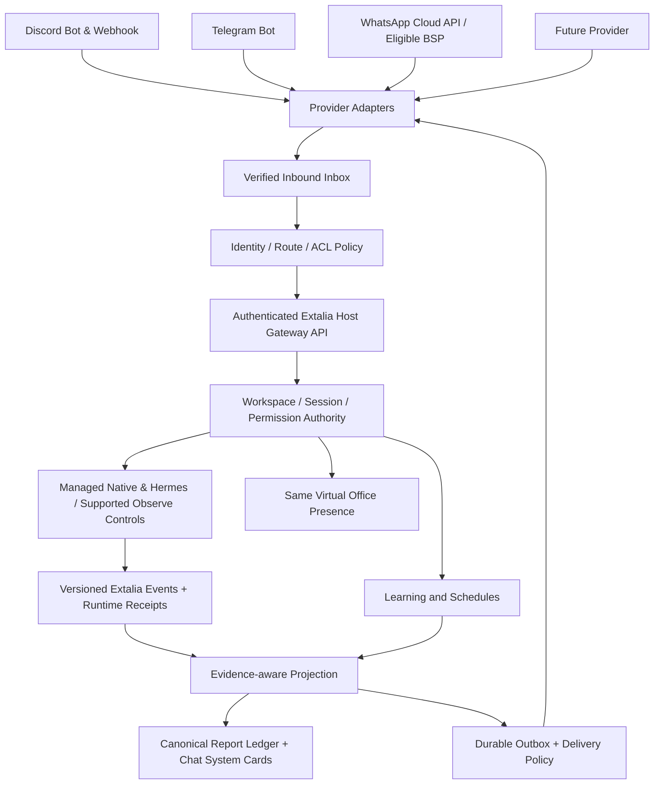

# PRD — Extalia Universal Gateway Module v2

## Discord Collaboration · Telegram Remote Operations · WhatsApp Monitoring · Autonomous Knowledge/Skills Reports

> **Document status:** Implementation in progress, revision 2.0 (M0–M3 core/UI/fanout & M4/M5 local modules implemented through `v0.4.362`; live Discord/Telegram/Meta WABA account certification and packaged soak remain separate).  
> **Code audit baseline:** `Extalia-VO/extalia-virtual-agent` tag `v0.4.353` (static baseline prior to incremental `v0.4.358`–`v0.4.362` slices).  
> **Repository path:** `docs/product/prd-universal-gateway-v2.md`.  
> **Companion PRDs:** [Schedule & Automation vNext (`prd-schedule-automation-vnext.md`)](prd-schedule-automation-vnext.md), [Session-First Workspace, Coding Workers & Discord (`prd-session-first-coding-discord.md`)](prd-session-first-coding-discord.md), [App Flow & Live Agents (`prd-app-flow-and-live-agents.md`)](prd-app-flow-and-live-agents.md), [Security Architecture (`../architecture/security.md`)](../architecture/security.md).  
> **Audience:** product owner, Extalia Host/Protocol engineers, Discord/Telegram/WhatsApp adapter engineers, UI engineering, QA and release security reviewers.  
> **Scope:** a *new module* using Extalia's existing authoritative Host, teams, runtime events, learning and schedules. **This PRD is not code, deployment evidence or a completed integration.**  
> **PRD alignment note:** Extends the Discord routing foundation in [`PRD-SF-1.0` (`Slice D`)](prd-session-first-coding-discord.md) into a provider-neutral Universal Gateway (`M0`–`M5`) covering Discord per-agent webhook portraits and replies, Telegram operations, policy-gated WhatsApp reporting, and canonical workspace autonomous Knowledge/Skills Chat reports.

---

## 0. Executive product contract (binding decisions)

1. **One Gateway Core, many providers.** Discord, Telegram and WhatsApp adapters are transports and presenters, never independent AI agents, runtime engines, state authorities or schedulers. Later providers (e.g. Slack, Teams, Matrix, provider/BSP transports) must implement the same capability-constrained adapter protocol.
2. **One authoritative Host.** The Extalia Host owns workspaces, sessions, lead/worker identity, execution permissions, learning artifacts, schedule runs and canonical reports; a Gateway process may be headless but may not create a second Host for the same profile root.
3. **Discord is the detailed collaboration console.** A visually distinct **Extalia Gateway Bot** handles system messages, command intake, health and automation notices. Actual **Lead Agents and Workers use their session-owned Extalia names, roles and portrait avatars** in per-message webhook presentation. They are not separate Discord user accounts. One parent-channel webhook can present multiple agent identities; never ask users to paste webhook tokens into channel chat.
4. **Telegram is the mobile operations console.** Authorized users can initiate/resume manageable sessions, inspect lead/team/task status, request safe controls, and receive summarized milestones, long-running heartbeat and Knowledge/Skills reports. Telegram messages are from one Extalia Bot and identify workers in *content*, not counterfeit Telegram accounts.
5. **WhatsApp is policy-gated monitoring.** Default to `accepted`, `heartbeat`, `attention`, and `terminal` status for eligible opt-in recipients; no step-by-step tool feed, uncontrolled general-purpose agent chat, arbitrary project commands or unsupported group routing. A limited use case must pass current Meta policy, account, country, template and pricing review before enabling the adapter.
6. **Automations must report where users actually work.** Every eligible autonomous Knowledge/Skills/meeting/periodic-maintenance terminal result must write a durable, attributed **System Report** to the latest eligible Chat in **the same workspace and authorized audience**, or to a workspace Reports Inbox if target selection is unsafe. Optional external fanout is downstream of the same canonical report. No synthetic user prompt, fake agent utterance or recursive learning loop.
7. **Truthful execution states.** Message accepted, agent turn completed, test verified, artifact published, report committed, and remote message delivered are different receipts. Do not mark any of them successful on the basis of another.
8. **Safety before convenience.** Inbound content is untrusted, workspace binding is explicit, identity linking is required for privileged actions, external sends are filtered and redacted, retries cannot duplicate agent work or uncertain side effects, and no platform bypasses Extalia's existing tool/grant restrictions.
9. **Recovery without fiction.** Long-running tools and disconnected agents can be `running`, `waiting`, `suspected_stalled`, `unreachable`, `interrupted` or `unknown`; inactivity alone never proves failure. External-watchdog alerts require an independently running mechanism.
10. **Deliver progressively.** G0 Core & Chat Reports → G1 Discord → G2 Telegram → G3 schedule/learning fanout and reliability → G4 WhatsApp (conditional) → G5 adapter SDK, operations certification and other providers.

### Delivery scope by milestone

| Milestone | Must have | Not implied |
|---|---|---|
| M0 Gateway foundation | Host-owned configuration, linked identity, routes, bindings, durable inbox/outbox, authorization, report ledger, redaction, audit | Any live platform integration |
| M1 Discord production candidate | Real bot+webhook, distinct agent portraits, scoped thread workflow, replies and worker activity, commands, recovery | A full terminal shell that bypasses Native executor |
| M2 Telegram production candidate | Real Bot API, DM/group/topic routing, commands, worker summary, milestones, lifecycle, reports | Per-worker bot accounts |
| M3 Automation integration | Verified schedule result, Knowledge/Skills Chat report + authorized fanout, liveness escalation | New permission to auto-activate skills |
| M4 WhatsApp conditional candidate | Official Cloud API/BSP, approved use case, consent, templates, billing and four-signal reporting | General-purpose coding assistant on WA |
| M5 Operations and extensibility | Headless service, independent watchdog where configured, connector conformance, security/release matrix | 100% external delivery or exactly-once remote effects |

## 1. Source baseline, boundaries and constraints

### 1.1 What is already in v0.4.353

- `packages/protocol/src/events.ts`: versioned events for session lifecycle, prompts, agent/subagent states, tool/command/file/Git, task progress, approvals and meetings. Events carry IDs and optional `agentId`, `taskId`, correlation and sequencing. Some runtime sources provide weaker observation; do **not** claim every event is available on every provider.
- `packages/core/src/teams.ts`: `TeamMember` with stable `id`, `name`, `role`, `gender`, allowed models, `soul`, connection, write/access scopes. Its identity is **session/team contextual**, not a Discord account.
- `packages/core/src/characterAppearance.ts`: saved `CharacterAppearance` per `<sessionId>:<agentId>`. Does not by itself expose a public PNG URL or reliable server portrait rendering.
- `packages/platform/src/agentHost.ts`: workspace, managed/observed sessions, `running`, lead name, team summary, operating profile and runtime distinctions; existing Host APIs and permission boundaries.
- `packages/host/src/learningSchedule.ts`, `packages/platform/src/learningSchedule.ts` and `docs/getting-started/automatic-learning.md`: post-task and project Knowledge/Skills learning, queued/running/partial/failed results, bounded quiet-period scheduling, saved-artifact receipts, and recovery semantics. UI notices exist, but durable Chat System Report integration described here is proposed work.
- `packages/host/src/schedules.ts`, `packages/platform/src/schedules.ts`, `docs/getting-started/schedules.md`: general recurrence/schedule foundations, which require exact run outcome correlation in the companion PRD.
- `apps/cli/src/bridge/server.ts`: loopback Bridge; do not turn it into a public webhook endpoint. `apps/cli` provides a no-open/headless launch path subject to service ownership and certification.
- `docs/adr/0086-native-user-skill-learning-sources.md`, `docs/adr/0088-grounded-knowledge-and-skill-refinement.md`: skill candidate recording, scoped evidence, scanner/review/activation authority; automatic curation cannot activate a generated skill.

### 1.2 Current gap

No integrated Discord+Telegram+WhatsApp Universal Gateway, universal linked-user ACL, provider-neutral durable inbox/outbox, per-agent Discord portrait system, or persistent last-eligible-chat autonomous report projection was verified on the pinned baseline. Existing hook activity does not prove remote delivery, worker attribution on every runtime, or live test passage.

### 1.3 Non-goals

Direct public access to Extalia Bridge; arbitrary plugin code execution; a new Host/AI-model router per platform; unrestricted file/terminal operations through chat; guaranteed exactly-once external effects; automatic promotion of generated skills; mirroring private raw transcripts to external groups; replacing the existing Native/Observed authority model; unsupported WhatsApp Web reverse engineering; accepting third-party gateway claims as independent verification.

## 2. User stories and success measures

| ID | User story | Acceptance outcome |
|---|---|---|
| US-01 | As an administrator I install/connect Discord once, then bind each channel to a registered workspace without pasting secret URLs into chat | Authenticated wizard, scope review, automatic webhook and route receipt |
| US-02 | As a developer I see the real Lead and each Worker speaking/working under their own Office profile in Discord | Distinct names/portraits, exact source-event attribution, no mixed workspace |
| US-03 | As an authorized reviewer I reply to a Worker in a Discord thread | Reply resolves exact worker/task, then routes via Lead unless explicit capability supports safe direct worker control |
| US-04 | As a mobile developer I can start or resume approved sessions and view milestone status in Telegram | Correct session ownership, no duplicate turns, permissions enforced |
| US-05 | As a user I know a 30-minute job is alive, blocked or unknown without checking a screen | Honest heartbeat and escalation, provider-specific noise controls |
| US-06 | As a report recipient I receive a concise WhatsApp outcome where permitted | Opt-in, eligible business use, approved template and cost guard; no unsupported AI chat |
| US-07 | As a workspace user I find autonomous Knowledge and Skills outcomes in my last relevant Chat | Persistent system card with exact provenance and per-artifact results; safe inbox fallback |
| US-08 | As an operator I restart gateway/Host during an uncertain network send | No duplicated execution, no blind duplicate message, inspectable `unknown` |
| US-09 | As a team owner I operate multiple Discord channels/Telegram topics/workspaces simultaneously | No identity, vault, team, approval or report crossover |
| US-10 | As a maintainer I add a fourth provider | Conformance protocol + capability contract, no changes to engine or scheduler |

**Exit goals (aspirational until live measured):** 100% authenticated mutations, 100% source-event provenance on agent-labelled messages, 0 observed cross-workspace leaks in adversarial test matrix, 100% terminal autonomous events with a committed report or explicit routing exception, and per-provider real account evidence before production claims.

## 3. Domain definitions and authority

| Domain object | Identity | Owner and meaning |
|---|---|---|
| Connector | `connectorId` | One Discord bot application, Telegram bot token or WhatsApp business phone/BSP transport config |
| External actor | `connectorId + externalActorId` | Platform identity, **not** trusted Extalia user until linked |
| Linked principal | `extaliaUserId + linkageReceipt` | One Extalia account with verified platform proof, expiry/revocation and scope |
| Route | `routeId + revision` | Tenant/guild/chat/channel/topic → registered workspace + permission/presentation policy |
| Conversation binding | `bindingId + revision` | External conversation → exactly one managed or supported observed session and workspace |
| Session | `sessionId` | Host-owned history, runtime, grants and lead execution authority |
| Lead identity | `sessionId + primary` | Actual lead name/role, operating profile and portrait snapshot |
| Worker identity | `sessionId + TeamMember.id` | Real roster member; source event must corroborate worker before attributing speech |
| Event | `sourceEventId + source trust` | Actual observed/verified activity evidence; not automatically a successful side effect |
| Run | `scheduleRunId / agentTurnId` | Execution state separate from dispatch/admission and notifications |
| Autonomous report | `reportId + revision` | Durable host-authoritative system output about Knowledge/Skills or schedule state |
| Delivery intent | `deliveryId` | Destination-specific outbound attempt with payload hash, provider response, uncertainty |
| Remote receipt | `connectorId + remoteMessageId` | Provider-assigned ID used for editing, replies, reconciliation |

**Trust ladder:** `untrusted_external` → `authenticated_transport` → `linked_actor` → `authorized_route` → `admitted_host_action` → `actual_runtime_receipt` → `verified_artifact/test` (where applicable). No presentation layer may promote a claim upward.

### 3.1 Isolation invariants

- A route selects only a **registered** workspace; no arbitrary filesystem root from Discord/Telegram/WhatsApp input.
- Worker access to folders/models remains the authority of the session team/Host, not the channel's membership.
- A route edited while messages are queued does not silently redirect them: pin effective route/binding revisions, revalidate before effects, refuse stale authority.
- A webhook override name/avatar is *visual presentation*; identify in logs and UI that it was delivered by Extalia's application webhook. External bots may not spoof a human account or a worker with no observed event.
- An unavailable runtime capability is unavailable: no fake command completion, forced cancellation, unsafe terminal execution or pretend delivery.

## 4. High-level architecture



**Host/API placement:** Transport listeners may run in a separated process. They authenticate to a **private** Host API with narrow actions and scoped credentials; no public Bridge binding. The Host or its transactional sidecar owns report/outbox mutation. React/web apps only render and call authorized APIs. Existing Rust Knowledge/artifact publication remains authoritative; report projection reads its receipts, not raw vault files by path guessing.

### 4.1 Deployable components

1. **Gateway Supervisor** — per connector lifecycle, reconnection policy, secret access, metrics and fencing token.
2. **Transport Adapter** — verified inbound envelopes, provider request/response mapping, capability discovery, send/edit/delete where supported.
3. **Identity Link Service** — challenge issuance, external proof, Host user confirmation, revocation and audit.
4. **Route/Binding Resolver** — deterministic match to workspace/session with revision and permission checks.
5. **Inbound Admission & Execution Dispatcher** — dedup, control concurrency, one lead turn and controlled worker references.
6. **Event Projection and Notification Policy** — classifies run/worker/learning events; produces per-provider safe summaries.
7. **Report Ledger & Chat Projection** — durable structured system reports in latest eligible Chat or workspace Reports Inbox.
8. **Outbound Delivery & Reconciler** — stored intents, rate limit, retry uncertainty, provider receipts, routing health.
9. **Settings & Operations UI** — connector wizard, route preview, privacy/consent, cost and service health, audit.
10. **Independent Watchdog (optional)** — separate process/service with independent liveness source and permitted alert route; no Host-self-report when the Host is dead.

## 5. Capability and fidelity matrix

| Capability | Discord | Telegram | WhatsApp |
|---|---|---|---|
| Receive command | Slash, interactions, explicit mentions/replies | `/command`, DM, mention/reply | No general agent commands in initial eligible reporting-only scope |
| Session creation/resume | Scoped | Scoped | Not enabled in MVP |
| Live worker portrait as message author | Per-message webhook username/avatar | Bot sender + named worker in content | Business sender, no worker persona |
| Detailed activity | Lead/worker/task/tool/test/git timeline | Summarized milestones + `/details` | No step-by-step |
| Worker reply | Correlated, delegated through Lead | Contextual worker selection, delegated through Lead | No direct worker control |
| Long-running status | Live status cards + activity timeline | Editable status + heartbeat | Sparse heartbeat if permitted |
| Approval | Exact-action review link + visible pending state | Link and read-only notice; stronger remote approval separately gated | Attention only; no action granting in MVP |
| User uploads | Scoped, checked, optional | Scoped, checked, limited | Not part of reporting MVP |
| Chat autonomous reports | Native canonical; Discord copy | Summary/digest | High-signal report/alert only if permitted |
| Message updates | Webhook edits/interaction updates where supported | Edit existing bot-owned message | New approved message, not streaming edit assumption |
| Cost controls | Rate limits/spam | API quotas/optional paid broadcast disabled by default | Pricing, template, consent, recipient budget |
| Delivery evidence | Discord returned message ID with `wait=true` | Telegram `message_id` and API result | Meta accepted `wamid` plus delivery/read/failure callbacks |

## 6. Cross-platform onboarding and accounts

### 6.1 General setup wizard

`Settings > Gateways > Connect` → choose provider → display exact scopes/permissions/limits → enter credentials into encrypted/OS protected secret store **never into channel chat** → verify app account/number → select allowed workspaces → bind explicit destinations → test harmless signed message → save route revision → enable inbound/outbound feature flags → audit confirmation.

- Connector starts **disabled** until validation and owner approval; secret reference is stored, not raw credential in configuration JSON, logs, or messages.
- Support `test`, `pause`, `rotate credential`, `revoke`, `disconnect`, `disable outbound`, `disable inbound`, and `view delivery diagnostics` without destroying underlying session or reports.
- Every setup wizard must explain channel visibility and the loss of confidentiality once content reaches a third-party platform.

### 6.2 Identity linking (required for privileged inbound)

User requests one-time short-lived linkage from authenticated Extalia UI; Host persists salted challenge digest + expiry + intended connector; external account sends proof via bot DM/interactive challenge; Host verifies exact actor and then asks an authenticated Extalia session to confirm. Consume one-time token, pin external account ID and provider tenant/phone (not display name), write audit. Replay, forwarded code, same-name accounts, anonymous group admins and expired/revoked proof must fail. Group membership is separate from linking and checked as needed for route privileges.

- Scoped permission bands: `read_status`, `view_reports`, `submit_prompt`, `manage_own_session`, `manage_schedule`, `manage_gateway_route`, `approve_sensitive_action` (not part of initial remote flow).
- Default group policy: status visibility only to approved members; commands gated to linked principals. DM is not intrinsically privileged just because it is private.
- Rotate or revoke linkage when account/role changes; audit route and linked actor on each effect. Message receipt alone does not grant filesystem or model permission.

### 6.3 Route precedence (exact policy)

1. Existing active exact external conversation binding (connector + tenant + chat/channel + thread/topic) and its pinned session, subject to current ACL.
2. Explicit authenticated route for that exact thread/topic.
3. Explicit parent channel/group route with allowed new-session policy.
4. Explicit configured personal-DM default for a linked user (if enabled).
5. **No implicit cross-workspace fallback.** Ambiguous routes yield a selection/review prompt (or safe refusal); never guess by latest global session/title/name.

A renamed thread/topic retains platform numeric ID. A moved/archived/deleted channel never magically migrates route. Session histories survive removal of external destinations; outbound is blocked/fallback to Extalia Reports Inbox as configured. Each route has independent `inbound`/`outbound` scopes, permission check and audience classification (`private`, `team`, `public`); public routes do not receive private attachments or project-sensitive output by default.

### 6.4 User interface for managing routes

- Connector map: account → server/group/business number → channel/topic/chat → workspace → session policy.
- Always show effective route, principal/role allowed, active binding count, last confirmed delivery, last error and real capability health.
- `Preview as recipient` displays exactly the redacted safe text before enabling fanout; does not send an actual secret-bearing report.
- Route removal cancels unsubmitted outbox intents; in-flight sends move to reconciled/unknown instead of retargeting.

## 7. Generic inbound and reply contract

**Ingress pipeline**: verify transport → parse bounded payload → prevent bot/self echo → store unique `(connector,eventId)` inbox receipt → resolve route → link actor → authorize → normalize user intent → pin session/runtime/permission revisions → dispatch exactly one admitted operation or return a safe refusal → retain definitive action receipt. Remote event dedup is not agent-side effect dedup unless admission is durable and correlated.

- Accepted prompt ≠ completed turn: return `queued/admitted` receipt, then subscribe to execution events.
- Per-session lead turns are serialized or safely rejected according to Host capability; no parallel uncoordinated prompts just because two platforms send at once.
- Edited/deleted inbound provider messages after admission do not rewrite already-admitted instructions. A new explicit user action must request a correction/cancel; maintain audit and media retention policy.
- Replying to an agent/webhook bot message must resolve original *remote message ID* → exact `sessionId`, `agentId`, `taskId`, `eventId` **from stored receipt**, not by parsing message author name/avatar. If mapping lost, refuse and ask user to select target; never guess by display name.
- Any direct-to-worker reply is expressed as context to the actual Lead orchestration unless runtime advertises a secure direct worker channel. Worker identity is not automatic permission for external direct invocation.
- System and automation messages are **not** user turns; they must not re-enter adapters as new prompts.

## 8. Discord adapter specification — G1

### 8.1 Install, permissions and transport

- Use Discord Application/authorized bot as the **system Gateway identity**; implement slash/application commands plus explicit mention/reply admission. Determine whether Gateway WebSocket or signed HTTP interactions best fits deployed transport; prefer minimal intents. Message Content privileged intent is not assumed available.
- Wizard must verify bot guild membership, channel visibility, slash command scope and `Manage Webhooks` on selected channels. Provide revocable auto-created webhook. Fallback without webhook is explicitly **bot-only sender** with worker labels, never pretend portrait-identity mode is functioning.
- Never ask users to paste webhook tokens into chat. Manual webhook connection, if allowed, uses protected authenticated Settings form. Tokens are secrets; rotate on suspect exposure.
- Different guild/channel permission snapshots are revalidated when route, role, channel type or webhook permission changes. Allow only authorized guild and channel IDs.
- `wait=true` on agent webhook send when remote ID is needed for reply routing; `thread_id` only when supported, and preserve thread receipt. Initial command response and webhook actor presentation are separate Discord mechanisms; Discord interaction followups do not support arbitrary `username`/`avatar_url` overrides.

### 8.2 Discord command contract

| Command | Scope | Behavior | Failure/refusal |
|---|---|---|---|
| `/extalia connect` | Admin | Link gateway connection via secure UI, show health | No credentials in chat |
| `/extalia bind workspace:<id>` | Workspace manager | Bind allowed channel/forum parent to registered workspace | Ambiguous or unauthorized IDs rejected |
| `/extalia unbind` | Route manager | Disable route, preserve prior session data | Reject stale revision or unauthorized use |
| `/extalia new [workspace]` | Linked user | Make managed session with existing profile/runtime grant | Capability/connection unavailable reported |
| `/extalia session [id]` | Session owner | Show/select bound session; explicit switch with confirmation | No cross-workspace switch |
| `/extalia status [run]` | Allowed viewer | Lead, worker, task, runtime and last-activity status | `unknown` if no reliable event |
| `/extalia team` | Allowed viewer | Agent names, roles, state and portrait, no private `soul` | Redacted according to audience |
| `/extalia tasks` | Allowed viewer | Task DAG summary and links | Do not invent tasks from natural language |
| `/extalia schedule` | Scoped scheduler role | List/preview; mutate via gated exact action | No accidental schedule creation |
| `/extalia reports` | Allowed viewer | Latest Knowledge/Skills/schedule reports | No private report leakage |
| `/extalia pause` | Scoped controller | Pause new inbound submissions for binding | Does not kill running job |
| `/extalia cancel` | Scoped controller | Request cancellation of exact turn where runtime supports it | Honest pending/unsupported/uncertain result |
| `/extalia help` | All authorized | Self-document features and limitations | No secret disclosure |

Design commands as interaction objects; defer acknowledgement within platform deadline and send long work results through later report delivery. Use ephemeral responses for sensitive admin confirmation where supported; detailed worker timeline remains in authorized thread.

### 8.3 Channel, forum and thread behavior

- A parent text channel may bind to one workspace while each thread maps to distinct managed sessions. A forum post can be a session under a specific parent forum route. No implicit title-based remapping or permission inheritance beyond platform-verified effective ACL.
- On new thread: determine parent route; send bot system receipt; create/attach session only on explicit authorized admission, depending on route policy (`explicit-only`, `thread-new-session`, `reuse-pinned`). Worker team follows the *resolved session*, not a global workspace team by name.
- On archived/locked thread: pause outbound unless support/permissions are proven; never auto-unarchive as default. Offer UI-assisted move/rebind with fresh permission and audience review. Deleted thread leaves session intact and marks binding `destination_lost`.
- On route change or guild exit: disable sends and inbound. No fallback into a different channel, DM, or guild without prior explicit authorization.

### 8.4 Agent portraits and identity

- Lead identity: actual session `agentName`, role metadata and `CharacterAppearance` for `<sessionId>:primary`. Worker identity: exact TeamMember stable ID and actual runtime agent ID; resolve against active session team only, with fallback `unidentified-worker` **system report**, not fabricated actor.
- Render and cache a safe headshot from the *saved Office appearance* with the same hair, presentation, skin tone and applicable outfit. Need a headless renderer or one canonical asset export, not a hand-picked stock avatar or a model-generated replacement. Avoid including private scene, names/paths in public asset metadata.
- Avatar may be exposed through short-lived read-only HTTPS asset fetch if Discord requires retrieval; verify expiry, privacy classification, response type, cache and revocation. Prefer image attachment where supported for report cards; initial portrait fetch design needs an ADR and real Discord test. No `localhost` URL masquerading as public.
- Store identity `profileRevision`, `appearanceHash`, `avatarRevision` and event snapshot. Historic messages keep original sender metadata; new messages pick current safe snapshot on revision refresh. Same names in different workspaces are not equivalent agents.
- Agent utterance uses worker visual identity only when actual worker output is observed; a gateway-generated summary of worker activity must explicitly say it is a system projection. The Gateway Bot itself never impersonates Lead or Worker for operational alerts.

### 8.5 Discord event fidelity and noise budgets

| Output surface | Content | Default behavior |
|---|---|---|
| Agent utterance | Actual Lead/Worker text with source-event receipt | New webhook message under true visual actor |
| Live run card | Run ID, current state, uptime, Lead/worker counts, recent verified activity | Edit bot-owned summary on significant changes, coalesce 3–5 s target |
| Worker activity | Delegations, task states, file summary, tool start/finish, test/command result, Git, review, blocker | Structured thread entries; redact content and suppress noisy repeated tool deltas |
| Evidence links | Commit SHA, file diff summary, test result/exit code, artifact receipt | Link to authenticated Extalia UI, not raw private URL |
| Approval pending | Exact action ID, subject, expiration, risk; user action link | Bot system notification; gated Host approval UI |
| Learning/schedule report | Canonical system artifact summary | Bot system identity, no false worker speech |
| Health/recovery | Gateway, Host and runtime liveness | Bot system identity; `unknown` if no proof |

Detailed means **richer semantics than Hermes**, not an unlimited stream. `model.thinking` and internal chain-of-thought are never emitted; tool outputs redacted, bounded and summarized. Worker activity cards explicitly distinguish `runtime-observed`, `host-verified` and `model-reported` evidence. Use `allowed_mentions` with restrictive safe defaults to prevent surprise mass pings. Do not emit whole private diffs unless user explicitly chooses a safe, permission-reviewed attachment.

### 8.6 Reply and interaction state machine

`Discord reply` → look up original message `remoteMessageId` → pinned binding/workspace/agent/task/event snapshot → validate human principal and destination ACL → normalize intent (`comment`, `lead_instruction`, `worker_context`, `cancel_request`) → Host permission/capability check → one lead turn admission or read-only response → event/report lifecycle. No webhook triggers itself. If underlying worker is no longer active, tell the user and request a Lead action rather than silently spawning it.

### 8.7 Acceptance essentials

Live guild/thread test required: per-agent name/avatar really visible; webhook-created message ID returned and later reply correlates; channel lacks `Manage Webhooks` gets clear fallback; forum/archived/locked/deleted threads handled safely; hostile mentions and injected tool output redacted; rapid activity throttled; changed team name/appearance updates new messages only; no cross-project worker identity bleed.

## 9. Telegram adapter specification — G2

### 9.1 Product model

Telegram is a **remote control and milestone companion**. One bot sends messages; Lead and Worker identities are named within status cards, not separate Telegram users/bots. A user may manage multiple workspaces through private chat, and a group **topic** can pin one session/workspace. Telegram private chats that support forum-topic mode must use the actual `message_thread_id`; normal private chats have no topic key. Never rely on chat display title or username.

### 9.2 Connection and transport

- Register bot with BotFather; store token in Secret Store. Verify account using `getMe` with least credential exposure. Allow exactly one active delivery owner per connector.
- Choose **webhook or `getUpdates` polling**, never both. Webhook requires an HTTPS edge, configured `secret_token` checked against `X-Telegram-Bot-Api-Secret-Token`, limited updates, bounded request body and replay/dedupe control. Polling persists last committed update offset and uses single-leader lease; advance only after durable inbox admission, not before.
- Telegram `update_id` may repeat or arrive in recovery; process exactly once at Host admission boundary, not by assuming network delivery is exactly once. Store `(connectorId,update_id)` and provider message IDs; read-only callbacks are separately idempotent.
- Default privacy mode ON in groups. Admit explicit commands, bot mentions and reply-to-bot when allowed; do not demand full group message access. An anonymous administrator/chat sender cannot inherit a linked personal identity.
- On bot removed, revoked token, target topic closed/deleted, unavailable chat, or insufficient rights: mark connector/destination degraded, retain runs/reports, notify in authenticated UI, never switch to an unrelated group/topic.

### 9.3 Conversation binding behavior

| Target | Route key | Default |
|---|---|---|
| Direct message without topic | `connectorId + chat_id + topic=null` | Linked user's explicit selected workspace/session; no global fallback |
| Direct message with forum topics (if enabled) | `connectorId + chat_id + message_thread_id` | Each topic has explicit session/workspace binding |
| Ordinary group | `connectorId + chat_id + topic=null` | Commands/mentions only; explicit admin route; default no broad prompt intake |
| Forum supergroup topic | `connectorId + chat_id + message_thread_id` | One topic/session, separate from other topics |
| Migrated group/supergroup | Provider migration IDs + signed/verified event | Pause old binding, confirm rebind after ACL check; no name fallback |
| Forwarded message | Original forward attribution untrusted for authorization | Treat sender as current actor; no inherited authority |

Routing to a private chat with two or more eligible sessions must ask an explicit selection. Source session history is not modified when the user only changes the chat's active binding. `/new` creates Host session with allowed workspace/connection/profile; `/sessions` only lists currently authorized sessions.

### 9.4 Command and callback inventory

| Telegram command | Authorization | Result and refusal |
|---|---|---|
| `/start` | Public onboarding | Show bot purpose and current linked status, no private project details |
| `/link` | External proof + Extalia UI confirmation | One-time account proof, never expose token/secret |
| `/help` | Public | Available commands, capability limitations |
| `/projects` | Linked user | Only allowed workspaces |
| `/bind` | Route manager | Pin current chat/topic to approved workspace with confirmation |
| `/unbind` | Route manager | Retire route, preserve Extalia session |
| `/new` | `submit_prompt` | Authorized new managed session or explicit capability refusal |
| `/sessions` | `read_status` | Filtered saved sessions; choose by callback with bound nonce |
| `/use` | `manage_own_session` | Confirm change of current session; no implied grant change |
| `/status` | `read_status` | Exact run state + last verified activity + confidence |
| `/team` | `read_status` | Lead and worker names/roles/status; no sensitive persona/model secrets |
| `/tasks` | `read_status` | Real task list, not model-invented pseudo tasks |
| `/details` | `read_status` | On-demand bounded event summary, link to Extalia full console |
| `/schedule` | `manage_schedule` | List + preview; writes require explicit revision-bound confirmation |
| `/reports` | `view_reports` | Latest scoped Knowledge/Skills/schedule reports |
| `/pause` | `manage_own_session` | Pause submissions, not execution |
| `/cancel` | `manage_own_session` | Exact session/turn cancellation if runtime advertises safe control |
| `/settings` | Linked user | Per-chat notification mode, quiet hours, subscription visibility |

Callbacks include a *server-side* short opaque action ID bound to principal, chat/topic, workspace, session/run, action, expiry, authorization revision and single-use nonce. No raw arbitrary path, command or approval content embedded in Telegram callback data. Telegram callback acknowledgement is prompt and independent of the potentially long Extalia action. Privileged callbacks require fresh Host authorization even if callback message is old.

### 9.5 Inbound user messages

- In linked private DM, ordinary text is allowed only when an active managed session was explicitly selected and a route policy authorizes prompt submission. Group/topic text requires explicit mention/reply/command and proper binding; general group chatter is ignored.
- Text is bounded by Telegram limits, normalized/escaped, classified as untrusted user input. Slash command parsing is strict (`/command@BotUsername`, not a fuzzy prefix). Reject self/bot messages to prevent echo loops.
- `/cancel` does not mark stopped until Host acknowledges actual cancellation and runtime settles. Distinguish `request_sent`, `cancelled`, `not_supported`, `already_finished`, `unknown`.
- Replies to worker summaries resolve cached `remoteMessageId` → real worker/task context, but all new instructions route through Lead by default. Telegram group messages cannot cause worker privilege escalation.
- Edit/delete after durable submission is not a command correction; user may issue a new explicit update. Message media are not automatically ingested by the model without media policy and ownership check.

### 9.6 Telegram media and attachment policy

MVP P0 accepts *text-first*. P1 media may accept limited document/image attachments from linked authorized users only, with configurable safe size/format caps **below provider maximum**, malware/content sniffing, filename canonicalization, one-time download URL, byte/digest receipt, storage quota, expiration and no arbitrary file path writes. Unsupported types reply with clear limitation. Media cannot be saved directly into project workspace without explicit authorized Host action. Caption, MIME label and file name are untrusted. Files are not forwarded between workspaces. Voice transcription, stickers, media groups, albums, inline mode and Telegram Business connections are out of MVP unless explicitly added by capability gate; optional future work must not alter baseline security.

### 9.7 Telegram outbound renderer

`quiet` (only attention/terminal), `balanced` (accepted, meaningful milestone, long-running heartbeat and terminal; **default**), `detailed` (more frequent worker/task summary, still no full tool stream). Create an initial status card and edit when feasible; if stale/uneditable, post a new bounded summary with correlation receipt. Avoid repeated "working" messages that contain no new verified liveness. Link to scoped Extalia report with authenticated access; never paste raw secret URLs or private logs. Normalize Markdown/HTML escaping, chunk messages within Bot API limit, use no `parse_mode` if escaping cannot be proven safe, and store sent `message_id` for replies and edits.

**Default policy targets (must be benchmarked):** milestone coalescing ≥5 minutes under continuous noisy work, except start/critical/terminal; heartbeat at 10 minutes then no more than every 30 minutes for long work if enabled; `/status` responds on demand with actual state. Telegram Bot API typing action is *ephemeral* and not a durable heartbeat. A status event must carry observed activity time and liveness quality.

### 9.8 Error and restart matrix

- `429/retry_after`: obey returned retry instruction, durable backoff/jitter, per-chat quota, and outbound priority with critical/terminal above routine milestones.
- `403 blocked`, user left group, chat migrated/topic lost: classify `blocked`, do not keep retrying or move to another destination; show Host/UI health notice.
- `5xx/network timeout`: distinguish known-not-sent from ambiguous remote acceptance. Ambiguous sends become `unknown` and require reconciliation; no blind repeated notification.
- Restart polling/webhook: replay uncommitted provider updates safely, never re-admit already executed user action.
- Token rotation: fence old transport owner and jobs; new owner confirms `getMe` identity; no parallel polling consumers.

### 9.9 Telegram acceptance gate

Real bot and authorized group/topic/private-chat test: DM linking, command/callback nonce, default privacy, edit/delete behavior, two-topic isolation, same user across multiple workspaces, new session/resume, parallel user turns, worker reply routing through Lead, actual provider receipts, restart/replay, throttling, bot removed, token rotation, media refusal, long-job heartbeat, Knowledge/Skills report without extra agent turn.

## 10. WhatsApp adapter specification — G4 (conditional)

### 10.1 Supported transport and eligibility

Only officially permitted **WhatsApp Business Platform Cloud API** or sanctioned BSP transport with equivalent compliance and source authenticity is considered. Before any production activation, product/legal/operations owner must verify the actual account, intended recipients and countries, allowed AI vs incidental notification use, messaging category, templates, pricing, consent and retention. Terms as of 2026 contain restrictions for general-purpose AI assistants as primary service. **Being technically able to send Cloud API messages does not certify the use case.** If uncertain, feature flag `wa.enabled=false`, preserve Extalia Chat report and offer Telegram/Discord only when independently authorized. Unofficial WhatsApp Web clients are not a proposed bypass.

### 10.2 Account setup

- Record verified WABA ID, `phone_number_id`, application/business identities and token secret reference; never persist raw recipient numbers in routine event logs.
- Exchange/rotate authorized system-user or supported access token via protected Settings/secret store and verify minimal required permissions; enforce WhatsApp-specific organization/recipient scope.
- Register webhook via public narrow HTTPS ingress gateway, verify `hub.challenge` during setup, verify HMAC SHA-256 `X-Hub-Signature-256` against **raw request bytes** with constant-time comparison, enforce size/timestamp/replay/idempotency and minimal scopes, rotate app secret without unauthorized fallback.
- Pin Graph API version in adapter config with explicit supported-upgrade certification and expiration/error handling. Reject unknown provider payload state instead of assuming sent.
- BSP transports must expose actual Meta message ID/status, sending number, template category and cost basis; provider-specific IDs are additional receipts, not substitutes for source proof.

### 10.3 WhatsApp product scope

Default **reporting-only** for expressly approved use cases, recipients and template categories. Four outbound signal classes:

| Class | Trigger from real Extalia state | Safe content | Default |
|---|---|---|---|
| `accepted` | Host admitted a schedule/agent job (not just webhook accepted) | Project-safe short task label, started/queued timestamp | Off unless opted-in |
| `heartbeat` | Job confirmed alive and remains long-running | Elapsed duration, last observed progress time, if waiting/blocked | Off until opted-in, target first ~10 min then ≥30 min |
| `attention` | Waiting approval, confirmed interrupted, suspected stall, runtime unreachable/unknown, failure | Severity, precise uncertainty, authenticated Extalia URL | On only for eligible opted-in severity |
| `terminal` | Actual run, turn or autonomous report terminal receipt | Completed/failed/partial; short verified result; follow-up location | Opt-in, default once per run |

No worker tool-by-tool feed, private prompt, full file path, raw code diff, hidden `soul`, secret, sensitive image or unrestricted reply-to-agent command in WhatsApp. For autonomous Knowledge/Skills, default to digest/no-change suppression; a skill candidate is only `awaiting review`, never "installed" or "activated".

### 10.4 Conversation window and templates

- Evaluate allowed **customer-service window** per recipient from verified inbound customer message events; a window is **not** created by an outbound business message. Outside window, only currently approved templates of an eligible category are sent. Template approval is not proof that the Extalia product use case complies with Meta terms.
- Maintain a registry of exact template name, language, category, version, variable schema, approval state, allowed event class, bounded payload examples and consent class. Strictly map `accepted/heartbeat/attention/terminal` into eligible templates; reject missing/paused/reclassified templates. Never substitute a marketing template to sneak through notification eligibility.
- Revalidate opt-in, purpose, window, template, recipient block status, policy flag, daily quota and current cost policy **at send time**, not just at configuration time. If blocked, record `policy_blocked`, avoid sending, and keep canonical report in Extalia.
- A user reply does not activate general-purpose AI conversation by default; inbound can only update opt-in/opt-out or limited approved subscription commands if counsel/eligibility explicitly permits those interactions.

### 10.5 Pricing and delivery accounting (2026-sensitive)

WhatsApp Business Platform pricing is per delivered message with category/market-dependent rates; **pricing changed effective 1 October 2026**, including service messages/utility in many circumstances. Hence assume neither template nor service message is reliably free; consult current official account-specific rate card and billing status. Record `estimatedCharge` at intent time and actual rated/delivered charge when available; costs may differ by country/category/tier, free allowances, BSP markup, time and revised Meta terms. The user-configured **hard budget** blocks noncritical sends; critical sends still require explicit budget override or fail closed—no hidden costs.

Cost controls: per connector/phone/recipient/month budgets, per-workspace event budgets, opted-in heartbeat cadence, digest bundling, quiet hours/time zone, duplicate suppression and kill switch. Show estimated number of heartbeat messages in Settings before enabling. Billing unknown → display `unpriced` and require admin approval before optional high-volume delivery; never silently assume zero charge.

### 10.6 Webhook statuses and receipt reconciliation

`POST /messages` accepted + `wamid` means the API accepted a send, not delivered/read. State transitions when authentic callbacks indicate `sent`, `delivered`, `read`, `failed` (provider-specific), preserving times and error/category. Later events may arrive out of order; append receipts, use monotonic state rules and record anomalies. Avoid resending after unknown acceptance, or after delivery callback without local API response. Receipt correlation uses exact account/number/message ID, not phone display name.

- Consent revoked / user blocked: stop new notifications immediately and disable queued optional sends.
- Template rejected or paused: `policy_blocked`; no fallback to free-form outside window.
- Wrong country/number/tenant: block, never send to guessed replacement.
- If full Host is down, in-process WhatsApp cannot report it; an independently powered watchdog is required for real host-down notification (and must itself be policy/consent/budget compliant).

### 10.7 WhatsApp message samples (illustrative; not approved Meta templates)

`ACCEPTED: Extalia • Project A • Run #42 admitted at 10:00. You will receive an update if work takes longer or needs attention.`

`HEARTBEAT: Project A • Run #42 is still running (30 min). Last confirmed runtime activity at 10:28. No action required. This does not guarantee task progress.`

`ATTENTION: Project A • Run #42 has no verified progress for 15 min. Status: being checked, not declared failed. Inspect securely in Extalia.`

`TERMINAL: Project A • Run #42 finished. 5 files changed; test result not independently verified. Full details in Extalia.`

Each is a **content template proposal only**; verify category and approval before use, use approved/authorized locale and limits, and never paste a private link inaccessible to target principal.

### 10.8 WhatsApp acceptance gate

No production claim until real eligible WABA/phone test and policy sign-off. Cases: invalid signature, duplicate webhook, out-of-window without approved template, opt-out after intent creation, approved template and recipient, cost cap, rate/quality limits, callback out-of-order, accepted-but-no-delivery, deleted subscription, number recycled/re-linked, 30+ minute run heartbeat, unknown liveness, host-down only with external watchdog, no step-by-step worker leaks, policy gate disabled.

## 11. Autonomous Knowledge / Skills / Meetings / Schedule reporting

### 11.1 Product objective

Whenever Extalia's autonomous engine completes an eligible Knowledge update, generated Skill candidate, optional team Knowledge meeting or recurring maintenance schedule, the owning workspace's user must be able to **find a durable report in the relevant Extalia conversation**. This is a canonical system artifact, not a transient toast, a new user prompt, a fake assistant turn, or a source transcript mutation. Discord/Telegram/WhatsApp deliveries are *optional projections* of the same verified report.

### 11.2 Trigger classes and receipts

| Source | Source receipt required | Report display |
|---|---|---|
| Deferred post-task learning | `LearningScheduleJob` source session, workspace/profile ID, terminal result and Rust artifact receipts | Knowledge saved/indexed/failed; skill candidate created/revised/unchanged; partial outcomes |
| Automatic project Knowledge build | `ProjectKnowledgeBuildResult` plus actual overview publication/index | Inventory/read/created/updated/unchanged/deduplicated/conflict counts; status `saved/unchanged/partial/failed` |
| Optional team Knowledge meeting | Meeting result with outcome, minutes path and indexing receipt | Participants, saved minutes, citation/evidence status, unresolved failure |
| Skill candidate import/refinement | Actual immutable registry receipt, revision ID, inspection and review state | Candidate exists, **not activated**; `review required`; no false test success |
| Recurring Knowledge/Skills maintenance | `ScheduleRun` terminal outcome and exact artifact receipts | Scheduled run status, changed/no-op/partial details; does not claim source curator ran if it did not |
| Scheduler ordinary task | Actual turn/run completion and verification receipt | Queued/admitted/running/completed/failed/unknown with verified test caveat |

Only actual receipt-backed artifact changes may be called `saved`, `indexed`, `created`, `reviewed`, `activated`, `passed` or `delivered`. A curator's text is a reported claim, never a proof. If publication succeeded but index refresh failed, display both separately and mark `partial`, not "failed to save". If the output is an unchanged/no-op result, retain a report ledger entry and optionally suppress noisy external messages via digest policy.

### 11.3 Selecting the **last eligible Chat**

Candidate eligibility is determined **at report commit time**, never guessed by the last UI-selected tab or platform channel. Build candidate set from existing sessions with **same exact registered `workspaceId`**, current authorized user/owner audience, compatible visibility, readable saved history and report projection capability, not deleted/trashed/private-to-other-user/observed immutable source transcript. Prioritize:

1. A user-configured pinned report Chat for the source workspace, if still eligible and authorized.
2. The **latest eligible saved Chat in that workspace**, ordered by last genuine *human or agent foreground* activity time, excluding system-report projections, bot notifications, maintenance jobs and session-title-only updates, with deterministic ID tie-breaker.
3. A configured `source-session-only` option, if source session eligible; otherwise fallback to workspace Reports Inbox.
4. If no safe Chat target exists or multiple ownership interpretations conflict, **workspace Reports Inbox**; never arbitrary global latest session, other profile or unbound observed conversation.

For a shared workspace: additionally require recipient principal and chat audience authorization; if last Chat is private to another user, skip it. A user preference `reportAudience` must not grant access that the Host/session ACL does not allow. Changing report audience or target while job runs must revalidate at projection. Target selection stores a snapshot decision ID, actor scope, candidate rules and a limited rejection reason in audit. Once committed, report does **not** automatically migrate to a newer chat when a later prompt arrives; user can explicitly move/link it with a reviewed action.

**Report destination examples:**

- Workspace A → last authorized Chat A2, even if a user recently spoke in Workspace B; never B.
- Workspace A → report inbox when A2 is deleted, history-off, private to someone else, or observed-only source history cannot accept system cards.
- Worker from Team A → workspace A report addressed to approved user; no own-global report destination or separate worker vault.
- Knowledge/Skill result from a session whose profile binding has since changed → refuse unsafe projection and show unresolved report in authenticated maintenance dashboard, not redirect into current profile.

### 11.4 Chat System Report UI card

A report card should show `System • Automatic Learning`, workspace and source session label, job ID and outcome, committed time, last verified update, `Knowledge` section (created/updated/saved + `indexed` truth), `Skills` section (candidate ID/revision, new/revised/no-op, scanner/review/activation status), `Meeting` section where applicable, problems and recovery state, and authenticated buttons `Open Knowledge`, `Review Skill`, `Inspect Run`.

Cards must be persistently queryable from Chat history and workspace Reports Inbox across Web/Desktop restart and route disconnection; UI dismissals are view state only, never delete report or artifact. This card is a **read-only system entry**, excluded from Native model history, learning evidence inputs and observed-source transcript import. If a future explicit user response references a card, normal Host authorization and prompt submission apply only to that *new human* turn.

### 11.5 External fanout rules

| Event | Chat system card | Discord | Telegram | WhatsApp |
|---|---|---|---|---|
| Learning queued/countdown | Optional status, not terminal card | Optional bot status if exact binding | No routine push | No |
| Learning actually running | Update existing status | Optional system status | Long-job heartbeat if opted in | Only optional permitted heartbeat |
| Knowledge saved + indexed | Immutable report revision | System bot report in authorized source/bound thread | Milestone/digest | Optional final/digest where eligible |
| Knowledge saved but index failed | `partial` | Partial warning | Attention/digest | Critical only if compliant |
| New Skill candidate | Candidate with review state | Bot status, no worker impersonation | Candidate summary/digest | Default off |
| No new knowledge/skill | No-op report (possibly collapsed) | Default no push | Default digest only | Default off |
| Failed/interrupted/uncertain | Exact partial/error state | Bot alert | Immediate attention | Allowed severity-based attention |

External fanout must pass connector route ACL, report audience, opt-in, cost and policy **again when sending**. Report commitment must never wait for an external API. Unknown outbound delivery is not an unknown Knowledge publication.

### 11.6 Automatic learning is not a cron job

Existing post-task curator uses an idle/quiet period, not fixed recurrence. Recurring schedules and source curator must retain distinct ownership and budgets. Deduplicate same source evidence/result with a **canonical maintenance intent** `(workspaceId, vaultProfileRevision, maintenanceKind, evidenceWindow/sourceReceiptDigest)` when equivalent. A scheduled run can generate its own report but must not trigger a second curator solely because a system report was projected into Chat. No model is authorized to activate a Skill candidate or mutate shipped built-ins. Confirmed Rust publication receipts own actual result; ambiguous publication is inspected, not blindly repeated.

### 11.7 Report and notification examples

```text
Extalia System Report — Autonomous Knowledge / Skills
Workspace: Example Project    Source: Session #S42
Outcome: PARTIAL              Run: LRN-093

Knowledge: 2 notes saved; index refresh confirmed for 1, incomplete for 1.
Skills:   1 new immutable candidate revision saved; inspection pending;
          review/approval required; NOT ACTIVE.
Failures: 1 knowledge index refresh incomplete.

Open Knowledge | Review Candidate | Inspect Receipt
```

When sending this as a Telegram milestone, reduce to outcome + counts + review status. WhatsApp is limited to permitted high-level monitoring text and may omit Skills entirely. The Discord Gateway Bot, not a Worker persona, publishes the system report.

## 12. Common status, liveness and escalation engine

### 12.1 Separate five health dimensions

1. **Gateway transport:** connector authenticated/reachable, connected/polling/webhook receiving.
2. **Extalia Host:** process/service heartbeat and exclusive profile ownership.
3. **Runtime:** provider/child/session liveness and actual turn state.
4. **Progress:** observed new task/tool/agent event, real command process activity, or verified artifact receipt.
5. **Notification:** provider-side remote message accepted/delivered/read/failed or uncertain.

Do not collapse these into a single "online" boolean. A connected Telegram bot does not prove a coding worker remains alive. An API-accepted WhatsApp message does not prove delivered/read. A running long build that emits no tool output may still be alive; avoid arbitrary auto-failure.

### 12.2 Execution health states

```text
queued -> admitted -> running -> completed|failed|cancelled
                       |-> waiting_approval
                       |-> suspected_stalled
                       |-> runtime_unreachable
                       |-> interrupted
                       |-> unknown

All transitions carry source evidence, last real activity, next planned check,
confidence/reason and revision. Recovery is an explicit reconciliation step.
```

- `running`: verified live turn/child/process lease, not merely a stale UI `running=true`.
- `waiting_approval`: exact pending approval with risk/action ID, no automatic grant.
- `suspected_stalled`: threshold exceeded without corroborating progress, runtime may still be alive; can clear with fresh verified activity.
- `runtime_unreachable`: Host cannot prove runtime state due to connection loss; no implied cancellation.
- `interrupted`: supervisor confirms process/session interrupted; unknown side effects still unresolved.
- `unknown`: unable to establish terminal state or remote action certainty. Operators get an audit and safe next action.

### 12.3 Initial cadence proposals (not SLA claims)

| Situation | Discord | Telegram | WhatsApp |
|---|---|---|---|
| New admitted task | Immediate system card | Immediate initial status if subscribed | Optional permitted accepted message |
| Noisy worker event stream | Coalesce ~3–5 sec, important events immediate | Milestone or ≥5 min aggregation | No step details |
| Long task heartbeat | Live card fresh on verified health | First ~10 min, then ≥30 min (opt-in) | Same cadence only when opted-in and compliant |
| `waiting_approval` | Promptly show exact action | Promptly send safe link | Attention only if allowed, no approval button in MVP |
| Suspected stall | Promptly show uncertainty | Attention with last observed progress | Approved attention where allowed |
| Terminal | Detailed evidence report | Concise summary | One safe final report where allowed |

Quiet hours, urgency override and daily budgets are route/user specific. A status request on demand is read-only and should not cause a paid model invocation. For WhatsApp cost controls, optional heartbeat must be suppressible or aggregated. For infrastructure-wide Host-down, only a watchdog in an **independently available process/service** can truthfully send an alert; a worker living inside dead Host cannot.

### 12.4 Monitor and escalation policy

- Store `lastTransportHeartbeatAt`, `lastHostHeartbeatAt`, `lastRuntimeLeaseAt`, `lastProgressEventAt`, `lastVerifiedEffectAt` and `expectedNextCheckAt` separately.
- Tool-aware thresholds: process with valid PID/lease and ongoing work does not fail just for silence. If source cannot expose telemetry, mark `verification_insufficient` and avoid false confidence.
- Severity `info` (routine), `warning` (stale/partial), `critical` (confirmed fail/lost Host) is **not** the same as approval to broadcast. Re-evaluate recipient/route authorization at dispatch.
- Escalation stops when terminal state is confirmed or user unsubscribes, and emits a single deduped recovery notice if useful.
- Race: terminal event arriving after `suspected_stalled` supersedes the alert and should send final corrected status; no contradictory stale repeated heartbeat.

## 13. Event contracts and TypeScript API proposal

All examples in this section are **proposed contracts**, not claims about existing types. Prefer extending existing `@extalia/protocol` and `@extalia/platform` in their dependency direction rather than leaking provider APIs into core.

```typescript
export type GatewayProvider = 'discord' | 'telegram' | 'whatsapp' | (string & {});
export type DetailLevel = 'detailed' | 'milestone' | 'report';

export interface GatewayInboundEvent {
  schema: 'extalia.gateway.inbound.v1';
  connectorId: string;
  provider: GatewayProvider;
  providerEventId: string;        // Discord interaction/message; Telegram update_id; Meta webhook event
  providerAccountId: string;      // guild/bot/WABA identity namespace
  channelId: string;
  threadId?: string;              // Discord thread / Telegram topic
  externalActorId: string;
  actorKind: 'human' | 'bot' | 'webhook' | 'unknown';
  remoteMessageId?: string;
  replyToRemoteMessageId?: string;
  kind: 'command' | 'text' | 'callback' | 'attachment' | 'lifecycle';
  text?: string;                  // bounded; untrusted
  receivedAt: string;
  authenticatedTransportReceipt: string; // Host-generated, not provider-supplied truth
}

export interface GatewayRouteBinding {
  id: string;
  connectorId: string;
  providerAccountId: string;
  channelId: string;
  threadId?: string;
  workspaceId: string;
  sessionId?: string;
  mode: 'explicit-only' | 'thread-new-session' | 'reuse-pinned';
  policyRevision: number;
  audience: 'private' | 'team' | 'public';
  state: 'active' | 'paused' | 'destination-lost' | 'revoked';
}

export interface AgentPortraitIdentity {
  workspaceId: string;
  sessionId: string;
  agentId: string;
  kind: 'lead' | 'worker';
  name: string;
  role: string;
  teamMemberId?: string;
  appearanceHash?: string;
  portraitAssetId?: string;
  portraitRevision?: string;
  profileRevision?: number;
  provenance: 'host-team-roster' | 'verified-runtime-identity';
}

export interface GatewayProjectEvent {
  sourceEventId: string;
  workspaceId: string;
  sessionId: string;
  runId?: string;
  agentId?: string;
  taskId?: string;
  category: 'agent-message' | 'worker-activity' | 'execution-health' |
    'approval' | 'terminal' | 'autonomous-report';
  provenance: 'host-receipt' | 'runtime-observed' | 'model-reported';
  verification: 'verified' | 'unverified' | 'unknown' | 'not-applicable';
  safeText: string;
  at: string;
}

export interface WorkspaceSystemReport {
  id: string;
  revision: number;
  source: 'learning' | 'knowledge-build' | 'knowledge-meeting' |
    'skills' | 'scheduled-maintenance' | 'schedule-run';
  sourceJobId: string;
  sourceRunId?: string;
  workspaceId: string;
  vaultProfileId?: string;
  vaultProfileRevision?: string;
  sourceSessionId?: string;
  targetChatId?: string;          // null => workspace Reports Inbox
  targetSelection: 'pinned' | 'last-eligible' | 'source-only' | 'inbox';
  outcome: 'completed' | 'partial' | 'failed' | 'cancelled' |
    'skipped' | 'unknown';
  knowledge?: {
    state: 'saved' | 'unchanged' | 'partial' | 'failed' | 'skipped';
    indexed?: boolean;
    artifactReceiptIds?: string[];
  };
  skills?: Array<{
    packageId: string;
    revisionId: string;
    state: 'candidate-saved' | 'inspection-pending' | 'review-required' |
      'active-confirmed' | 'failed' | 'unknown';
    activationPerformed: boolean;
  }>;
  committedAt: string;
  lastUpdatedAt: string;
  audienceScopeId: string;
}

export interface GatewayOutboundIntent {
  id: string;
  connectorId: string;
  targetBindingId: string;
  targetBindingRevision: number;
  sourceEventId?: string;
  reportId?: string;
  reportRevision?: number;
  senderKind: 'gateway-system' | 'lead' | 'worker';
  senderPortrait?: AgentPortraitIdentity;
  format: DetailLevel;
  messageClass: 'accepted' | 'milestone' | 'heartbeat' |
    'attention' | 'terminal' | 'system-report';
  payloadDigest: string;
  policyEvaluationId: string;
  state: 'pending' | 'sending' | 'accepted' | 'delivered' |
    'read' | 'blocked' | 'failed' | 'unknown';
  remoteMessageId?: string;
  lastProviderError?: string;
}

export interface GatewayAdapter {
  provider: GatewayProvider;
  capabilities(connectorId: string): Promise<Readonly<GatewayCapabilities>>;
  authenticateInbound(request: RawVerifiedTransport): Promise<VerifiedProviderBatch>;
  normalize(batch: VerifiedProviderBatch): GatewayInboundEvent[];
  send(intent: ApprovedOutbound): Promise<RemoteSendReceipt>;
  edit?(receipt: RemoteSendReceipt, intent: ApprovedOutbound): Promise<RemoteSendReceipt>;
  health(): Promise<ConnectorHealth>;
  // No direct getWorkspace, executeTool, activateSkill or createHost methods.
}
```

The adapter cannot set `workspaceId`, `agentId`, `verification:'verified'` or `targetChatId` from external payload. Only Host authority resolves these fields. Envelopes must be bounded and strictly schema validated; reject forged provider names, unknown enum values or unsafe additional fields at trust boundaries. Version upgrade strategy must handle persisted older envelopes and event replay. Use UTC ISO timestamps; IANA time zones only for display, quiet hours and schedule semantics.

## 14. Persistence and transactional invariants

Proposed SQLite database is hosted under the **active Extalia profile-owned state root**, not any shared global profile. An ADR must choose same DB as schedule ledger vs separate Gateway DB, checkpoint/journal mode, encryption-at-rest strategy, transaction boundaries, backup, migration and rollback. Never insert rows directly into Rust Knowledge/mission stores or duplicate their authoritative artifact lifecycle.

### 14.1 Tables and indexes

| Table | Core fields | Uniqueness / invariants |
|---|---|---|
| `gateway_connectors` | id/provider/account/secretRef/status/policyVersion/capabilityRevision/lease | Unique active connector account+provider identity; no raw token |
| `gateway_principal_links` | connector/externalActor/extaliaPrincipal/challengeReceipt/revocation | Unique active external actor mapping per connector; user proof required |
| `gateway_routes` | connector/account/channel/topic/workspace/mode/audience/revision | Unique effective route key; explicit parent fallback only |
| `gateway_bindings` | route/session/externalConversation/revision/status | Unique active normalized conversation; pinned workspace=session workspace |
| `gateway_inbox` | connector/providerEventId/fingerprint/actor/state/attempt/time | Unique `(connectorId, providerEventId)`; one Host admission |
| `gateway_actions` | inboxId/hostActionId/authProof/state/receipt | Unique action identity; pending/terminal reconciled |
| `gateway_event_projection` | eventId/session/agent/task/provenance/verif/safeText | Unique `(eventId,presentationProjectionVersion)` |
| `gateway_outbox` | intentId/connector/destinationRevision/class/recipient/payloadHash/state | Unique logical delivery key; transactional enqueue before network |
| `gateway_send_attempts` | intent/attempt/lease/fencing/httpResult/remoteId/error/at | Append-only attempts; no blind unknown retry |
| `gateway_remote_receipts` | provider/connector/remoteId/eventId/senderSnapshot/deliveryTimes | Unique `(connectorId, remoteMessageId)` for actual messages |
| `gateway_avatar_assets` | characterId/appearanceHash/revision/assetRef/expiry | No private Office texture URLs/exposed roots |
| `gateway_report_ledger` | reportId/sourceJob/profile/workspace/outcome/artifacts/revision | One canonical report per source job & scope; revisions immutable/auditable |
| `gateway_chat_projections` | reportId/chatId/selectionReceipt/createdAt | Unique report projection; no user/assistant-turn mutation |
| `gateway_policy_receipts` | policyVersion/actor/audience/template/consent/cost/decision | Exact sending authorization snapshot; redacted |
| `gateway_audit` | actor/action/resource/outcome/reason/timestamp | Retained security trail with masked identifiers |
| `gateway_watchdog_leases` | hostId/ownerEpoch/heartbeat/lastSignal | Independent monitor does not assume Host process is alive |

### 14.2 Idempotency keys

```text
inboundKey       = hash(connectorId, providerAccountId, providerEventId)
leadActionKey    = hash(inboundKey, resolvedSessionId, requestedAction, routeRevision)
autonomousKey    = hash(sourceJobId, workspaceId, vaultProfileRevision, reportKind)
reportRevisionId = hash(reportId, immutableArtifactReceiptSet, actualOutcome)
deliveryKey      = hash(reportOrSourceEventId, bindingId, bindingRevision,
                        messageClass, recipientId, projectionVersion)
```

Never use display names, message text or timestamps alone as idempotency keys. Exact uniqueness matters across restart and multiple gateway transport workers. Null topic must normalize consistently for unique database constraints. A remote send ID proves provider acceptance; local timeouts may leave an ambiguous state.

### 14.3 Transaction outline

**Inbound transaction A:** accept authenticated event only once, write normalized envelope, actor/route decision and action intent. After commit, enqueue Host dispatch. **Dispatch transaction B:** pin session/permission revisions, obtain one Host action admission receipt; if unsafe or unknown, do not create another action. **Execution transaction C:** append actual Host runtime results. **Report transaction D:** commit canonical autonomous report then Chat projection selection/copy, independent of network sends. **Outbound transaction E:** persist exact recipient/payloadHash/policy receipt and attempt lease before network send; reconcile response/callback and block replay of unknown sends.

### 14.4 State machines

```text
CONNECTOR: disabled -> configuring -> connected -> degraded|blocked|revoked

INBOX:     received -> authenticated -> deduplicated -> route-resolved
           -> authorized -> admitted|queued|rejected|unknown

ACTION:    accepted -> admitted -> running -> completed|failed|cancelled|unknown

REPORT:    awaiting-receipts -> committed -> projected-chat|workspace-inbox
                                  \-> revised (same report ID; immutable version)

OUTBOX:    pending -> leased -> sending -> accepted -> delivered -> read
                                      \-> failed|blocked|unknown

Unknown remote side-effect cannot be blindly retried. Retry is only allowed
when evidence proves original action was never admitted/sent or provider has
an independently verified idempotency mechanism for that exact operation.
```

### 14.5 Retention/privacy

Initial policy proposal (benchmark and policy-review required): raw ingress content only until action admission or bounded troubleshooting retention; redact/expire media on download; normalized event summaries 7 days, remote receipts and audit metadata 90 days where allowed; canonical report/Chat availability follows user-facing retention and safe tombstones. No secret, token, full `soul`, raw private file, model reasoning, full logs or customer phone number in routine events/metrics. Expose data export, revocation, report visibility and delete/disconnect semantics where the Host has lawful authority. Audit records for legitimate security retention must not become a hidden copy of sensitive message content.

## 15. Outbound policy, uncertainty, queueing and rate limits

### 15.1 Priority classes

`P0 critical health/approval` → `P1 terminal/partial result` → `P2 accepted/meaningful milestone` → `P3 routine heartbeat/digest`. P0 never bypasses compliance, consent or budget authorization; if blocked, retain canonical report and notify in Extalia UI. Use weighted rate-limit queues per connector + destination; bound backlog and coalesce stale heartbeat updates to the most recent state. Never let one noisy Discord thread starve unrelated Telegram error notices.

### 15.2 Delivery failure semantics

| Transport result | Canonical classification | Safe action |
|---|---|---|
| Preflight permission failure | `blocked` | Stop; show exact fix, no network |
| Explicit `429` with retry time | `failed-retryable` | Backoff with bounded rate, retain same intent |
| Proven request not sent | `retryable` | Retry with same durable intent once policy revalidated |
| Timeout after sending request | `unknown` | Reconcile remote receipt/read if possible; do not blindly resend |
| Provider accepted with message ID | `accepted` | Await later delivery receipt if provider supports; no duplicate send |
| Provider reports delivered | `delivered` | Update delivery independent from Host run outcome |
| Provider rejects permanently (403/blocked/invalid template) | `blocked` | Disable target, notify authenticated UI, no fallback to unapproved destination |
| Old route/token after rotation | `stale-authority` | Fence attempt; reauthorize or cancel; no silent retarget |

Discord `wait=true` and Telegram sent `message_id` provide useful remote IDs; Meta Cloud API callbacks are distinct from send acceptance. All providers may deliver duplicate webhook callbacks, which must be idempotent. Use immutable `providerRequestKey` and fencing token to avoid two workers sending same intent, plus application-visible reconciliation for unknown.

### 15.3 Notification digest and coalescing

- Per execution stage `task` and `agent` state updates are ordered by source event sequence; older state never overwrites newer. Preserve out-of-order arrivals for audit, correct projection only with validated monotonic sequence.
- Text messages/attachments are chunked at provider limits after redaction and formatting. A partial chunk delivery is `partial`; do not claim complete report delivery because one chunk succeeded.
- When message edits are supported, pin remote message and revision; stale edit failures should not create duplicate status cards indefinitely. At most one current running status card per `(binding,run)` by default.
- Quiet hours apply to optional status; urgent failures can bypass only when user opted in to urgent notifications. WA templates and charging rules continue to apply.

## 16. Security, privacy, abuse and compliance

### 16.1 Threat model

Attacks include forged Discord/Meta/Telegram webhook, stolen bot token, attacker in permitted channel but not an Extalia user, anonymous group admin, confused-deputy cross-workspace route, webhook self-echo, reply impersonation by edited username/avatar, prompt injection in external messages/filenames/tool outputs, unsafe attachment processing, malicious mass mentions, callback replay, staff leaving a Discord guild, Telegram topic reuse, WhatsApp phone reassignment, network timeout during side effects, secret/avatar URL leakage, SSRF through media or avatar retrieval, silent downgrade of permission/provenance, and regulatory/price changes after schedule creation.

### 16.2 Required controls

- TLS and verified origin transport: Discord signed HTTP interactions if using public endpoint, or authenticated Bot Gateway WS; Telegram webhook secret (or single-leader polling), Meta raw-body signature for Webhooks. `hub.challenge` setup token is not equivalent to subsequent inbound signature validation.
- Multi-tenant ACL checked server-side at **route resolution, user action, report projection and outbound send**. Channel membership is not Host authority. Link external principals with proof and revocation.
- Private Host API with scoped service credentials, credential rotation, authenticated intra-service requests, replay protection and exclusive Host lock. No public direct Bridge.
- Secrets in encrypted store/keychain where supported, masked UI and logs. Never require webhook URL pasted in messages.
- Untrusted content escaped/sanitized; strict `allowed_mentions` and Telegram formatting; links to local/private files only through authenticated and scope-checked Extalia UI. No broad publicly hosted portraits or raw artifact URLs.
- Attachment admission via size, MIME/bytes, quotas, safe file handling and explicit authorization, without direct project write.
- Human approval required for new root grants, high-risk commands, skill activation, broad schedule changes, and gateway route changes. Remote mobile buttons are not an independent Host grant; show actionable reviewed UI links.
- WhatsApp: product legal/policy sign-off, supported account/country, recipient consent, approved current template, window, pricing, unsubscribe and category check at send. Policy flag defaults deny.
- For observed Hermes/Codex/Claude external conversations, hooks/transcripts are *untrusted observations*; do not promote them into native tool execution rights or forged stable worker identity.
- Provide `pause all outbound`, `disable connector`, `revoke linked user`, `rotate secrets`, `invalidate route` and `export redacted incident record` as auditable admin controls.

### 16.3 Classification-based disclosure

| Classification | Discord private approved channel | Telegram linked DM | WhatsApp |
|---|---|---|---|
| Public/safe run label | Allowed per route | Allowed per route | Allowed if permitted |
| Worker name and role | Allowed where team ACL permits | Allowed status-only | Default omitted |
| Short safe task progress | Yes | Yes | High-level only |
| Detailed file paths and diff | Gated + limited | Authenticated UI link | Not sent |
| Code/log excerpts | Explicit reviewed opt-in + redact | Not in routine summary | Not sent |
| Secrets/raw credentials/`soul`/model thoughts | Never | Never | Never |
| Knowledge note/skill content | Link to authorized Extalia UI | Link to authorized Extalia UI | High-level outcome only |
| Customer phone, internal ID, private vault path | Mask or omit | Mask or omit | Mask or omit |

## 17. Settings & UX specification

### 17.1 IA

```text
Settings > Gateways
  Overview: [Discord] [Telegram] [WhatsApp] [Other]
  Connections: credentials, platform health, connect/test/rotate/disconnect
  Routes: guild/channel/thread, chat/topic, recipient -> workspace/session/policy
  Linked Accounts: verified principals, roles, unlink, revoke, expiry
  Automation Reports: target chat, digest, per-provider fanout, no-op policy
  Notifications: detailed/milestone/report, heartbeat/quiet hours/cost budget
  Deliveries: outbox, provider receipts, blocked/unknown, no blind retry
  Security: permission previews, webhook status, audit, access/cost controls
  Diagnostics: last Host heartbeat, gateway reconnect, observed progress quality
Workspace > Reports Inbox
Chat > Persistent System Report Card
Office > Lead/Worker source identities (unchanged canonical ownership)
```

### 17.2 UI flows

- **Discord setup:** connect app → choose guild → verify channel role & webhook permission → select workspace → preview audience/content → create auto-managed webhook → bind route → send harmless bot test → enable per-agent portraits when asset proof succeeds. On failure, show precise missing capability and safe bot-only fallback.
- **Telegram setup:** connect BotFather token in secret UI → verify bot identity → choose webhook or polling transport → link personal identity → bind DM/group/topic → choose notification profile and command scopes → test `/status` → enable.
- **WhatsApp setup:** confirm policy suitability **before connection activation** → WABA/phone/token → verified webhook → verified recipient consent → review template registry/window/cost estimate → test approved template to opted-in test recipient → enable only sanctioned notification classes.
- **Learning report:** once committed, append persistent card to eligible chat and Reports Inbox index; external fanout toggles are separate and do not influence local card creation.

### 17.3 Accessibility and i18n

English and Indonesian complete parity; buttons have text labels/keyboard focus and visible explanation for state `unknown`, `partial`, `stalled`; don't rely solely on color or animation. Mobile statuses readable with narrow width and reduced motion. Forms never display unmasked secrets after save. Time/date display uses recipient timezone; logs store UTC and original provider timezone only as presentation context.


## 18. Functional requirements — acceptance-traceable backlog

All `GW-FR-*` are proposed feature requirements, not implemented claims. `P0` means required within its assigned milestone; WhatsApp `P0` is conditional on compliance signoff. A requirement cannot be closed by documentation alone.

### 18.1 GWC — Core, trust and routing

| ID | Pri | Requirement | Acceptance proof |
|---|---|---|---|
| GW-FR-001 | P0 | Connector records are provider-neutral, versioned and scoped to one Extalia profile root | Connectors cannot become execution owners or cross profile roots. |
| GW-FR-002 | P0 | Credential secrets are stored by reference and never in messages or plain configuration | Settings/DB/log inspections show no reusable token. |
| GW-FR-003 | P0 | Each connector has independently disabled, connected, degraded, blocked and revoked states | Revocation fences all new admissions. |
| GW-FR-004 | P0 | Transport ingress verifies source-specific authenticity before normalization | Unauthenticated payloads cannot write inbox actions. |
| GW-FR-005 | P0 | Inbound dedup keys use stable connector/provider event IDs | Duplicate webhook/polling events admit one Host action. |
| GW-FR-006 | P0 | External identity linking requires platform proof and authenticated Host confirmation | Name matching/forwarded codes cannot link. |
| GW-FR-007 | P0 | Linked identities support revocation, expiry, actor and tenant scopes | Old callbacks fail after revocation. |
| GW-FR-008 | P0 | Route registration maps exact provider conversation to registered workspace | Unregistered project path fails closed. |
| GW-FR-009 | P0 | Route precedence is deterministic and recorded with revision | No last-global-session fallback. |
| GW-FR-010 | P0 | Exact conversation binding refers to one existing/current session and workspace | Binding uniqueness survives restart. |
| GW-FR-011 | P0 | Route and session audience ACL evaluated for every command and send | Guild/group membership alone never grants Host access. |
| GW-FR-012 | P0 | Route changes fence pending effects and never silently redirect payloads | Stale route revision is blocked. |
| GW-FR-013 | P0 | Lead turns submitted from different platforms serialize within Host authority | Two simultaneous prompts cannot interleave uncoordinated. |
| GW-FR-014 | P0 | Inbound source bot/self/webhook messages never recursively become prompts | Self echoes ignored and audited. |
| GW-FR-015 | P0 | Remote reply attribution uses receipt IDs not visible usernames | Deleted/missing original receipt cannot target arbitrary worker. |
| GW-FR-016 | P0 | Unsafe remote approvals always use existing Host-reviewed workflow | External button does not bypass grants. |
| GW-FR-017 | P0 | Provider capabilities are discovered/declared and enforced per connector | Unsupported actions produce honest capability error. |
| GW-FR-018 | P0 | External attachments never write directly to workspace roots | Only reviewed Host operations can admit file changes. |
| GW-FR-019 | P0 | Route/account disconnect preserves session and artifact history | No erasure of source execution records. |
| GW-FR-020 | P1 | Independent future adapters pass schema/permission/conformance tests | One new adapter cannot alter Host authority. |

### 18.2 GWD — Discord

| ID | Pri | Requirement | Acceptance proof |
|---|---|---|---|
| GW-FR-021 | P0 | Gateway Bot persona is stable and distinct from Lead and Worker personas | System alerts use bot only. |
| GW-FR-022 | P0 | Installation wizard verifies guild and selected channel permissions | Cannot claim fully connected when missing rights. |
| GW-FR-023 | P0 | Auto-managed channel webhooks created only with authorized Manage Webhooks permission | One webhook presents many agent names. |
| GW-FR-024 | P0 | Manual webhook URL if permitted is accepted only in encrypted Settings | No token copy/paste via Discord chat. |
| GW-FR-025 | P0 | Every Discord command enforces linked principal and workspace authorization | Unauthorized bind/new/cancel refused. |
| GW-FR-026 | P0 | Discord interaction transport and acknowledgements respect platform deadlines | Long task does not block initial ack. |
| GW-FR-027 | P0 | Message Content Intent not required for default slash/explicit interaction workflow | Minimal intent works on real guild. |
| GW-FR-028 | P0 | Parent channel, forum and thread routes support explicit session policy | Thread creation cannot auto-leak another session. |
| GW-FR-029 | P0 | Renaming or archiving a thread never changes session identity | Remote ID remains source of truth. |
| GW-FR-030 | P0 | Deleted/locked/archived thread stops unsafe sends without deleting Host session | No silent channel fallback. |
| GW-FR-031 | P0 | Discord Lead messages use real session Lead name/portrait | Bot system messages never impersonate Lead. |
| GW-FR-032 | P0 | Discord Worker messages use session TeamMember name/role/portrait and real event attribution | No invented Worker utterances. |
| GW-FR-033 | P0 | Same worker name across workspaces yields separate stable internal identity | No cross-team avatar/role mix. |
| GW-FR-034 | P0 | Headless portrait export reflects saved Office appearance and keeps revision history | Visible avatar matches saved character profile. |
| GW-FR-035 | P0 | Avatar distribution uses HTTPS-safe bounded revocable assets | Discord fetch works without exposing local roots. |
| GW-FR-036 | P0 | Gateway records remote Discord message IDs for reply-to-agent routing | Reply resolves exact agent/task/event. |
| GW-FR-037 | P0 | Worker-directed reply goes through Lead unless explicit safe runtime capability | Worker access scope unchanged. |
| GW-FR-038 | P0 | Live run card exposes real state and last verified activity with adaptive edit rate | No false running/progress claims. |
| GW-FR-039 | P0 | Detailed timeline includes delegation, task, tool, file, command/test, Git and approval receipts if available | No fictional events for weak providers. |
| GW-FR-040 | P0 | Tool and file summaries are redacted and do not expose model private thinking | Secret/mass mention injection blocked. |
| GW-FR-041 | P0 | Discord detailed messages are coalesced and provider rate limits respected | High-volume workers do not flood channel. |
| GW-FR-042 | P0 | Webhook wait=true remote receipts preserved when needed for replies | Remote IDs trace source events. |
| GW-FR-043 | P0 | Approved route supports exact thread rebind with reviewed change | No implicit permission escalation. |
| GW-FR-044 | P1 | Source-correlated worker discussions and task links are searchable within Extalia | Thread and event receipts remain navigable. |

### 18.3 GWT — Telegram

| ID | Pri | Requirement | Acceptance proof |
|---|---|---|---|
| GW-FR-045 | P0 | Telegram uses official Bot API with verified bot identity | Token rotation revokes stale owner. |
| GW-FR-046 | P0 | Connector uses exactly one of secret-token webhook or durable single-leader polling | No simultaneous getUpdates and webhook consumption. |
| GW-FR-047 | P0 | Webhook validates X-Telegram-Bot-Api-Secret-Token and payload bounds | Bad secret cannot admit events. |
| GW-FR-048 | P0 | Polling commits offsets only after durable inbox admission | Restart preserves unseen updates. |
| GW-FR-049 | P0 | Telegram update_id deduplicates inbound actions across replay | No duplicate lead turns. |
| GW-FR-050 | P0 | Private DM without topic supports linked-user explicit active session | Unknown session asks user selection. |
| GW-FR-051 | P0 | Topic-enabled private chats use message_thread_id when present | Private topics do not collide. |
| GW-FR-052 | P0 | Forum supergroup topic routes use chat_id plus message_thread_id | Two topics can target two workspaces safely. |
| GW-FR-053 | P0 | Default group privacy mode and explicit command/mention/reply behavior | Ordinary group chatter not consumed. |
| GW-FR-054 | P0 | Anonymous administrator and forwarded sender never inherit linked identity | Privileged commands refused without proof. |
| GW-FR-055 | P0 | Telegram commands implement start/link/projects/bind/new/sessions/use/status/team/tasks/details/reports/help | Each returns consistent scoped result. |
| GW-FR-056 | P0 | Telegram cancel/pause/schedule commands require exact current Host grants | Unsupported cancel not labelled complete. |
| GW-FR-057 | P0 | Inline callbacks are one-time nonce actions with actor, destination and revision binding | Old forwarded button cannot mutate session. |
| GW-FR-058 | P0 | Bot acknowledgements are prompt and distinct from long execution completion | No Telegram handler timeout waiting for agent. |
| GW-FR-059 | P0 | DM ordinary text admits prompts only with selected authorized managed session | No guessed workspace. |
| GW-FR-060 | P0 | Replies to bot worker summaries resolve real task context through receipt | No direct unauthorized worker prompt. |
| GW-FR-061 | P0 | Telegram output defaults to balanced milestone profile | No raw tool spam. |
| GW-FR-062 | P0 | Status cards edit bot-owned message when supported and keep message IDs | Safe restart can update same card. |
| GW-FR-063 | P0 | Heartbeat shows actual last runtime signal and progress quality | Ephemeral typing not treated as progress. |
| GW-FR-064 | P0 | Bot supports explicit error/blocker/terminal summaries with scoped links | Terminal survives all milestone coalescing. |
| GW-FR-065 | P0 | 429 retry_after and per-chat rate limits are obeyed | No unbounded flood/retry. |
| GW-FR-066 | P0 | Bot removed, blocked chat or deleted topic stops delivery without fallback | UI shows blocked target. |
| GW-FR-067 | P0 | Telegram message edits/deletes after admission cannot rewrite admitted instruction | Correction requires fresh authorized action. |
| GW-FR-068 | P1 | Text-first bounded attachments can be enabled with size/type/quota policy | No direct arbitrary project file write. |
| GW-FR-069 | P1 | Per-chat quiet/balanced/detailed setting and quiet hours are persisted | User can tune noise without changing agent history. |
| GW-FR-070 | P1 | Telegram daily/periodic Knowledge/Skills report digests preserve artifact verification | Candidate not reported active. |

### 18.4 GWW — WhatsApp

| ID | Pri | Requirement | Acceptance proof |
|---|---|---|---|
| GW-FR-071 | P0 | WhatsApp connector is disabled by default pending policy/use-case eligibility sign-off | Unreviewed deployment cannot send. |
| GW-FR-072 | P0 | Use only official Meta Cloud API or sanctioned BSP with equivalent receipts | No unofficial WhatsApp Web bypass. |
| GW-FR-073 | P0 | Verified WABA/phone/Graph API version and secret references required | Wrong account fails setup. |
| GW-FR-074 | P0 | Webhook challenge and raw-body HMAC signature are verified independently | Forged event rejected. |
| GW-FR-075 | P0 | Inbound event handling is deduplicated by account/message/event | Repeated callback does not mutate another run. |
| GW-FR-076 | P0 | Allowed use case in MVP is explicitly scoped reporting and consent management | No general-purpose coding chat exposed. |
| GW-FR-077 | P0 | Recipient opt-in is purpose-specific, auditable and revocable | No message after opt-out. |
| GW-FR-078 | P0 | Message class accepted is triggered by Host job admission only | Not simply API webhook received. |
| GW-FR-079 | P0 | Message class heartbeat needs verified live runtime and cadence policy | No fake liveness updates. |
| GW-FR-080 | P0 | Message class attention distinguishes suspected stall, unreachable, interrupted and failed | Uncertainty not mislabelled failure. |
| GW-FR-081 | P0 | Message class terminal uses actual job/receipt outcome and safe summary | No final report on prompt admission alone. |
| GW-FR-082 | P0 | All WhatsApp outputs omit raw worker/tool/file activity | No step-by-step leak. |
| GW-FR-083 | P0 | Service window is computed from authentic inbound customer activity | Outbound messages do not reopen 24h window. |
| GW-FR-084 | P0 | Template registry requires approved category/language/version and variable bounds | Unapproved/out-of-window freeform blocked. |
| GW-FR-085 | P0 | Policy/recipient/consent/window/template checks repeat at send time | Stale schedule approval insufficient. |
| GW-FR-086 | P0 | Per-connector and per-recipient cost estimate/hard budget evaluated per send | No assumed free heartbeat. |
| GW-FR-087 | P0 | WhatsApp outbound acceptance and delivery/read webhook states tracked separately | Accepted is not delivered. |
| GW-FR-088 | P0 | Failed/paused template or blocked recipient halts delivery safely | No hidden category substitution. |
| GW-FR-089 | P0 | WhatsApp phone reassignment or revoked identity blocks until relinked | No leaks to next owner. |
| GW-FR-090 | P0 | Unavailable provider policy or unclear AI use case blocks the adapter | Telegram/Discord alternate only if separately approved. |
| GW-FR-091 | P1 | Approved high-severity alerts can use externally hosted watchdog | Dead Host cannot self-report. |
| GW-FR-092 | P1 | Optional digest bundles multiple terminal reports within user-specified budget | Reduces send cost and noise. |
| GW-FR-093 | P1 | BSP conformance verifies Meta IDs, status, category and price provenance | No blind trust in provider wrapper. |

### 18.5 GWA — Learning, schedule, Chat and reporting

| ID | Pri | Requirement | Acceptance proof |
|---|---|---|---|
| GW-FR-094 | P0 | Every eligible autonomous terminal outcome yields a canonical durable report or visible routing exception | No silent disappearance. |
| GW-FR-095 | P0 | Reports are sourced from verified Knowledge/Skills/meeting/schedule receipts | Model narrative alone not proof. |
| GW-FR-096 | P0 | Report selection stays within exact workspace and authorized audience | No global latest chat rule. |
| GW-FR-097 | P0 | Pinned eligible report chat takes precedence over latest eligible workspace chat | Preference is not a grant. |
| GW-FR-098 | P0 | Latest eligible chat uses real foreground activity and deterministic order | Bot report cannot make itself latest. |
| GW-FR-099 | P0 | Shared workspace report projection respects session privacy/ownership ACL | No private chat exposure. |
| GW-FR-100 | P0 | Missing/ambiguous/deleted/observed-only targets use workspace Reports Inbox | No external transcript mutation. |
| GW-FR-101 | P0 | Chat reports are system cards excluded from model history and learning triggers | No feedback loop. |
| GW-FR-102 | P0 | One report ID may acquire immutable revisions as receipts settle | Partial to terminal updates without duplicate reports. |
| GW-FR-103 | P0 | Knowledge saved-but-not-indexed is represented as partial with both receipts | No false total success. |
| GW-FR-104 | P0 | Skills candidate state is distinct from scan, review, approval and activation | No auto-activated claim. |
| GW-FR-105 | P0 | No-op learning retains ledger and can be externally digest-suppressed | No meaningless notification spam. |
| GW-FR-106 | P0 | Report is committed before any external send attempt | Discord/TG/WA outage cannot lose local report. |
| GW-FR-107 | P0 | Fanout is scoped to explicit destinations and recipient ACL/consent | No automatic broadcast to all routes. |
| GW-FR-108 | P0 | Knowledge/Skill schedule uses separate run identity from post-task curator | No conflation with ordinary learning quiet period. |
| GW-FR-109 | P0 | Equivalent pending maintenance evidence is deduplicated without erasing distinct findings | No duplicate publication for same evidence. |
| GW-FR-110 | P0 | No unknown Knowledge/Skills effects are blindly retried | Rust confirmation remains authority. |
| GW-FR-111 | P0 | Recurring scheduled agent result uses true turn completion and verification | Dispatch acknowledgement not final success. |
| GW-FR-112 | P0 | Calendar/timezone/quiet-hour settings do not change source report timestamps | UTC ledger with IANA presentation. |
| GW-FR-113 | P0 | Chat report retains source profile and session identity across route changes | Never retarget after committed selection. |
| GW-FR-114 | P1 | Knowledge meeting participant identity and minutes receipts are reportable | No fake meeting contributions. |
| GW-FR-115 | P1 | Report subscriptions allow per-provider digest/immediate/off preferences | User controls noise and cost. |

### 18.6 GWO — Operations, reliability, privacy

| ID | Pri | Requirement | Acceptance proof |
|---|---|---|---|
| GW-FR-116 | P0 | Gateway persists inbound, actions, reports, outgoing intents and attempts transactionally | Restart cannot drop committed jobs silently. |
| GW-FR-117 | P0 | Outbox remote ambiguous send becomes unknown and is not blindly replayed | No duplicate remote message by timeout. |
| GW-FR-118 | P0 | Per-connector leader lease fences duplicate transport owners | Restart/failover sends once when state known. |
| GW-FR-119 | P0 | Delivery failures never change Host run or Skill artifact status | Separate lifecycles visible. |
| GW-FR-120 | P0 | UI shows transport, Host, runtime, progress and notification health separately | No fake single online status. |
| GW-FR-121 | P0 | Long running tool with actual process lease is not declared failed due to silence alone | Stall suspicion is explicit. |
| GW-FR-122 | P0 | System health and worker messages retain attribution/provenance and redaction | No fabricated worker output. |
| GW-FR-123 | P0 | Token/config/route rotation invalidates stale callbacks and outbound intents | No stale authority send. |
| GW-FR-124 | P0 | Sensitive content filtering applies to all platforms and logs | Secrets/hidden instructions not leaked. |
| GW-FR-125 | P0 | Gateway supplies a connector kill switch and recipient opt-out control | No further optional outbound after revocation. |
| GW-FR-126 | P0 | Headless service and Desktop/Web share one Host/profile owner | No duplicate Host data root. |
| GW-FR-127 | P0 | Public webhook edge is isolated from local Bridge and Host API | Bridge remains loopback/private. |
| GW-FR-128 | P0 | Real-provider acceptance is required before marking adapter production supported | Mock tests insufficient. |
| GW-FR-129 | P0 | English/Indonesian UI translations and accessible controls are supported | No dead controls or unlabeled state. |
| GW-FR-130 | P1 | Independent watchdog stores heartbeat of Host in another process and sends only approved alerts | Host-down alert genuine. |
| GW-FR-131 | P1 | Operational metrics and audit avoid sensitive payloads | Enough diagnosis without data leak. |
| GW-FR-132 | P1 | Documented restore/rollback handles newer schema and retention tombstones | No destructive downgrade. |
| GW-FR-133 | P1 | Fourth-party adapter certification uses fixed conformance suite | No Host changes for basic new provider. |

## 19. Nonfunctional requirements

| ID | Area | Requirement / release evidence |
|---|---|---|
| GW-NFR-01 | Security | 0 unauthorized cross-workspace sends on adversarial test suite; deny on missing ACL, signature and stale revision. |
| GW-NFR-02 | Privacy | No raw credentials, soul, private chain-of-thought, unredacted log bodies or plain recipient phone numbers in normal gateway storage/telemetry. |
| GW-NFR-03 | Durability | Committed reports and inbox/outbox receipts survive process and OS restart; storage corruption yields explicit degraded state. |
| GW-NFR-04 | Delivery semantics | At-least-once inbound transport with idempotent Host admission; external notification uncertainty is explicit, not claimed exactly once. |
| GW-NFR-05 | State honesty | Every user-visible state has source receipt, timestamp and evidence class; unknown is not mislabeled success. |
| GW-NFR-06 | Availability | Host service and transport watchdog capability certified separately per OS; no global uptime claims without environment proof. |
| GW-NFR-07 | Performance | Projection and fanout remain bounded at tested high-volume agent event rates; no UI freeze or unbounded outbox. |
| GW-NFR-08 | Rate limits | Respect provider retry_after/HTTP limits and isolate noisy destinations; critical events prioritize over routine status. |
| GW-NFR-09 | Cost | WhatsApp/paid Telegram features disabled by default without budget; estimate based on current provider rates and actual billing reconciliation. |
| GW-NFR-10 | Accessibility | EN/ID, keyboard/screen reader, mobile responsive status, sufficient contrast, non-color-only warnings, reduced-motion support. |
| GW-NFR-11 | Interoperability | Protocol schema versioned across TS/Rust/Host/adapter; old events rejected or migrated safely. |
| GW-NFR-12 | Observability | Metrics: inbound accepted/rejected, route mismatches, run liveness, report lag, delivery attempts, unknown and policy blocked. |
| GW-NFR-13 | Operations | Token rotation, disable, pause, rebind, retry-state inspection, backup and restore documented and auditable. |
| GW-NFR-14 | Retention | Configurable separate TTL for raw external content, normalized safe projections, reports, receipts, and audit metadata. |
| GW-NFR-15 | Correctness | No duplicate agent turns from provider redelivery or concurrent connectors; tests cover races and physical settlement. |
| GW-NFR-16 | Portability | Mac local mode and Linux headless are separate certification targets; Windows not claimed until tested. |
| GW-NFR-17 | Third-party | Provider adapter certification proves authentication, dedup, capabilities, policy, error and delivery receipts. |
| GW-NFR-18 | Rollback | New DB schema prevents unsafe downgrade; release notes contain migration path and recoverable backups. |
| GW-NFR-19 | Compliance | WhatsApp current AI use-case eligibility, opt-in, template, service window, billing and restrictions checked at release and periodically. |
| GW-NFR-20 | Localization | Dates/time stored UTC; user-facing IANA timezone, language and quiet hours are applied at render/send only. |

## 20. Acceptance matrix — adversarial and real-platform

`GW-AT-*` below are required implementation tests. A mocked provider is useful for integration logic but does not replace real guild/bot/Cloud API acceptance. Every result must record test environment, platform, timestamp, evidence class and relevant commit/release.

### 20.1 Core and identity

| Test | Scenario | Required result |
|---|---|---|
| GW-AT-001 | Forged unsigned inbound request arrives | Request denied before Host action; audit reason no private payload. |
| GW-AT-002 | A real webhook arrives twice | Only one inbox and Host action; duplicate receipt visible. |
| GW-AT-003 | Two clients send same prompt simultaneously | Host serializes or rejects extra submission; one lead execution owner. |
| GW-AT-004 | Discord/TG share same linked Extalia user | Each retains independent channel route and scope; no union of grants. |
| GW-AT-005 | External username changed to another user name | Privilege does not change. |
| GW-AT-006 | Account linking code forwarded or replayed | Link refused and one-time code invalidated. |
| GW-AT-007 | Identity revoked after callback creation | Callback denied at execution time. |
| GW-AT-008 | Workspace route changed during queued message | Stale mutation blocked; no new workspace side effect. |
| GW-AT-009 | Unregistered project path in inbound text | Never treated as workspace root grant. |
| GW-AT-010 | Destination target removed while outbox pending | No fallback to other channel/chat. |
| GW-AT-011 | Same display worker in two workspaces | Correct source identity/portrait in each, no crossover. |
| GW-AT-012 | Deleted source message after accepted prompt | Accepted Host instruction immutable; new explicit correction needed. |
| GW-AT-013 | Unreadable report audience | Denied with Reports Inbox or admin routing exception. |
| GW-AT-014 | Host permission revoked between preview and send | Outbound blocked after revalidation. |
| GW-AT-015 | Agent output contains mass mention, token and private path | Sensitive tokens/redacted; no surprise mention or raw path leak. |

### 20.2 Discord

| Test | Scenario | Required result |
|---|---|---|
| GW-AT-016 | Discord bot invited but lacks Manage Webhooks | Explain limitation, bot-only identity fallback. |
| GW-AT-017 | Admin binds channel to workspace | Route revision persisted and effective permission shown. |
| GW-AT-018 | Unauthorized guild member invokes /extalia bind | No route created. |
| GW-AT-019 | Create thread under bound forum | Correct workspace and session by chosen policy. |
| GW-AT-020 | Thread rename does not change remote ID | Same session binding maintained. |
| GW-AT-021 | Archived or locked thread receives report | No blind unarchive or unauthorized send. |
| GW-AT-022 | Thread deleted while session running | Extalia run continues; destination marked lost. |
| GW-AT-023 | Lead and Worker speak in same thread | Visual portraits/names match actual saved profiles. |
| GW-AT-024 | Worker roster changed midrun | Old messages keep snapshot; new eligible messages use revision. |
| GW-AT-025 | Avatar fetch cannot reach server | Safe fallback labeled; no localhost/private asset URL exposed. |
| GW-AT-026 | Worker emits no direct text but tool event | Activity card is system-projection labeled; no forged worker quote. |
| GW-AT-027 | Reply to worker webhook message | Receipt resolves task/session and Lead delegates safely. |
| GW-AT-028 | Reply to lost webhook receipt | Refuse ambiguous target. |
| GW-AT-029 | 100 tool progress events in short burst | Adaptive coalescing, important transitions preserved. |
| GW-AT-030 | Webhook send returns message ID | Remote receipt stored and reply correlates. |
| GW-AT-031 | Discord interaction followup sent | Does not impersonate agent via unsupported username override. |
| GW-AT-032 | Injection with @everyone and malicious markdown | Mentions disabled/sanitized. |
| GW-AT-033 | Guild bot leaves server | All guild routes disabled; no leak to another guild. |
| GW-AT-034 | Message Content Intent unavailable | Slash commands and explicit interactions still work. |
| GW-AT-035 | Real guild, real forum, real webhook | Actual platform IDs, portraits and permissions verified, not mocked. |

### 20.3 Telegram

| Test | Scenario | Required result |
|---|---|---|
| GW-AT-036 | Bot token is configured and getMe returns ID | Identity pinned and token hidden. |
| GW-AT-037 | Webhook secret header wrong | Ingress rejected with no inbox action. |
| GW-AT-038 | Polling restarted with old update_id | Offset replay still only one Host admission. |
| GW-AT-039 | Webhook and polling accidentally both enabled | Connector refuses second owner. |
| GW-AT-040 | Linked DM has no selected session | Text does not start random project, asks selection. |
| GW-AT-041 | User selects a session from /sessions | Only current authorized project sessions shown. |
| GW-AT-042 | Two topics of same supergroup bound to different workspaces | Strict topic isolation, no report bleed. |
| GW-AT-043 | Private-chat topics are enabled | Correct message_thread_id route; plain DM remains distinct. |
| GW-AT-044 | Group with privacy mode on | Bot handles commands/mentions/replies, ignores unrelated chatter. |
| GW-AT-045 | Anonymous admin runs privileged /bind | Fails without linked real actor proof. |
| GW-AT-046 | User replies to Telegram worker summary | Context resolves exact Lead/task, never new worker account. |
| GW-AT-047 | User taps stale Telegram callback | One-time nonce/revision check refuses mutation. |
| GW-AT-048 | Telegram /cancel on non-cancellable runtime | Returns unsupported, does not fabricate stop. |
| GW-AT-049 | Telegram edits previously submitted prompt | No automatic changed Host action. |
| GW-AT-050 | Telegram file exceeds local size limit | Reject safe explanation, no project write. |
| GW-AT-051 | Telegram editing old status message fails | New bounded status with fresh receipt or blocked state; no infinite spam. |
| GW-AT-052 | 429 retry_after received | Reschedule respecting provider value, no duplicate action. |
| GW-AT-053 | Telegram bot blocked/user removed | Outbox blocked, local report stays. |
| GW-AT-054 | Long-running job has no tool text but valid lease | Heartbeat says live but no asserted progress. |
| GW-AT-055 | Knowledge + skill candidate result | Summary says indexed vs pending review correctly, no auto activation. |
| GW-AT-056 | Actual Telegram DM + forum E2E | IDs, callbacks, topic routing, auth and restart verified. |

### 20.4 WhatsApp

| Test | Scenario | Required result |
|---|---|---|
| GW-AT-057 | WhatsApp adapter enabled without policy approval | Fails closed before any send. |
| GW-AT-058 | Official Cloud API setup with wrong signature | Webhook event denied. |
| GW-AT-059 | Duplicate Meta status callback arrives | One state transition, no duplicate report/action. |
| GW-AT-060 | Recipient not opted in | No outbound, local report remains. |
| GW-AT-061 | Recipient opts out after intent created | Sending blocked on current consent. |
| GW-AT-062 | Out-of-window event without template | No freeform message sent. |
| GW-AT-063 | Approved template wrong language or category | Policy blocked, no alternate category trick. |
| GW-AT-064 | Meta changes template approval after schedule save | Recheck at send and block if no longer valid. |
| GW-AT-065 | Task admitted but turn not running | Accepted says admitted/queued, not completed. |
| GW-AT-066 | Live 30-minute run and heartbeat subscription | One lawful heartbeat with actual last activity and duration. |
| GW-AT-067 | No verified liveness despite old running flag | No claim 'still working'; unknown or unavailable alert. |
| GW-AT-068 | Confirmed stuck suspicion | Report uncertain state, not false failure. |
| GW-AT-069 | Turn completed but no tests run | Final report states test unverified. |
| GW-AT-070 | Meta POST /messages accepted with wamid | Only accepted status, not delivered. |
| GW-AT-071 | Delivery webhook arrives later/out of order | Correct delivered/read state and anomaly audit. |
| GW-AT-072 | Provider times out after possibly accepting send | Unknown state, not blind resend. |
| GW-AT-073 | Cost estimate exceeds budget | Optional message blocked without invoice surprise. |
| GW-AT-074 | October 2026 pricing account rates changed | Cost guard uses current rate, never assumes messages free. |
| GW-AT-075 | Recipient phone reassigned | Reverification required; no send to old linked identity. |
| GW-AT-076 | Host dies before heartbeat | In-process adapter cannot claim alert; independent watchdog test separately. |
| GW-AT-077 | Live eligible WABA and approved template E2E | Legal/use-case signoff plus actual delivery and cost receipt. |

### 20.5 Autonomous, Schedule and recovery

| Test | Scenario | Required result |
|---|---|---|
| GW-AT-078 | Knowledge artifact saved and indexed | Exactly one durable report in last eligible same-workspace Chat. |
| GW-AT-079 | Knowledge saved but indexing fails | Report shows partial with separate saved/indexed receipts. |
| GW-AT-080 | Skill candidate created | Report says candidate saved, review/activation required. |
| GW-AT-081 | Skill candidate scan failed | No 'active' or 'verified' false claim. |
| GW-AT-082 | Curator no-op | Report ledger retained, routine remote fanout suppressed if policy says digest. |
| GW-AT-083 | Workspace A learning ends while Workspace B chat is globally latest | A report only in A eligible Chat or A Reports Inbox. |
| GW-AT-084 | Private chat owned by other user is latest in shared workspace | Cannot receive report for unauthorized audience. |
| GW-AT-085 | Source conversation is observed immutable transcript | System report overlays elsewhere; transcript remains untouched. |
| GW-AT-086 | Last chat deleted or history off | Workspace Reports Inbox gets report. |
| GW-AT-087 | New chat created after report committed | Prior report remains selected destination, no migration. |
| GW-AT-088 | System report appended to Chat | No prompt submitted, new learning or extra agent turn. |
| GW-AT-089 | Periodic maintenance overlaps same evidence as post-task curator | Equivalent publications deduped by artifact receipt. |
| GW-AT-090 | Schedule prompt admitted but agent still running | Notification says admitted/running, not complete. |
| GW-AT-091 | Schedule agent turn failed yet Discord send succeeded | Run remains failed independent of delivery success. |
| GW-AT-092 | Knowledge publish had uncertain acknowledgement | No blind repeat; inspect Rust receipts. |
| GW-AT-093 | Gateway crashes after canonical report commit | Report survives; authorized outbox reconciles. |
| GW-AT-094 | Report delivered to Discord but Telegram blocked | Canonical report and successful destinations unaffected. |
| GW-AT-095 | Process crash after provider send with unknown response | Unknown delivery retained; no blind resend. |
| GW-AT-096 | Two report result revisions arrive out of order | Projection shows highest committed meaningful outcome. |
| GW-AT-097 | Host restarts while learning queue had uncertain effects | Recovery never repeats publication solely due to notification. |
| GW-AT-098 | Independent watchdog configured and Host stops | Watchdog detects missing Host lease and sends only eligible alert. |
| GW-AT-099 | Restart on a real supported OS/service manager | Single Host owner, no duplicate bot consumer. |

## 21. Work packages, dependencies and engineering estimates

Estimated **developer-days** are directional after code/ADR review and real account access, **not** delivery promises; they are not additive calendar-day schedules because parallel work and integration risk matter. WhatsApp starred estimates exclude Meta/legal approval lead time.

| WP | Deliverable | Pri | Dependencies | Est. developer-days | Evidence / output |
|---|---|---|---|---:|---|
| GW-WP-01 | Architecture ADR, provider capability & trust contracts | P0 | none | 2–3 | ADR, protocol types, source-gap tests |
| GW-WP-02 | Host transactional Gateway DB, migrations and locks | P0 | 01 | 4–6 | Schema, retention, backup/rollback, dedup tests |
| GW-WP-03 | Secret store, connector lifecycle, ingress authenticity | P0 | 01–02 | 3–5 | Connector service, HMAC/secret tests, rotation |
| GW-WP-04 | Identity linking, route ACL, revisions and session binding | P0 | 02–03 | 5–7 | Wizard backend, Host authorization and isolation tests |
| GW-WP-05 | Safe event projector, liveness classifier, notification policy | P0 | 01–04 | 4–6 | Source trust labels, redaction, health state machine |
| GW-WP-06 | Canonical report ledger and latest eligible Chat projection | P0 | 02,04–05 | 5–7 | Chat system cards, inbox fallback, no-loop tests |
| GW-WP-07 | Durable outbox, remote receipts, unknown-send reconciler | P0 | 02–05 | 5–7 | Rate limiting, receipts, crash/retry tests |
| GW-WP-08 | Discord bot, commands, guild/thread/forum routing | P0 | 03–04,07 | 5–8 | Real interactions and workspace bindings |
| GW-WP-09 | Office portrait export, webhook identity and worker replies | P0 | 05,07–08 | 5–8 | Real avatar/headless render, receipts, agent/task replies |
| GW-WP-10 | Discord detailed timeline, approvals and recovery E2E | P0 | 05,08–09 | 4–6 | High-fidelity timeline, real guild acceptance |
| GW-WP-11 | Telegram transport, secure polling/webhook, topics, commands | P0 for M2 | 03–04,07 | 5–8 | Real Bot API, DM, group/topic, callbacks |
| GW-WP-12 | Telegram status/milestone/heartbeat, media gate and E2E | P0 for M2 | 05,07,11 | 4–6 | Mode presets, actual bot acceptance |
| GW-WP-13 | Schedule and Knowledge/Skills/meeting fanout integration | P0 | 05–07,11–12, Schedule PRD | 5–8 | Correct run receipts, digests and no loops |
| GW-WP-14 | WhatsApp eligibility, policy/consent/templates/cost ADR | Conditional | 01,03 | 3–6* | Documented gate with actual account and use case |
| GW-WP-15 | WhatsApp Cloud API/BSP signature and delivery adapter | Conditional | 07,14 | 5–8* | Official webhook, `wamid`, callbacks, template receipt |
| GW-WP-16 | WhatsApp heartbeat/attention/final and billing E2E | Conditional | 05,13–15 | 4–7* | Consent, window, rate, cost, live-sanctioned proof |
| GW-WP-17 | Gateway Settings UI, reports & security dashboard | P0 | 03–16 slices | 5–8 | EN/ID UI, admin flows, accessibility tests |
| GW-WP-18 | Headless packaging and independent watchdog proof | P1 | 02–07,13 | 4–7 | Single Host ownership, OS service acceptance |
| GW-WP-19 | Threat model, chaos, provider conformance & release gate | P0 | all in-scope | 5–8 | Security review, reliability evidence matrix |
| GW-WP-20 | Adapter SDK + sample fourth provider conformance | P1 | 01–07,19 | 3–5 | Provider-neutral SDK and conformance fixture |

### 21.1 Parallel workstream recommendation

- **Stream A — Contracts, storage and security:** WP-01 through WP-04; finalizes authority and migrations before provider work.
- **Stream B — Discord collaboration:** WP-08 through WP-10, with portrait/worker reconciliation to Host protocols.
- **Stream C — Telegram operations:** WP-11 and WP-12 after common inbox/outbox + linking contract; does not reimplement runtime engine.
- **Stream D — Autonomous reports:** WP-05, WP-06, WP-07 and WP-13; Chat report can ship before external fanout.
- **Stream E — WhatsApp (conditional):** WP-14 legal/eligibility stop/go, then WP-15 and WP-16 only after approval.
- **Stream F — UI, service and release:** WP-17 through WP-20; OS tests and security ongoing, not final-week-only.

### 21.2 Compatibility with Schedule vNext PRD

The schedule PRD remains authoritative for schedule occurrence, exact turn correlation, recurrence/timezone, physical execution state, safe effect recovery, and headless Host lifecycle. This Gateway PRD owns **notification routing, adapter behavior and Chat reporting**. Link schedules by `scheduleRunId` and `runRevision`; never create a second scheduler in Discord/Telegram/WhatsApp. A `scheduleRun` that only successfully submitted a prompt is `admitted`, not `completed`. Confirm actual runtime completion and any required verification before final notification.

## 22. File/component touchpoint map (proposed, verify actual tree before changes)

| Repo area | Proposed work |
|---|---|
| `packages/protocol/src/events.ts` | Extend event/report/transport protocol or add adjacent versioned Gateway contracts; do not mutate existing event semantics casually |
| `packages/core/src/teams.ts` | Reuse actual TeamMember identity; no new global worker identity required |
| `packages/core/src/characterAppearance.ts` | Reuse appearance hash and character ID; design safe server-rendered portrait export adapter |
| `packages/platform/src/agentHost.ts` | Host API for linked identity, session authorization, report projection and connector health |
| `packages/platform/src/learningSchedule.ts` | Consume actual source results; do not replace existing timer/publication owner |
| `packages/host/src/learningSchedule.ts`, `packages/host/src/learningRecovery.ts` | Emit/report terminal receipts with proper source; preserve physical settlement |
| `packages/host/src/schedules.ts`, `packages/host/src/nativeScheduleJobs.ts` | Correlate exact schedule run/turn and hand off notifications to Gateway core |
| `packages/host/src/` (new `gateway/*`) | Host-backed connectors, ingress authentication, routes, inbox/outbox, report ledger, policy and failure recovery |
| `apps/cli/src/bridge/server.ts` | Remains private; expose only an authenticated narrow internal bridge if required, not public inbound HTTP |
| `apps/cli/src/` (new external edge process) | HTTPS ingress for signed platform events, service ownership, health and shutdown |
| `apps/web/src/` (new gateway/settings components) | Connector wizard, routes, identity links, notification presets, costs, reports, audit, diagnostics |
| `apps/web/src/chat/` | Persistent read-only System Report cards separate from model conversation history |
| `apps/web/src/office/scene/avatars/` | Portrait export fidelity test and fallback with actual appearance |
| `apps/web/src/i18n.ts` | English/Indonesian strings and accessibility coverage |
| `packages/host/test/`, `apps/web/test/`, provider fixtures | Unit, integration, model/routing security, Web/Desktop acceptance |
| `docs/adr/`, `docs/product/`, `docs/getting-started/` | ADR, onboarding, policy, permissions, rollback, user help |

## 23. Migration, release, rollback and operator runbook

### 23.1 Migration

1. Read current Extalia Host/schema/protocol/learning/schedule versions; snapshot active profile and backup before any migration.
2. Create Gateway DB schema under active profile with signed migration ID, no pre-created connector credentials, routes or recipient subscriptions; **default off**.
3. Do not migrate previous Discord conversations or manually stored webhooks by guessing ownership from names. Offer an explicit import preview and fresh authorization for any existing connector secrets.
4. Existing sessions/teams/appearance records remain canonical; Gateway bindings are additive references; no duplicate worker profiles.
5. Existing `LearningSchedule` notices continue to work. New report ledger reads actual receipts; cannot retroactively claim a valid Chat report for source jobs whose provenance is unavailable.
6. Schema upgrade must track compatibility and on-disk backup; an older binary must refuse unsafe write to newer store with clear restore/downgrade guidance.
7. Rotation/revocation/import must invalidate old route and secret generations, not just rewrite visible labels.

### 23.2 Staged release gates

- **R0 / Core:** schema, Host permissions, isolated test fixtures, reports and no-loop validated.
- **R1 / Discord:** real test guild, forum/thread, bot permissions, webhook identity portraits, reply-to-worker, rate limit/reconnect and cross-workspace tests.
- **R2 / Telegram:** real bot, privacy mode, DM/topic, callback replay, restart and rate-limit tests.
- **R3 / Autonomous:** persisted Chat reports and schedule run correlation, plus Discord/Telegram fanout and partial failures.
- **R4 / WhatsApp:** explicit written policy/account/use-case approval; authorized recipient opt-in; live approved template, real service-window, October 2026 pricing/cost, callback/signature and delivery tests.
- **R5 / Headless:** real OS service manager and Host ownership, watchdog failover only where separately installed, backup/restore evidence and security audit.

For every release: run `pnpm check` as repository guidance requires, record code SHA, test evidence, source fixture vs real API, UI English/Indonesian/a11y verification, feature flag rollout, rollback path, and actual unverified limitations. Update `CHANGELOG.md`, run repository versioning as directed in current `AGENTS.md`, and do not claim another OS/provider without certification.

### 23.3 Recovery and rollback playbook

| Incident | Immediate action | Durable state and recovery |
|---|---|---|
| Secret leaked | Disable connector and rotate credential at provider | Fence old outbox owner; recheck subscriptions and redact logs |
| Wrong route/workspace | Pause route, revoke and investigate affected audience | Never silently move historical reports; explicit audited correction |
| Gateway outage | Keep Host agent running; stop new ingress | Reconcile stored inbox/outbox; do not duplicate unknown sends |
| Host dead | Restart via OS supervisor; external watchdog may alert if independent | Inspect run lease and unconfirmed effects before reenabling jobs |
| Telegram bot blocked | Pause delivery to chat, show target error | No fallback to other chat without authorization |
| Discord webhook deleted | Recreate only with admin permission and route revision | Existing message IDs remain linked; no blind replay |
| WhatsApp template disabled/policy changed | Disable WA sends immediately | Preserve local reports; admin reapprove use case/template before resuming |
| Lost knowledge publication receipt | Inspect Rust durable artifact confirmation | Never re-run curator or overwrite note from missing UI notification alone |
| DB schema corruption | Stop Gateway side effects, restore verified profile-specific backup | Use repair/migration tool; don't start fresh unscoped DB silently |

## 24. Open ADR decisions, default recommendations and blockers

| Decision | Default proposal | Proof needed before implementation claim |
|---|---|---|
| Gateway persistent store | Host-owned SQLite lane, transactionally coordinated with outbox | DB migration and lock/backup/consistency tests |
| Public webhook edge | Narrow HTTPS receiver, private authenticated Host API | Real TLS/signature/abuse tests; no public Bridge |
| Discord transport | Minimal Gateway WS for replies + slash interactions or signed HTTP as deployed | Privileged-intent and interaction deadline compliance proof |
| Discord portrait hosting | Safe short-lived HTTPS cache or supported attachment pipeline | Real Discord fetch/caching and revocation test |
| Latest Chat report target | Pinned preferred; else latest eligible same-workspace foreground Chat; else Reports Inbox | Shared-workspace/privacy race and observed-history tests |
| Telegram bot operating mode | Polling in local dev, webhook for server if ingress available | Single-owner update cursor + restart tests |
| Telegram group intake | Commands/mentions/reply only, privacy ON | Actual Bot API behavior/permission tests |
| Telegram attachment ingestion | Text only MVP, bounded image/document behind P1 | Malware, quota, authorization and data deletion tests |
| Remote sensitive approvals | Extalia authenticated UI; mobile notice only | Separate exact-action permission ADR before button grant |
| WhatsApp legality | Disabled until written use-case and terms review | Official current policy/account/country confirmation |
| WhatsApp price assumptions | Assume nonzero until live rate-card/account proof | October 2026 service message/utility rate & billing test |
| WhatsApp template mapping | Four signal templates only if category approved | Template review, language, 24h window and actual delivery |
| Host-down alert | Independent watchdog, opt-in recipient and valid external route | Kill Host and verify external supervisor notice |
| Uncertain remote send | `unknown`, no blind retry | Provider remote receipt reconciliation and incident playbook |
| Schedule vs learning merge | Separate owners, canonical report and dedup intents | Rust publication + ScheduleRun tests under concurrency |
| Third-party adapter | Signed/versioned capability SDK, restricted Host action surface | Complete provider conformance suite |

## 25. Definition of Done

The relevant provider milestone is **done** only when its P0 requirements and linked acceptance tests pass, plus:

- A connected live platform test is documented with exact account/guild/chat IDs masked and test timestamps; unit mocks alone are insufficient.
- All Lead/Worker messages on Discord use real source-scoped identities and actual Office portrait revisions; Gateway Bot is a distinct system actor.
- Telegram supports authorized DM/topic operations and correct, concise milestones without duplicate Host actions after replay.
- WhatsApp stays disabled unless current Meta policy, use case, number, recipient consent, template, service window and per-message cost are independently approved and tested.
- Autonomous Knowledge/Skills and schedule runs create **durable, truthfully sourced, workspace-safe Chat reports** that survive restart; any external fanout never controls artifact publication.
- Partial failure, runtime uncertainty, stale permission, unknown sends, duplicated webhook, lost connector, and Host downtime are surfaced honestly with audited recovery, not false success.
- `pnpm check`, security, protocol/DB migration, lifecycle, accessibility, EN/ID, performance/rate and real-platform gates pass for the supported configuration.
- All consent, logs, retention, unsubscribe, cost and incident controls exist and are documented; no private secrets/paths or personal names are introduced into public repository docs or fixtures.
- `CHANGELOG.md`, user documentation, release notes, versioning and rollback instructions reflect actual code and tests, not planned architecture.

**Not Definition of Done:** authoring this PRD, generating a static UI preview, `POST /messages` returning 200 without confirmed status, webhook send without a reply receipt, a model saying it updated Knowledge, Skill candidate saved without activation approval, or a demo using a mocked Telegram/WhatsApp provider.

## 26. Verified source and documentation links

### Pinned Extalia baseline

- [Extalia tag v0.4.353](https://github.com/Extalia-VO/extalia-virtual-agent/tree/v0.4.353)
- [Extalia event protocol](https://github.com/Extalia-VO/extalia-virtual-agent/blob/v0.4.353/packages/protocol/src/events.ts)
- [Extalia TeamMember](https://github.com/Extalia-VO/extalia-virtual-agent/blob/v0.4.353/packages/core/src/teams.ts)
- [Extalia CharacterAppearance](https://github.com/Extalia-VO/extalia-virtual-agent/blob/v0.4.353/packages/core/src/characterAppearance.ts)
- [Extalia learning schedule](https://github.com/Extalia-VO/extalia-virtual-agent/blob/v0.4.353/packages/host/src/learningSchedule.ts)
- [Extalia automatic learning guide](https://github.com/Extalia-VO/extalia-virtual-agent/blob/v0.4.353/docs/getting-started/automatic-learning.md)
- [Extalia ADR 0086](https://github.com/Extalia-VO/extalia-virtual-agent/blob/v0.4.353/docs/adr/0086-native-user-skill-learning-sources.md)
- [Extalia ADR 0088](https://github.com/Extalia-VO/extalia-virtual-agent/blob/v0.4.353/docs/adr/0088-grounded-knowledge-and-skill-refinement.md)

### External platform official sources (checked 2026-11-24)

- [Discord webhook API](https://discord.com/developers/docs/resources/webhook): username/avatar override, thread ID, provider receipts/behavior.
- [Discord interactions](https://discord.com/developers/docs/interactions/receiving-and-responding): command/interaction deadlines, followup limitations.
- [Discord rate limits](https://discord.com/developers/docs/topics/rate-limits).
- [Telegram Bot API](https://core.telegram.org/bots/api): `getUpdates`, webhooks, secret token, topic/thread IDs, send/edit/callback and rate behavior.
- [Telegram Bot FAQ](https://core.telegram.org/bots/faq): group privacy mode and mention/reply behavior.
- [WhatsApp Business Platform official overview](https://developers.facebook.com/documentation/business-messaging/whatsapp/overview/).
- [Meta Webhooks authenticity](https://developers.facebook.com/docs/graph-api/webhooks/getting-started/): `X-Hub-Signature-256` and challenge setup.
- [WhatsApp Business Platform official pricing](https://business.whatsapp.com/products/platform-pricing): delivered-message and market/category pricing. **Recheck account-specific service-message rules after October 1, 2026; older secondary guides may be stale.**
- [WhatsApp Business Solution terms](https://www.whatsapp.com/legal/business-solution-terms/) (redirects to Meta Terms for WhatsApp Business Platform): current AI Provider restrictions and exceptions, subject to legal interpretation.
- [Meta Terms for WhatsApp Business Platform](https://www.facebook.com/legal/Meta-Terms-for-WhatsApp-Business-Platform): legal policy source; requires authorized browser access for some jurisdictions.

### Implementation evidence ledger (fill during development)

| Artifact | Expected owner | Current status |
|---|---|---|
| Gateway ADR decision records | Architecture owner | Proposed / not implemented |
| Protocol schema, DB migration, tests | Host/Core engineers | Proposed / not implemented |
| Discord real-guild/portrait capture | Discord integration QA | Not performed for this PRD |
| Telegram real DM/topic/callback transcript | Telegram integration QA | Not performed for this PRD |
| WhatsApp signed webhook/template/cost receipt | WA integration QA + policy owner | Not performed for this PRD |
| Autonomous Chat report output after restart | Host learning/Chat QA | Not performed for this PRD |
| Schedule run actual terminal correlation | Scheduler owner | Companion PRD; not certified here |
| macOS/Linux service and crash recovery | Release/infra QA | Not performed for this PRD |

---

**Final product decision:** Extalia Gateway is a communication and observation layer around one Host and its real agents. Discord presents detailed genuine Lead/Worker collaboration, Telegram presents authorized mobile operations and milestones, WhatsApp presents lawful concise health/reporting only, and autonomous Knowledge/Skills reports belong durably to the correct workspace Chat before any optional external notification.
