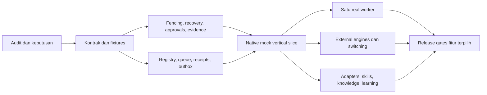

# Rencana penambahan pengembangan Extalia berdasarkan audit PRD v2

Tanggal: 2026-10-29. Baseline: v0.4.122 lokal. Status: **rencana rekomendasi untuk
adopsi bertahap**, belum persetujuan migrasi stack/repository atau pernyataan
fitur sudah selesai. Dasar: [audit kode dan PRD v2](prd-v2-audit.md).

## 1. Arah pengembangan

Perluas Extalia yang ada, dengan perubahan kecil yang dapat diuji dan di-rollback.
Tetap gunakan React/Electron/Three.js, `@extalia/protocol` sebagai otoritas skema,
Rust sebagai canonical control plane bertahap, dan TypeScript untuk host/provider
serta executor yang sudah berjalan. Python tetap worker on-demand sesuai ADR 0022.
Ini rekomendasi kompatibilitas; setiap perubahan terhadap keputusan yang berlaku
harus dicatat melalui ADR, bukan diambil dari contoh kode paket masuk.

Native coordinator dan Native API agent harus bisa hidup bersama. Coordinator
mengatur DAG, dispatch, policy dan evidence; executor API yang ada tetap memberi
chat dan coding melalui model/router pengguna. OpenCode adalah kandidat external
coding worker pertama, bukan engine keempat atau pengganti seluruh Native.

Setiap tahap mempertahankan Chat, Office, import, Git, knowledge dan skills yang
sudah tersedia. Perbaikan dependency/evidence/permissions memiliki prioritas
lebih tinggi daripada menambah kartu provider atau dekorasi baru.

## 2. Keputusan desain yang perlu direkonsiliasi pada T0

Ini daftar keputusan untuk ditinjau pada desain konkret, bukan permintaan approval
untuk audit ini dan bukan penghalang membaca sumber/menyiapkan proposal.

| ID | Keputusan | Rekomendasi dan batas |
| --- | --- | --- |
| D-01 | Repository dan stack | Pertahankan repository publik serta React/Electron/Rust. Perlakukan F0-02/Vue sebagai usulan yang perlu disesuaikan; tidak membuat repo baru atau memindahkan sejarah. |
| D-02 | Native | Tambah deterministic coordinator di atas executor Native API yang ada. Provider-free berarti manual planning/navigation/mock bisa berjalan tanpa API, bukan mengklaim coding nyata tanpa worker/model. |
| D-03 | Kontrak kompatibilitas | Satu otoritas protokol; pilih versi envelope baru, ID mapping dan state translation. Jangan mengganti `extalia.v0`, UUID maupun ID legacy secara in-place. |
| D-04 | Makna selesai | Pisahkan execution outcome, validation dan acceptance; historical `completed + unverified` tetap unverified. Tetapkan dependency policy/waiver eksplisit sebelum mengubah scheduler. |
| D-05 | Gerbang rilis | Mock-only = preview. Core alpha v2 memerlukan satu real permitted worker; pilih apakah OpenCode wajib atau kandidat pertama yang bisa diganti melalui keputusan terdokumentasi. External-engine E2E menjadi gate fiturnya, bukan syarat core alpha. |
| D-06 | Isolasi/policy | Tetapkan profile dan per-workspace engine generation, exact action approvals, source/session ownership dan fencing. Scanner/advisory wording tidak melemahkan quarantine/activation rules yang sudah diterima. |
| D-07 | Milestone/carryover | Rekonsiliasi v0.5/v0.6 dengan gate produk, Rust/Python/learning yang sudah disepakati, tanpa mereset versi aplikasi ke 2.0. EN/ID dan target performa yang ada dipertahankan. |

T0 menghasilkan ADR usulan/amendment yang sempit dan satu tabel canonical
requirement→backlog→test→release applicability. Label LOCKED dari dokumen masuk
harus dibahas ketika berkonflik dengan keputusan/proyek berjalan.

Rekonsiliasi untuk kontrak additive kini dicatat pada
[ADR 0036](../adr/0036-prd-v2-compatible-adoption.md) dan
[acceptance map](prd-v2-acceptance-map.md). Keputusan ini tidak mengaktifkan
runtime baru. Increment V2-02A memvalidasi capability manifest. V2-02B menambah
kontrak pemetaan identitas sesi/workspace eksplisit, validasi TS/Rust/schema dan
lookup murni yang dibatasi profile/workspace. Penyimpanan/admission registry,
verifikasi kepemilikan sumber, pemasangan translator ke runtime, engine aliases,
proyeksi evidence autoritatif, delegation dan semua gerbang eksekusi tetap lanjutan.
V2-02C memisahkan claim lifecycle/outcome/validation/acceptance dan revisi definisi
dari revisi state, dengan validasi TS/Rust/schema dan proyeksi legacy read-only
yang menjaga namespace serta ketidakpastian. Record acceptance/waiver belum
di-resolve; semua gerbang efek dan dependency release tetap tertutup untuk kontrak
baru. V2-02D menambah envelope delegasi, inspeksi lineage/attenuation dan perbandingan
intent idempotency murni TS/Rust. Hasil konsisten belum memverifikasi authority
atau mengizinkan dispatch; reservasi yang terhubung ke otoritas riil dan broker
tetap lanjutan. Increment ini belum menyelesaikan V2-02 atau acceptance T1/AR-01–04.

Prasyarat storage V2-08A kini memiliki ledger reservasi provisional Rust/schema 9
([ADR 0037](../adr/0037-provisional-delegation-reservations.md)): seed eksplisit,
escrow subtree, CAS, receipt idempotent, clock konservatif dan revokasi satu arah.
API ini belum diekspos melalui daemon/host/runtime. Claim seed bukan grant yang
terverifikasi; registry, admission efek, metering aktual, queue/outbox dan gerbang
V2-03/04/05/06 tetap lanjutan. Ini persiapan lokal yang tidak mengubah dependency
atau acceptance aktivasi T2/T3/AR-04/15–17.

Prasyarat V2-05A menambah lifecycle intent edit native/schema 10
([ADR 0038](../adr/0038-admission-bound-native-action-intents.md)) yang terikat
ke admission dan lease nyata. Record ini hanya pending/expired/revoked; policy,
hash argumen dan kanal approval pengguna belum terverifikasi. Formatnya tidak
bisa menjadi grant, dan tidak ada consumer RPC/runtime. Verifikasi argumen/JCS,
policy/skill resolver, keputusan user terautentikasi, once-consumption dan gerbang
efek V2-03/04/05/06 tetap lanjutan; AR-09–11 belum selesai.

## 3. Tahap dan dependency

| Tahap | Hasil yang dapat dipakai | Dependency | Reuse / tambahan | Exit gate |
| --- | --- | --- | --- | --- |
| **T0 Audit dan adopsi** | Crosswalk, keputusan, gate serta kasus tes yang tidak ambigu | Audit ini | Reuse ADR/ledger; selesaikan D-01–07 dan cacat spesifikasi | Tidak ada konflik P0 tersembunyi; setiap story punya kontrak/owner/tes |
| **T1 Kontrak kompatibilitas** | Engine/worker/provider terpisah, versioned manifests, state/evidence dan ownership definitions | T0 | Extend protocol/platform; translator legacy; mock contract conformance | Golden fixtures TS/Rust, version refusal, no capability fabrication |
| **T2 Eksekusi dan acceptance aman** | Fencing, explicit reconciliation, durable exact approvals dan evidence gates | T1 | Reuse Rust leases/reaper/review; lengkapi gate 3.3/3.4 dan worktree authority | Crash/race/revocation/review-digest cases lulus; unknown tidak direplay; hasil gagal validasi tidak membuka dependency |
| **T3 Data workspace dan delivery** | Profile/engine registry, canonical jobs/command receipts, event inbox/outbox dan replay; snapshot export primitive | T1; aktivasi dispatch sesudah T2 | Migrasi bertahap di balik API lama; satu writer untuk setiap store | Consistent state/event/outbox; dua claimant satu owner; profile isolation; reconnect tanpa gap |
| **T4 Vertical slice Native/mock** | Manual mission tanpa inference wajib, antrean/approval/review/2D/Office memakai state sama; import dan export minimal | T2 + T3 | Reuse halaman sekarang, source-safe import dan Native executor; tambahkan worker seam | E2E create→dependency→permission→evidence→restart→export, WebGL off; mock tetap preview |
| **T5 Coding worker nyata pertama** | OpenCode candidate: managed session, stream, permission relay, artifacts, cancellation/reconcile | T4; dokumentasi spike boleh lebih awal | Satu adapter terisolasi, tanpa memindahkan credential pengguna | Technical PoC + account/mode policy review, pinned version dan receipt evidence; gate core alpha hanya jika benar-benar lolos |
| **T6 External engines** | Hermes observe-first/formal engine bridge; OpenClaw scoped Gateway; safe engine switch | T2–T4, kontrak T1 | Pertahankan Hermes runtime/observer yang ada; tambah Gateway dan broker | Per-engine gate, isolated workspace, drain/switch/lineage/revoke/reconnect; control tetap off jika belum terbukti |
| **T7 Fitur beta dan carryover** | Codex/Claude terpisah; Kiro/Google per permitted surface; skills routing/scanner/Python; knowledge/meeting; learning | T2–T4; tiap fitur punya gate tambahan | Reuse import, registry, graph, learning core, teams/soul; jalur paralel di §6 | Actual version/mode evidence; skill fail-closed; reviewed knowledge; evaluation tak mengaktifkan skill sendiri |
| **T8 Hardening dan stable scope** | Full backup/restore, SDK/plugin isolation, guarded automation, accessibility/benchmarks, packaged release | Gate fitur yang hendak dirilis | Reuse updater/packaging; tambah supply-chain/compatibility/support evidence | CI wajib lulus, packaged OS smoke, rollback drill, source/secret/asset checks; maintainer publication |

T3 dapat mengerjakan schema/replay fixtures bersamaan dengan T2 setelah kontrak
stabil; **tidak** boleh mengaktifkan dispatch/retry baru sebelum V2-03/04/05/06
(ownership/fencing, reconciliation, exact approvals dan evidence/dependency gates)
lulus untuk jalur itu. PoC dokumentasi adapter boleh paralel,
real task/credential/config writes tidak dilakukan sebelum sandbox dan mode yang
diizinkan disiapkan. T7 bukan dependency tunggal T6: knowledge, skills dan
learning tidak perlu menunggu semua merek engine selesai.

## 4. Backlog eksekusi konkret

ID `V2-*` kini ditautkan ke issue GitHub melalui [roadmap #38](https://github.com/Extalia-VO/extalia-virtual-agent/issues/38)
dan [peta tracking/milestone](../release/prd-v2-tracking.md). Pembuatan issue adalah
tracking rencana, bukan penerimaan keputusan T0 atau bukti implementasi. V2-17A
memisahkan acceptance knowledge v0.5 dari parent learning v0.6. Referensi
F0/C1/N2/U3/A3/H4/O4/X4/W5/I5/S5/K5/G5/R6 tetap berasal dari paket masuk.
File owner ditetapkan ulang sebelum implementasi; dua coder tidak mengubah file
bersama secara paralel.

| ID | Scope dan file ownership yang diusulkan | Dependency | Acceptance / hasil review |
| --- | --- | --- | --- |
| V2-01 | ADR/gate/state reconciliation; `docs/adr/`, dua dokumen audit/rencana, source crosswalk | Audit | D-01–07, schema/version/ownership/outbox conflicts dan release applicability selesai ditinjau; no runtime edits |
| V2-02 | Kontrak, capability manifest, ID/state adapter; `packages/protocol/`, generator/fixtures; platform contracts terkoordinasi | V2-01 | `AR-01/02/03/04`, schema TS/Rust parity, unsupported tidak memanggil driver; maps FR-003/005/006/012/030 |
| V2-03 | Immutable complete executor membership, planner/child obligations dan Rust worktree/writer fencing; `crates/extalia-core`, daemon, bounded host authority adapter | V2-02 | `AR-05/06`; missing/unknown owner tetap quarantine; exact old epoch tidak bisa write/integrate; tidak menganggap local-drain proof remote-stop |
| V2-04 | Reviewed explicit terminal reconciliation + committed decision receipts; recovery core/host/UI yang dimiliki terpisah | V2-03 | `AR-07/08`; compare full review in write transaction, stale digest refuses, idempotent repeat, no automatic result fabrication/retry/worktree release |
| V2-05 | Durable action request/approval/revocation; core PDP/wire, runtime effect boundary, host relay; UI setelah API | Design/fixtures setelah V2-02; effect-path activation setelah V2-03 dan applicable V2-04 reconciliation | `AR-09/10/11`; exact validated parameters+scope+actor+expiry+policy version; stop after authority/revocation changes; provider-native permission remains effective |
| V2-06 | Execution outcome versus accepted evidence/waiver; artifact manifest and validation pipeline, DAG/mission projection compatibility | V2-02/04/05 | `AR-12/13`; failed tests/unverified summary cannot unlock required dependency or verified completion; old records remain explicitly unverified |
| V2-07 | Profiles/workspace engine pointer+generation; core models, authoritative repository/migration, host API; Settings separately | V2-02; switch activation after V2-04/05 | `AR-14`; two profiles isolated; engine change denied while active by default; CAS/conflict/migration and preserved source refs |
| V2-08 | Durable queue and separate command-intent/ack + event inbox/outbox/cursor; core migrations/daemon, host delivery adapter | Schema/mock setelah V2-02/07; production dispatch/retry off sampai V2-03/04/05/06 lulus | `AR-15/16/17`; atomic commit boundaries, two claimers, ambiguous acknowledgement quarantined, reconnect replay; no promise of exactly-once provider effects |
| V2-09 | Provider-free manual plan/mock worker/2D entry, onboarding and existing UI projection | V2-04/05/06/08 + V2-20 applicable Bridge gate | `AR-18/19`; manual planning without key; setup may postpone worker/workspace configuration consistently; explicit unavailable execution; full no-WebGL path |
| V2-10 | Minimal owned-data export + source-hash import regression; core portable/host exporter/UI | V2-06/08; expose with V2-09 | `AR-20`; selected mission/session/evidence/settings snapshot version+checksum, secrets excluded, read-only source; no claim full restore yet |
| V2-11 | OpenCode adapter sandbox PoC, then versioned driver | V2-09/10; policy gate V2-02/05 | `AR-21`; SDK/server version, two turns, events, allow/deny, abort receipt, killed process/restart, diff/test evidence; isolated configuration and bounded billing |
| V2-12 | Hermes formal engine adapter and lifecycle/profile mapping | V2-07/08/09 | `AR-22`; reuse existing CLI/observer, certify exact mode; do not write source DB or reinterpret a missing control surface as success |
| V2-13 | OpenClaw Gateway and cross-engine broker/switching | V2-07/08/09; scoped protocol PoC | `AR-23/24`; minimal scopes, revocation, lineage/hop limits, external receipts; old engine generation cannot regain authority after switch |
| V2-14 | Codex/Claude managed workers; observe/import retained | V2-11 common worker suite; separate mode reviews | `AR-21/25`; app-server hook trust is not task ownership; binary/SDK auth distinctions; no control of arbitrary already-open user sessions |
| V2-15 | Kiro ACP and Google permitted surfaces | Common worker suite + actual per-mode clearance | `AR-25`; version negotiation, refusal/cancel semantics; prohibited consumer wrapper stays blocked server-side, not just UI |
| V2-16 | Secure skills dependency/router + enforcement parity; pinned scanner/Python worker | V2-05; sandbox/ownership V2-03 | `AR-26`; exact skill hash/permission, deterministic resolver, unavailable/quarantined states, no autoactivation; Rust supervisor owns worker |
| V2-17 | Knowledge evidence/meetings, learning wire/UI and evaluation | V2-05/06; evaluation also V2-03/16 | `AR-27`; existing graph/CAS/history reused; meeting requires real event provenance; insufficient evidence stays explicit; proposed candidates are not activated by capture or evaluation |
| V2-18 | Full portable restore/profile migration, SDK/executable plugin isolation, notifications and automation | V2-08/10; relevant permissions/sandbox | `AR-28/29`; dry-run restore with rollback; no executable plugin before isolation; schedules retain idempotency and approvals |
| V2-20 | Bridge pairing/client grants/revoke; `apps/cli/src/bridge/`, scoped host transport/client; protocol changes via V2-02 owner | Design setelah V2-02/05; T3 backend/T4 client sebelum applicable alpha gate | `AR-32/33/34`, BRG-01–10; signed/scoped client identity, backend enforcement, revoked client loses access on next request/reconnect, preserve current loopback/Host/Origin limits |
| V2-19 | Cross-platform/release/a11y/performance and drift matrix | All capabilities included in that release | `AR-30/31`; actual package/OS/architecture and installed versions recorded; source/history/tarball/assets reviewed; no publish before required CI |

### Tiga work package pertama yang disarankan

1. **V2-01:** tutup kontradiksi dokumen dan ratifikasi compatibility decisions.
   Artefak: proposed ADR amendments + canonical gate/state/capability matrix.
2. **V2-02:** tulis additive contracts dan golden/mock fixtures terlebih dahulu.
   Perubahan tidak mengaktifkan adapter atau mengubah arti event lama.
3. **V2-03:** lengkapi ownership/fencing di atas recovery v0.4.122. Sesudahnya
   implementasikan V2-04 explicit reconciliation. Design/fixtures V2-05 durable
   grants boleh disiapkan setelah V2-02, tetapi effect-path activation menunggu
   V2-03 dan applicable V2-04; tidak ada perbedaan aturan antar lane.

V2-06 evidence design dapat disiapkan bersama V2-02, tetapi aktivasi status/dependency
baru menunggu V2-04/05. Skill containment parity adalah cross-cutting security
requirement T2; jangan menunggu integrasi scanner T7 untuk mencegah bypass pada
execution path yang baru.

## 5. Kasus acceptance tambahan yang harus diwujudkan

`AR-*` berikut adalah **skenario yang direncanakan, bukan tes yang sudah lulus**.
Tes lama dapat direuse setelah traceability/assertions diperiksa. Wajib mencatat
command, fixture, build, platform, observed output, digest artefak dan reviewer.

| ID | Skenario terukur / negative case | Pemetaan v2 |
| --- | --- | --- |
| AR-01 | Legacy `s_…/w_…`, orchestration UUID dan engine IDs round-trip melalui explicit mapping; collision/foreign ID ditolak | EVT-01, SES-06 |
| AR-02 | Envelope versions dan state mapping diverifikasi TS/Rust; unknown version ditolak tanpa mengganti state historis | EVT-01, ENG-08 |
| AR-03 | Every capability carries status/reason/version/mode; unsupported/policy-blocked command yields no process/provider call | ENG-01, WKR-01/02, SEC-08 |
| AR-04 | Delegation envelope includes actual authority reference, lineage, child/hop/budget caps; different field spelling cannot bypass broker | DEL-01–08 |
| AR-05 | Missing planner/task/owned-child proof or unverified worktree owner keeps quarantine; no closure from settled JS promise alone | REC-02/04/05 |
| AR-06 | Expired/old writer epoch cannot write or integrate; authority loss during await denies the following effect | QUE-02/04, GIT-01/02/09 |
| AR-07 | Reconciliation reviewed at digest D; late proof/event/lease/ownership change produces D2 and decision on D refuses | REC-06, SW-10 |
| AR-08 | Crash before/after closure commit and lost ACK preserve one immutable decision; duplicate retries do not fabricate result or release unknown resources | REC-01/02/07 |
| AR-09 | Changed args/cwd/actor/workspace/target/policy invalidates approval; expiry and revocation deny actual executor | PDP-01/02/09 |
| AR-10 | Pending approval survives client reconnect; deny/expired remain distinct audit records and never allow by timeout | PDP-03/10, UI approval |
| AR-11 | Native, delegated, skill-driven, Git and provider-relay effects all pass applicable policy; daemon unavailable fails closed | PDP-05/06/08 |
| AR-12 | Worker says done but validation fails: downstream required task never starts and mission does not become verified completed | DAG-03/04, NAT-04/05 |
| AR-13 | Evidence hash/path/source ownership checked; forged observed claim cannot become verified; explicit waiver records actor/version/scope | QA placeholders, NAT-05 |
| AR-14 | Two profiles/workspaces with different engines cannot read each other's grants, sessions, secrets or engine generations; stale switch rejected | WS-01–10, SW-01/08/10 |
| AR-15 | Kill at state/event/command-intent/outbox boundaries: committed projections agree; no orphaned dispatch authority | QUE-01/02/05, REC-01/02 |
| AR-16 | Remote accepts command then connection dies before ACK: state unknown and no automatic resend unless replay-safe receipt proves eligibility | QUE-03/09, REC-02/05 |
| AR-17 | Snapshot at cursor C plus duplicated/out-of-order post-C delivery converges in two clients; gaps require bounded replay/resync | EVT-02–07 |
| AR-18 | Fresh setup may skip inference/worker; manual DAG and existing history work offline with no paid call or fake worker execution | ONB-01/05/06, NAT-01, ENG-02 |
| AR-19 | WebGL disabled from startup: Chat/Tasks/Queue/Approvals/History/Git evidence/recovery stay usable; Office visibility never controls execution | OFC-10, WS-07, UI/A11Y |
| AR-20 | Import source hashes unchanged; export of a consistent owned-data selection has checksums/schema/provenance and no secret canary | IMP-02–08, PORT-01/03/07 |
| AR-21 | Real approved worker in disposable repo: session ownership, two turns, events, deny/allow, cancel receipt, crash restart, diff and test artifact | OC-01–10, WKR-03–09 |
| AR-22 | Actual supported Hermes lifecycle events map stable profile/instance IDs; absence of control surface disables that operation without source DB write | HM-01–08 |
| AR-23 | Gateway auth/scope/revoke/version failures stop only affected workspace; reconnect does not duplicate accepted tasks | CL-01–10, E2E-C |
| AR-24 | Drain denies new dispatch; old generation cannot regain authority, history retained; loop/child/hop overflow cannot create another root silently | SW-01–10, DEL |
| AR-25 | Per-version provider/auth modes have independent results; consumer wrapper blocked at backend; no credential extraction or external-session takeover | CX/CC/KR/GG, SEC-08/09 |
| AR-26 | Unknown scanner/license/report format remains unavailable; copied revision immutable, resolver rejects cycle/conflict/escalation, revoked revision denies next effect | SKL-01–18 |
| AR-27 | Knowledge CAS conflict preserved, cross-profile ACL enforced, meeting claims refer to actual records; learning candidate/evaluation cannot autoactivate privileged skill | KNO-01–15, legacy learning |
| AR-28 | Corrupt/colliding archive refuses before writes; interrupted multi-store restore has manifest/rollback and leaves vendor histories untouched | PORT-02/04–10 |
| AR-29 | Executable plugin cannot import privileged renderer/main APIs; denied scope/revocation stops next operation; repeated schedule does not duplicate unsafe action | SDK/SEC placeholders, legacy automation |
| AR-30 | Packaged claimed OS/architecture works in clean home/machine; upgrade during active work is deferred; rollback and data schema compatible | REL/UPD placeholders |
| AR-31 | Published frame-time/latency/memory/10k-session measurements identify hardware/build/load; 2D fallback/a11y/EN-ID regressions and public-safety scans pass | PERF/A11Y/NFR |
| AR-32 | Unpaired or wrong-origin client cannot call privileged API; malicious WS Origin, CSRF, Host/rebinding and brute-force attempts fail while loopback remains default | BRG-01–05/09/10 |
| AR-33 | Explicit pairing grants only requested client/workspace capabilities; hidden endpoint/body changes cannot acquire shell/approval scope | BRG-06/07, SEC-08 |
| AR-34 | Revoked/expired pairing denies next request and reconnect, including open SSE/WS paths where applicable; another origin/client cannot inherit prior approval | BRG-08, SEC-10 |

DB/ART/AUD/EXEC/CLI/UI-SEC/SDK/REL/UPD placeholders in the incoming plan still need
individual runnable cases, assertions and owners. These AR scenarios provide
requirements for that expansion; they do not certify the placeholder suites.

## 6. Jalur paralel dan kepemilikan

- **Core lane:** contracts freeze → ownership/recovery/approval → queue/outbox.
  Migration numbers and shared Rust/protocol files have one owner per increment.
- **Client lane:** consume published mock APIs for capability/evidence/recovery,
  then add 2D-only/setup/profile UX. UI never imports provider/runtime code.
- **Integration lane:** docs/policy matrix and disposable adapter fixtures first;
  OpenCode first implementation, Hermes/OpenClaw independently gated afterwards.
- **Knowledge/skills lane:** current graph/registry regression fixtures can run
  early; activate scanner/learning/tool privileges only after relevant core gates.
- **Release lane:** source and asset inventory, read-only migration tests, packaging
  and benchmark harnesses can proceed alongside the feature lanes.

Modifying workers use isolated worktrees and narrow ownership; read-only reviewers
can share a checkout. A worker failure does not authorize overlapping edits before
termination/partial changes are inspected. Never claim orchestration savings
without measured token/resource data. Hermes unavailability uses configured
fallback, not changes to the user's external application configuration.

## 7. Compatibility, migration and rollback

1. **Inventory first:** source licenses, schema versions, current config, ID
   mapping, stored runtime IDs, retained unverified results and active/unknown
   execution guards. Avoid copying arbitrary files or private history.
2. **Additive contracts:** new envelopes and authority tokens are versioned;
   one schema generator, shared TS/Rust fixtures. Do not infer privileges from
   merely parsed data or reinterpret legacy events as validated evidence.
3. **Single canonical writer:** migration specifies which SQLite/JSON stores
   are authoritative and which are projections. Never dual-write authority via
   Node and Rust without a transactional ownership design.
4. **Opt-in rollout:** maintain current stable behavior behind host-owned feature
   flags, never model-supplied flags. No fallback to weaker authority after failure.
5. **Migration rehearsal:** temporary profiles/data, backup and restore drill,
   interrupted migration, newer schema refusal, previous supported version read.
6. **Rollback preserves uncertainty:** stop admission, retain unknown effects,
   audit/receipts/worktrees. Do not clear guards or replay unknown commands to
   make the old UI appear healthy. Incompatible storage uses backup/forward fix,
   not unsupported destructive downgrade.
7. **Default authority and benchmarks:** Rust default-on remains subject to the
   accepted benchmark gate in ADR 0021/gap-map decisions. A new schema or passing
   mock does not enable it automatically; scanner/worker failure stays fail-closed.
8. **External config changes:** dry run, user approval, backup and undo remain
   required. Source imports never write vendor history or credential stores.
9. **Completion per increment:** release notes under Unreleased, once-only patch
   bump and full `pnpm check` for implementation; EN/ID + theme/phone checks when
   UI changes; actual platform/vendor evidence separately. Documentation-only
   audit does not bump application versions or claim new runtime behavior.

## 8. Milestone interpretation and release policy

| Target | Isi/gate yang direkomendasikan | Yang tidak boleh disimpulkan |
| --- | --- | --- |
| Current 0.4.x | Existing product plus small verified increments; v0.4.122 has coherent recovery review | PRD v2 adopted, full reconciliation finished, all workers/engines supported, newest changes publicly shipped |
| v0.5 candidate | Approved T1–T4 durable-control/profile/event/knowledge scope plus existing accepted scanner/Python gates; T7 lane scheduling does not waive them. Compatibility/old-feature regressions; any deferral needs explicit roadmap amendment | No automatic version release after a patch count; recovery review alone is insufficient |
| Core v2 alpha capability claim | T4 core + T5 one real permitted worker, minimal source-safe import/export, security and platform gates for claimed targets | Mock-only success cannot be called real integration alpha; Hermes/OpenClaw do not block core alpha unless explicitly selected |
| Beta feature lanes | T6/T7 capabilities each with versioned PoC/evidence; preserve knowledge/skills already present and label incomplete controls accurately | Adding brand tiles does not mean those controls work; scanner/learning unavailable is not silently bypassed |
| v0.6/Evolve candidate | Existing accepted learning roadmap, evaluation and rollback plus approved carryover from T7 | No self-modifying skill activation or implicit permission escalation |
| Stable/v1 | T8 plus all capabilities promised by that release, security, restore, SDK, compatibility and actual platform packages | PRD document v2 does not imply application v2.0; passing local tests does not imply all CI/package jobs passed |

T1–T4 alone cannot establish full v0.5 acceptance while the accepted scanner/Python
requirements remain open. The exact v0.5/v0.6 freeze remains a product/ADR decision. No dates are promised
from a document estimate; order is driven by dependencies and verification.
The existing requirement that all required CI passes before publication is
preserved. This plan creates no tag, npm login, installer, release or Git push.

## 9. Status dokumen

Audit dan staged plan selesai disusun dan direview pada 2026-10-29.
Cakupan terstruktur: 40 FR/18 NFR pada audit, T0–T8, 20 work packages dan 34
skenario AR yang **belum diimplementasikan/dijalankan oleh audit ini**. Link lokal,
bentuk tabel, public-safety, whitespace dan konsistensi versi lulus. Review
independen memastikan Bridge pairing, dispatch activation, dependency approvals,
serta carryover scanner/Python tidak terlewat. Adopsi/amendment T0 dan
implementasi paket-paket berikutnya tetap pekerjaan tersendiri; dokumen ini tidak
mengubah status dukungan engine/adapter atau menerbitkan rilis.
